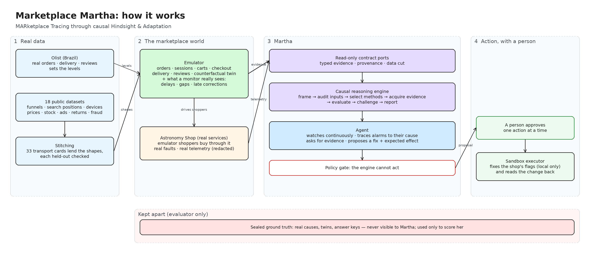

# Marketplace Martha

**MARTHA: MARketplace Tracing through causal Hindsight & Adaptation**

Every marketplace needs a caretaker. Martha is a fully agentic monitoring system for marketplaces: she watches continuously, traces every alarm back to its cause, proposes a fix with its expected effect, and adapts as the evidence comes in. She acts only with a person's approval.

## Demo

https://github.com/user-attachments/assets/7ee3e0f6-abe5-433f-a240-3645c502f7d0

## Overview

Dashboards show *that* a number moved. Someone still has to work out *why*: a broken logging pipeline or real lost demand? A failing payment service or fewer shoppers? Martha does that investigation.

- **Watches:** continuously, with no fixed rules to configure.
- **Investigates:** tests competing causes using declared relations between metrics (identities, funnel steps).
- **Asks:** requests the cheapest evidence that settles the question, then revises her answer.
- **Knows her limits:** abstains rather than guessing; never writes to production; acts only after approval.

## How it works



1. **Real data.** A marketplace emulator is calibrated on real Brazilian e-commerce data (Olist). 18 other public datasets lend behavioural patterns (funnels, search positions, devices, prices, stock, ads, returns, fraud) through 33 held-out-checked transport cards.
2. **The marketplace world.** The emulator simulates orders, sessions, carts, checkout, delivery and reviews, plus what a monitor really sees (delays, gaps, late corrections). Its shoppers buy through the real [OpenTelemetry Astronomy Shop](https://github.com/open-telemetry/opentelemetry-demo), so faults and telemetry are real.
3. **Martha.** A domain-agnostic causal reasoning engine reads everything through read-only contract ports. On top of it, an agent watches, investigates and proposes.
4. **Action, with a person.** A policy gate prevents the engine from acting. A person approves each proposal, and a sandbox executor applies it to the local shop only.

Ground truth (real causes, counterfactual twins, answer keys) is sealed away from Martha and used only to score her.

The diagram is editable: [`docs/martha-architecture.excalidraw`](docs/martha-architecture.excalidraw) (open it in [excalidraw.com](https://excalidraw.com)). The detailed design diagrams are in [`docs/`](docs/) (`*.excalidraw`).

## Getting started

### Prerequisites
- Python 3.10+
- Docker (only for the live shop)

### Installation
```bash
git clone https://github.com/dascoder/Almedia-hackathon-Agent-Monitoring-RunNRave && cd Almedia-hackathon-Agent-Monitoring-RunNRave
python3 -m venv .venv
.venv/bin/python -m pip install duckdb polars "pydantic>=2.7" numpy scipy pyarrow fastexcel pytest
echo "$PWD/causal_core" > "$(.venv/bin/python -c 'import site;print(site.getsitepackages()[0])')/causal_core_local.pth"
mkdir -p ~/data/mkt/stitch && unzip -q share/stitch_samples.zip -d ~/data/mkt/stitch/
```
The processed Olist tables (`artifacts/`) ship with the repo, so nothing else needs downloading.

### Run the tests
```bash
.venv/bin/python -m pytest -q
```

## Usage

| Task | Command |
|---|---|
| Martha (causal core) on the emulator | `.venv/bin/python -I scripts/core_on_emulator.py` |
| Closed loop: alarm → ask for evidence → revise, scored against a sealed answer | `.venv/bin/python -I scripts/mvs_headless.py 7 8 9` |
| Contract check against the core's contracts | `.venv/bin/python -I scripts/conform.py` |
| Stitch the datasets into transport cards (needs the raw datasets) | `.venv/bin/python -I scripts/stitch.py run` |
| Generate contract samples for all 106 variables | `.venv/bin/python -I scripts/stitch_samples.py` |

### Watch Martha live (real shop + agent dashboard)
After the installation above, with Docker running:
```bash
cd causal_core_demo_video
scripts/uc2_setup.sh                 # once: fetches the shop (OpenTelemetry demo, pinned) and prepares data folders
scripts/uc2_shop.sh up --traces      # start the Astronomy Shop with Jaeger + Prometheus (first time pulls ~3-5 GB)
scripts/uc2_watch.sh                 # run the payment-fault scenario (~8 min; --fast ≈ 6 min) and open the live view
scripts/uc2_shop.sh down             # stop the shop; scripts/uc2_engine.sh stop stops the engine service
```
The scripts use the repo's `.venv` automatically. `uc2_watch.sh` opens one page, side by side: Martha's dashboard on the
left; the shop's traces, failed requests, Monitor rates, the shop itself or the engine service on the right.
- Side-by-side view: http://127.0.0.1:8765/scenes/uc2_watch.html · Martha's dashboard alone: http://127.0.0.1:8765/scenes/uc2_live.html
- The causal engine runs as a local service (`scripts/uc2_engine.sh start | stop | status | logs`); status page: http://127.0.0.1:8770/
- The shop: http://localhost:8080 · traces: http://localhost:8080/jaeger/ui/

On Linux, run `NO_OPEN=1 scripts/uc2_watch.sh` and open the URLs yourself. More detail: [`causal_core_demo_video/README.md`](causal_core_demo_video/README.md).

## Results

| Check | Result |
|---|---|
| Realism against held-out real data (Olist 2018) | 9/10 checks pass |
| Hidden incidents diagnosed in the closed loop | 6/6 |
| Locating a fault in the funnel (checkout fault / demand drop / no false alarm) | 5/5 · 4/5 · 5/5 |
| Live sessions through the real shop | 400/400, 0 leaked fault details |
| Contract samples accepted by the causal core's own validator | 340/340 |

## Project structure

| Path | Contents |
|---|---|
| `causal_core/` | The causal reasoning engine (contracts, graph, methods, orchestration) |
| `mkt/` | Emulator, contract ports, stitching, Astronomy Shop adapters |
| `causal_core_demo_video/` | Agent, engine service, live dashboard and demo scripts |
| `scripts/` | Command-line entry points |
| `deploy/` | Astronomy Shop overrides (upstream untouched) |
| `docs/` | Architecture, reports, diagrams, handover |
| `tests/` | Test suite |

## Documentation

- [`docs/ARCHITECTURE.md`](docs/ARCHITECTURE.md): full design
- [`docs/master_implementation_blueprint.md`](docs/master_implementation_blueprint.md): causal core specification
- [`docs/ASTRONOMY_SHOP_INTEGRATION.md`](docs/ASTRONOMY_SHOP_INTEGRATION.md): shop integration
- [`docs/stitch/README.md`](docs/stitch/README.md): dataset stitching
- [`docs/HANDOVER.md`](docs/HANDOVER.md): status, setup and next steps

## Data and licences

- **Olist Brazilian E-Commerce** (Kaggle), CC BY-NC-SA 4.0: the processed tables in `artifacts/` derive from it (non-commercial use, with attribution).
- The other datasets are not redistributed. `scripts/datasets.py` downloads them under each source's own terms.
- **OpenTelemetry Astronomy Shop** (Apache-2.0), used unmodified at release 3.1.0.

## Team

| | Sneha Verma | Stefan Dye |
|:---:|:---:|:---:|
| |  |  |
| LinkedIn | <br>[msverma101](https://www.linkedin.com/in/msverma101/) | <br>[stefan-dye](https://www.linkedin.com/in/stefan-dye-782b962b/) |
