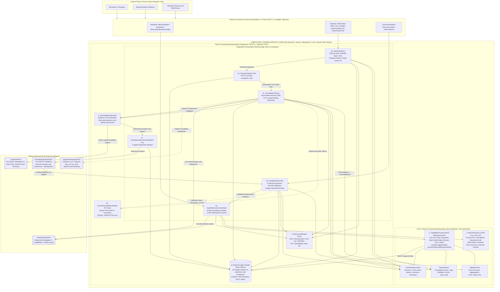
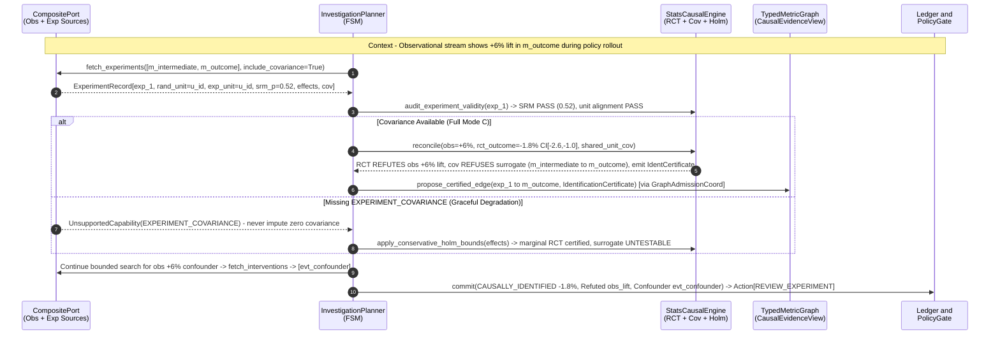
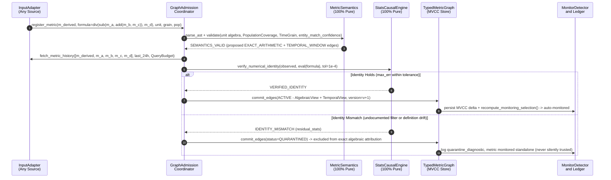
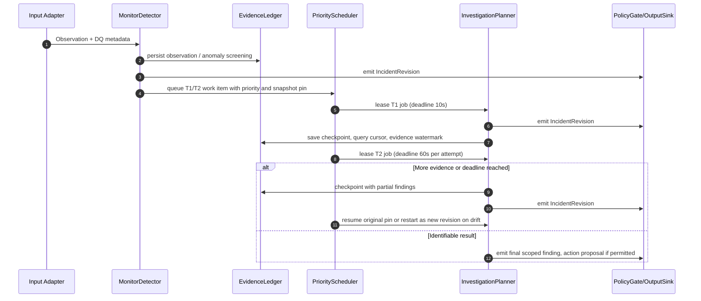
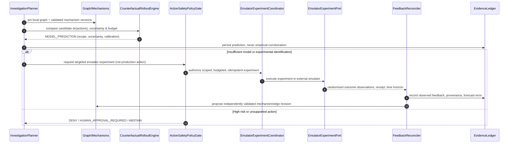

# Master Implementation Blueprint

> **Scope & isolation boundary:** This is the implementation specification for **Subsystem 2 (`causal_core`)**. The core remains domain- and source-agnostic: no application specific rules, warehouse SQL, database SDKs, alerting clients, external emulator internals, or LLM framework imports. application-specific mappings and intervention implementations remain in external adapters. An internal **sparse counterfactual model** is permitted only as a pure, bounded, explicitly uncertain computation over a versioned local causal neighborhood; it is **not** another emulator.
>
> **v2.1 change:** Progressive T0/T1/T2 execution; deferred T3 experiments and T4 feedback; a durable priority scheduler; an optional pure sparse rollout engine; a separate, permissioned emulator-experiment port; distinct evidence and prediction types; and benchmark scenarios emphasizing decisions conventional monitoring usually misses.

---

## 1. Executive Summary & Architectural Invariants

Subsystem 2 is a **Hexagonal (Ports-and-Adapters) modular monolith** with a single in-process composition root, divided internally into two clean halves:

1. **Part A — Dynamic Causal Graph (`MetricSemantics` + `TypedMetricGraph`):** Maintains canonical versioned nodes, bitemporal typed edges, provenance lineages, open-world unknowns, explicit observation-mechanism nodes, and three bounded read-only semantic views (`AlgebraicView`, `TemporalView`, `CausalEvidenceView`). Runs **zero** statistical estimators or action decisions.
2. **Part B — Causal Reasoning Engine:** `StatsCausalEngine`, `MonitorDetector`, `InvestigationPlanner`, `EvidenceLedger`, `ActionSafetyPolicyGate`, `GraphAdmissionCoordinator`, `FeedbackReconciler`, and a small `PriorityScheduler` support **progressive findings**: T0 detection (<2 s), T1 quick diagnosis (<10 s), T2 bounded investigation (<60 s), T3 deferred external emulator experiments (minutes+), and T4 event-driven outcome reconciliation. Each tier has its own budget; **no universal 20-second deadline**. The optional `CounterfactualRolloutEngine` produces local *predictions*, never causal certificates.

### Non-Negotiable Design Invariants
* **Functional Core / Imperative Shell:** `contracts`, `MetricSemantics`, and `StatsCausalEngine` are 100% pure (zero I/O, zero SQLite calls, zero port access). All external I/O and state mutations live inside four thin imperative coordinators.
* **No God Orchestrator:** `InvestigationPlanner` runs strictly read-only on a pinned graph snapshot as a pure-transition Finite State Machine (`InvestigationFSM`). Metric onboarding (`GraphAdmissionCoordinator`) and asynchronous post-intervention learning (`FeedbackReconciler`) are isolated controllers.
* **Open-World & Layer Separation:** Missing edges always resolve to `UNKNOWN`, never `KNOWN_ABSENT`. Observation mechanisms (`SAMPLING`, `SELECTION`, `CENSORING`, `MEASUREMENT`, `REPORTING_LAG`) occupy the `OBSERVATION` layer and can never be promoted to domain causes.
* **Evidence Firewall & Calibration:** `OBSERVED`, `EXPERIMENTAL`, `EMULATOR_OBSERVATION`, and `MODEL_PREDICTION` are distinct evidence classes, each with environment scope. Replicas sharing ancestry are deduplicated; distinct generator seeds do **not** imply independent real-world evidence. Simulator-generated data may be useful within a validated emulator but cannot certify production effects, and local predictions never corroborate their own premises.
* **External Ground-Truth Isolation:** Simulator or benchmark ground truth never enters `causal_core`, Input Adapters, or `HypothesisProposerPort`; it is consumed strictly by external evaluation harnesses reading `OutputSinkPort`.
* **Progressive, Nonblocking Execution:** T0 alerts and independently justified safety decisions never wait for T2/T3; slower findings update the same incident with revisions and audit history. Per-tier cutoffs persist useful partial results.
* **Risk-Bounded Intervention:** Production writes are denied by default; permissioned external-emulator experiments are a separate capability, gated by action policy, idempotency, scope, and budgets. Model-predicted benefit is insufficient for autonomous production action.
* **Lightweight Base Footprint:** Base P0 dependencies are strictly Python standard library (`sqlite3`), Pydantic v2, NumPy, SciPy, and NetworkX ($\approx 80\text{--}120\text{ MB}$ total, 100% offline-portable). Neural enhancements (TabPFN) are isolated behind an optional packaging extra (`pip install -e ".[tabpfn]"`).

---

## 2. System Topology, Acyclic DAG & Package Layout

### 2.1 Strict Acyclic Internal Dependency Order

```text
contracts (frozen Pydantic ADTs; schema v1.2; no internal dependencies)
   ^
   +-- MetricSemantics (pure; formulas, units, population/grain/epistemic checks)
   +-- StatsCausalEngine (pure; DQ, monitoring tests, decomposition, causal estimators, VoI)
   +-- CounterfactualRolloutEngine (P1 pure; sparse SCM + uncertainty, NO causal certificates)
   ^
   +-- TypedMetricGraph (MVCC bitemporal store + read-only bounded views)
   +-- EvidenceLedger / ActionSafetyPolicyGate (SQLite; provenance, jobs, prediction records, policy)
   ^
   +-- Thin imperative shell:
        |-- GraphAdmissionCoordinator (metadata + mechanism validation)
        |-- MonitorDetector (T0/T1 nonblocking detections)
        |-- PriorityScheduler (durable priority work items; retry, deadlines, preemption)
        |-- InvestigationPlanner (pure-transition resumable InvestigationFSM; pinned snapshot)
        |-- EmulatorExperimentCoordinator (P1; permissioned EXTERNAL experiment port)
        +-- FeedbackReconciler (T4 outcomes + model calibration + graph revision proposals)
```

The *dependency graph* remains acyclic even though runtime evidence and feedback create a learning loop. Scheduler, ledger, ports, and experiment dispatch remain in the imperative shell. The statistical/rollout engines receive immutable inputs only.

### 2.2 Component Interaction Topology



### 2.3 Target Repository Structure

```text
causal_core/                         # Subsystem 2 (100% domain-agnostic; AST-linted)
├── contracts/
│   ├── __init__.py
│   ├── inputs.py                    # Existing definitions + MechanismSpec, ObservationEnvironment, etc.
│   ├── graph.py                     # GraphNode, GraphEdge, NodeKind, EdgeKind, BitemporalValidity, ProvenanceLineage, TraversalBound
│   ├── outputs.py                   # Findings, IncidentRevision, CounterfactualPrediction, ActionProposal
│   └── ports.py                     # Read-only query, optional EmulatorExperimentPort, proposal, output
├── semantics/
│   └── validator.py                 # MetricSemantics (100% pure: AST, unit algebra, population/grain, temporal DAG, epistemic firewall)
├── stats/
│   ├── registry.py                  # EstimatorSpec & Capability-Driven Estimator Registry (100% pure)
│   ├── monitoring.py                # DQ/obs-maturity gate, seasonal MAD + Delta-Z, lineage-gated SAVI e-process
│   ├── decomposition.py             # Exact algebraic sensitivity, Kitagawa mix-vs-rate, RCD-lite invariance pruner, P1 Causal Shapley
│   ├── causal.py                    # DiD + pre-trends, P1 SDID QP, RCT/SRM/Covariance + Holm fallback, counterfactual bounds
│   ├── identifiability.py           # Graphical Identifiability Auditor (open backdoor latents, unadjusted selection/censoring)
│   ├── voi.py                       # Lineage-aware cost-bounded VoI scorer
│   └── tabpfn_estimators.py         # Optional P1 lazy-imported module (active only with .[tabpfn] + hw/budget gate)
├── counterfactual/                  # P1 OPTIONAL: pure sparse rollouts, no ground-truth access
│   ├── mechanisms.py                # Versioned mechanism validation + uncertainty contracts
│   └── rollouts.py                  # Bounded common-random-number what-if comparisons
├── graph/
│   ├── store.py                     # MVCC version-indexed TypedMetricGraph + O(1) GraphSnapshot pinning
│   └── views.py                     # Enforced read-only AlgebraicView, TemporalView, CausalEvidenceView
├── storage/
│   ├── schema.sql                   # SQLite DDL incl. durable jobs, revisions, predictions, mechanisms
│   ├── ledger.py                    # EvidenceLedger, checkpoints, revisions, provenance, replay
│   └── policy_gate.py               # ActionSafetyPolicyGate + incident fingerprint deduplication
└── orchestration/
    ├── admission.py                 # GraphAdmissionCoordinator (8-step onboarding + bitemporal supersession)
    ├── monitor.py                   # MonitorDetector (continuous screening + provisional alerts < 2s)
    ├── fsm.py                       # Pure InvestigationFSM transitions (SEED -> ACQUIRE -> EVALUATE -> AUDIT -> FINALIZE)
│   ├── planner.py                   # Resumable planner / stage-budget runner
│   ├── scheduler.py                 # P0 priority queue (same SQLite, bounded workers, retries)
│   ├── emulator.py                  # P1 permissioned external experiment coordinator
│   └── feedback.py                  # T4 intervention outcomes & calibration, safe graph revision

adapters/                            # Subsystems 1 & 3 (domain/source/sink specific; never imported by causal_core)
├── simulator/                       # Emulator adapter, scoped experiment execution, read-only evidence
├── outputs/                         # CLI/JSON renderer, Markdown report adapter, external eval harness connector
└── domain_specific/                 # Plug-in business adapters (e.g. mappers)

app/
└── wiring.py                        # Thin composition root binding adapters, SQLite ledger, and core services

tests/
├── lint/test_architecture_gates.py  # Gate 1: AST import-purity & dependency DAG enforcement
├── unit/                            # Pure unit tests for contracts, MetricSemantics, StatsCausalEngine, MVCC views
└── acceptance/                      # Gates 1-12: purity, inference, tiers, replay, safety, demo generalization
```

---

## 3. Canonical Data Model & `v1.2` Contract Specifications

Contracts use frozen Pydantic v2 models (`schema_version: str = "1.2"`) and discriminated unions. The v1.1 input surface is retained, with explicit migration/compatibility tests for old adapters. New P1-only contracts remain optional, but evidence class and environment scope are mandatory for newly created records (legacy data receive explicit `LEGACY_UNSCOPED` quarantine rather than assumed production validity).

### 3.1 Core Canonical Abstractions

| Canonical Abstraction | Purpose Inside Subsystem 2 | Core Layer / View | Structural & Epistemic Invariants |
| :--- | :--- | :--- | :--- |
| **`MetricDefinition` & `FormulaNode`** | Declares an opaque metric ID, unit, aggregation kind, `TimeGrain`, `PopulationCoverage`, and optional algebraic AST. | `DOMAIN` / `AlgebraicView` + `TemporalView` | Unit algebra, grain compatibility, and population subset checks run purely in `MetricSemantics`; empirical residuals verified before activation. |
| **`EntitySpec` & `DimensionSpec`** | Declares opaque grouping keys (`dim_1`, `dim_2`), cardinality hints, and entity hierarchies (`ENTITY_RELATIONSHIP`). | `DOMAIN` / `AlgebraicView` | Enforces top-$K$ plus `OTHER` sum conservation; uncertain links (`entity_match_confidence` $< 1.0$) isolated from exact arithmetic closure. |
| **`Observation` & `SufficientStats`** | Carries per-window numerator, denominator, sample size, sum-of-squares/SE, `event_time`, `as_of`, and `revision_id`. | `DOMAIN` / `MonitorDetector` + `EvidenceLedger` | Immutable per-bucket sufficient statistics; late revisions invalidate cached entries strictly on a higher `revision_id`. |
| **`InterventionEvent`** | Declares a scoped operational change, configuration update, release, fault, or exogenous event with `[started_at, ended_at]`. | `DOMAIN` / `TemporalView` + `CausalEvidenceView` | Masks known exogenous calendar effects in Stage 2a; serves as a candidate quasi-experimental treatment in DiD / SDID. |
| **`ExperimentRecord`** | Carries randomized assignment metadata (`randomization_unit`, `exposure_unit`, `srm_p_value`, propensities, effects, optional `effect_covariances`). | `DOMAIN` / `CausalEvidenceView` | Sole evidence path (via `StatsCausalEngine` `IdentificationCertificate`) capable of certifying `CAUSALLY_IDENTIFIED` edges; missing covariance degrades to conservative Holm bounds. |
| **`ObservationMechanismSpec` & `DataQualityStatus`** | Explicitly models `SAMPLING`, `SELECTION`, `CENSORING`, `MEASUREMENT`, `REPORTING_LAG`, and completeness watermarks. | **`OBSERVATION`** / `CausalEvidenceView` | Strictly firewalled from domain causes; halts false alerts in Stage 1 (`DQ_HALT`) and blocks causal certification when unadjusted. |
| **`LATENT` & `UNKNOWN_RELATIONSHIP`** | Explicitly models unmeasured confounders ($A \leftarrow U \to B$) and untested pairs under open-world semantics. | `DOMAIN` / `OBSERVATION` / `CausalEvidenceView` | Missing edges always resolve to `UNKNOWN`, never `KNOWN_ABSENT`; unblocked latent paths force `INCONCLUSIVE_ABSTAINED`. |
| **`ProvenanceLineage` / `EvidenceClass` / `EnvironmentScope`** | Preserve ancestry and distinguish real observations, randomized experiments, emulator outcomes, and local predictions. | `EvidenceLedger` + stats/rollout engines | Same-root replicas dedup; independent generation is **not** independent empirical validation. Certainty/permission is limited by source environment, mechanism validation and identification assumptions. |
| **`MechanismSpec` & `CounterfactualPrediction`** *(P1)* | Versioned local structural equation / lag / noise / parameter uncertainty with a scoped `do(...)` scenario and predictive intervals. | Pure `CounterfactualRolloutEngine`, prediction ledger | Forecast is not causal evidence, always linked to graph+mechanism versions and inputs; unsupported mechanisms -> abstain. |
| **`WorkItem` & `IncidentRevision`** | Priority, deadlines, checkpoints, attempts, graph pin, stage, evidence cursors and revision history. | Scheduler + ledger | Exactly-once-visible incident revisions via idempotency; execution at-least-once with dedup. |
| **External Ground Truth** | Emulator causal oracle / benchmark labels only for independent scoring. | **Strictly External** | Never injected into Subsystem 2, adapters, or proposer; factual emulator outcomes may enter as *scoped observations*, not oracle labels. |

### 3.2 Additive Contract Delta (`v1.0` $\to$ `v1.1`)

| Contract | Additive `v1.1` Fields / Changes | Backward-Compatibility Default (`v1.0`) |
| :--- | :--- | :--- |
| **`GraphNode`** | `kind: NodeKind` (`METRIC`, `ENTITY`, `INTERVENTION`, `EXPERIMENT`, `OBSERVATION_MECHANISM`, `LATENT`), `layer: MechanismLayer` (`DOMAIN`, `OBSERVATION`), `population: Optional[PopulationCoverage]`, discriminated `spec`, `created_at_version`, `retired_at_version`. | Defaults to `kind=METRIC`, `layer=DOMAIN`, `population=None`, `created_at_version=1`. |
| **`GraphEdge`** | All 13 typed `EdgeKind` values, `layer`, `status` (`ACTIVE`, `QUARANTINED`, `SUPERSEDED`, `REFUTED`), `BitemporalValidity`, `ProvenanceLineage`, lag bounds, `intervention_scope`, `entity_match_confidence`, `identification_certificate_id` (mandatory iff `CAUSALLY_IDENTIFIED`), `quarantine_reason`. | Legacy `HYPOTHESIZED_CAUSAL` maps to `CAUSAL_HYPOTHESIS`; defaults to `DOMAIN`, `ACTIVE`, `recorded_at_version=1`. |
| **`ProvenanceLineage`** | `evidence_ids`, `source_id`, `origin_kind` (`original`, `synthetic_replica`, or `synthetic_generated`), `lineage_root_id`, `parent_evidence_ids`, `generator_version`. **Synthetic origin is explicitly retained and never silently treated as real-world experimental evidence.** | Migrates missing origin metadata to `LEGACY_UNSCOPED` evidence with a deterministic lineage root; do **not** assume production/original credibility without adapter attestation. |
| **`EProcessState`** *(Ledger)* | Persisted separately from immutable `SufficientStats`: `log_wealth`, `peak_log_wealth`, `independent_lineage_count`, seen lineage roots, `last_bucket_end`, `alpha`. | Fresh streams initialize `log_wealth = 0.0` ($E_0 = 1.0$). |
| **`EvidenceQueryPort`** | Optional `bucket_grain: Optional[TimeGrain] = None` on `fetch_segment_breakdown` and `max_buckets: int = 168` on `QueryBudget`. Keeps the exact 6 capabilities. | `bucket_grain=None` preserves exact `v1.0` single-window breakdown. |
| **`InvestigationResult`** | `identifiability_audit`, `recommended_diagnostics`, `distinct_lineage_roots_used`, `partial_cutoff: bool = False`, plus `observation_artifact` and `latent_confounder` hypothesis kinds. | `v1.0` consumers ignore additive keys; `partial_cutoff` defaults to `False`. |

### 3.3 v1.2 Additive Contracts & Evidence Separation

| Contract | Essential fields / semantics | P0 vs P1 |
| :--- | :--- | :--- |
| `EvidenceRecord.evidence_class` | `OBSERVED`, `EXPERIMENTAL`, `EMULATOR_OBSERVATION`, `MODEL_PREDICTION`; local predictions cannot enter RCT/SAVI identification as independent data. | P0 schema + firewall; P1 predictions |
| `EnvironmentScope` | `environment_id`, `environment_kind` (`production`, `staging`, `emulator`, `offline_replay`), `data_cut`, `generator_version`, scope of estimand. Certificates and actions cannot silently cross scopes. | P0 |
| `WorkItem` / `Checkpoint` | `incident_id`, `stage` (T0/T1/T2/T3/T4), priority, SLA, attempt, lease, retry policy, cancelled flag, query cursors, pinned graph+mechanism versions, dependency fingerprints. | P0 (T0/T1/T2); P1 T3 |
| `IncidentRevision` | Monotonic revision number, provisional/refined/final status, hypothesis ranking, evidence watermark, source snapshot, supersedes revision ID, idempotency key. | P0 |
| `MechanismSpec` | `target_node`, parent lags, equation family, parameter estimates and covariance/interval, noise and valid regime, fitted-on lineage, scope, version and validation diagnostics. | P1 |
| `CounterfactualPrediction` | intervention specification, graph+mechanism+seed versions, baseline/treatment distributions, uncertainties, horizon, unsupported assumptions and `MODEL_PREDICTION`. | P1 |
| `EmulatorExperimentRequest` / `Receipt` | environment allowlist, action schema, hypothesis, randomization/controls, seed, horizon, max cost, authorization token, idempotency key, status and feedback correlation ID. | P1 |

**Do not conflate three notions of independence:** unique rows, distinct lineage roots and independent real-world causal evidence. Multiple scenarios or seeds from one emulator can inform simulation robustness but do not independently establish production effects. Causal certificates carry their source environment and estimand. Model-derived forecasts receive **zero evidential promotion**, regardless of the number of rollouts.

### 3.4 Persistent State Ownership (Single-Writer SQLite)

| State Artifact | Owner | Storage & Mutability | Consistency & Replay Model |
| :--- | :--- | :--- | :--- |
| **MVCC Bitemporal Graph & Definitions** | `TypedMetricGraph` | Version-indexed in-memory adjacency + append-only SQLite deltas | $O(1)$ zero-copy `GraphSnapshot(snapshot_version, domain_time)` pinning per investigation |
| **Evidence Records & Lineage Roots** | `EvidenceLedger` | Append-only SQLite (content-hashed IDs + `lineage_root_id`) | Immutable once written; drives deduplication and exact offline replay |
| **Running SAVI `EProcessState`** | `EvidenceLedger` | $O(1)$ SQLite record keyed by `(metric, segment_hash, hypothesis_key)` | Stores `log_wealth` (prevents underflow/overflow), `peak_log_wealth`, and seen lineage roots |
| **Sufficient-Statistics Cache** | `EvidenceLedger` | Bounded LRU + SQLite keyed by `(metric, ver, window, as_of, seg)` | Pure functional cache invalidated strictly on higher `revision_id` |
| **Incident Lifecycle & Suppression** | `EvidenceLedger` / `ActionSafetyPolicyGate` | Transactional SQLite state machine (`OPEN` $\to$ `INVESTIGATING` $\to$ `MITIGATED` $\to$ `RESOLVED` / `SUPPRESSED`) | Atomic transition per incident fingerprint; prevents duplicate alert storms |
| **Empirical Diagnostic Strategy Stats** | `EvidenceLedger` | Append-only query/action latency, answer usefulness, observed resolution | Calibrates VoI priors from verified, scoped feedback only; no domain rules |
| **Priority Work Items & Checkpoints** | `PriorityScheduler` / `EvidenceLedger` | Transactional jobs, leases, retries, stage cursors, idempotency keys | At-least-once internal processing, exactly-once *visible* incident revisions; survives crash / restart |
| **Mechanism Versions & Predictions** | `FeedbackReconciler` / `EvidenceLedger` | P1 append-only fitted mechanism specs, prediction records and calibration | Forecast/model versions pinned independently of graph snapshots; never inputs to empirical corroboration |
| **Emulator Experiment Receipts** | `EmulatorExperimentCoordinator` / `EvidenceLedger` | P1 authorized requests, receipts, budget consumption, feedback IDs | Only external emulator adapter can execute; safe retry with idempotency |

---

## 4. Part A: Dynamic Causal Graph Architecture

### 4.1 Typed Edge Taxonomy & Three Enforced Read-Only Views
Every view operates against a pinned immutable `GraphSnapshot(version, domain_time)` and requires `TraversalBound(max_hops=3, max_nodes=100, include_quarantined=False, include_superseded=False)`, guaranteeing $< 2\text{ ms}$ local lookups even on 5,000-node graphs.

| `EdgeKind` | Enforced View | Layer | Semantics & Structural Invariant |
| :--- | :--- | :--- | :--- |
| `EXACT_ARITHMETIC` | `AlgebraicView` | Domain | Verified `FormulaNode` identity ($R = Y/X$); passes unit, grain, population, and empirical residual checks. |
| `AGGREGATION_COMPOSITION` | `AlgebraicView` | Domain | Numerator/denominator or additive component composition for exact sensitivity and Kitagawa decomposition. |
| `DIMENSIONAL_DECOMPOSITION` | `AlgebraicView` | Domain | Partition across `allowed_dimensions` passing sum conservation across declared population coverage. |
| `ENTITY_RELATIONSHIP` | `AlgebraicView` | Domain | Structural hierarchy or identity link with `entity_match_confidence` $\in [0, 1]$; links with confidence $< 1.0$ are excluded from exact arithmetic closure. |
| `TEMPORAL_WINDOW` | `TemporalView` | Domain | Overlapping time grains on the same base metric (e.g., `1h` inside `1d`/`7d`) for echo deduplication. |
| `TEMPORAL_LAG` | `TemporalView` | Domain / Obs | Directed delayed dependency $X_t \to Y_{t+\Delta}$ with `[min_lag_seconds, max_lag_seconds]`. |
| `TEMPORAL_FEEDBACK` | `TemporalView` | Domain | Time-indexed feedback cycle permitted **only** when cumulative lag is strictly positive ($\sum \Delta > 0$). Instantaneous edges remain strictly acyclic (DAG). |
| `OBSERVATION_EFFECT` | `CausalEvidenceView` | **Observation** | Models how an `OBSERVATION_MECHANISM` alters or selects recorded values; **strictly forbidden** from promotion to a domain cause. |
| `OBSERVATIONAL_ASSOCIATION` | `CausalEvidenceView` | Domain | Empirical correlation or temporal lag alignment; candidate generation only. |
| `CAUSAL_HYPOTHESIS` | `CausalEvidenceView` | Domain | Conjectured domain mechanism (structural hint, intervention overlap, or optional LLM proposal); unverified. |
| `CAUSALLY_IDENTIFIED` | `CausalEvidenceView` | Domain | Certified causal effect requiring an immutable `IdentificationCertificate` emitted solely by `StatsCausalEngine`. |
| `LATENT_CONFOUNDING` | `CausalEvidenceView` | Domain / Obs | Bidirected/latent structure ($A \leftarrow U \to B$) signaling unmeasured confounding; blocks unadjusted backdoor identification. |
| `UNKNOWN_RELATIONSHIP` | `CausalEvidenceView` | Domain / Obs | Explicit open-world marker. Absence of an edge between $A$ and $B$ always resolves to `UNKNOWN`, **never** `KNOWN_ABSENT`. |

### 4.2 MVCC Bitemporal Storage & Pure Admission Rules
* **MVCC Zero-Copy Pinning:** Instead of deep-copying a NetworkX graph on every mutation, `TypedMetricGraph` stores immutable versioned edge records indexed by adjacency and `[recorded_at_version, superseded_at_version)` + `[valid_from, valid_to)` intervals. `pin_snapshot(v, domain_time)` is $O(1)$ zero-copy, and `temporal_view.active_at(t_before)` reconstructs historical belief states bit-for-bit.
* **Non-Destructive Updates:** Belief revision never overwrites an existing edge. `GraphAdmissionCoordinator` validates via pure `MetricSemantics`, sets `superseded_at_version = v + 1` (and `valid_to = t_0` on regime shifts), appends the revised edge at `v + 1`, and writes a snapshot delta to `EvidenceLedger`.
* **Quarantine Over Silent Failure:** Formula mismatches, unit violations, or incompatible populations are persisted with `status = QUARANTINED` and excluded from exact algebraic attribution rather than silently dropped or silently trusted.
* **Long-running Consistency:** A resumed investigation keeps its `(graph_version, domain_time, data_watermark, mechanism_version?)` pin and publishes that context. If material regime drift or newer evidence invalidates assumptions, mark its result `STALE` and fork/restart as a **new revision**; do not quietly mix snapshots.
* **Mechanism Registry (P1):** `MechanismSpec` objects reference existing graph nodes and are stored as versioned ancillary evidence, not silently embedded into causal edge labels. Missing/weak mechanisms prevent rollouts; model recalibration produces a new version after independently evaluated feedback.

---

## 5. Part B: Causal Reasoning Engine Architecture

### 5.1 Component Responsibility Mapping

| Component | Pure / Stateful | Primary Responsibility & Satisfied Requirements |
| :--- | :--- | :--- |
| **`MonitorDetector`** | Stateful Controller | **T0/T1 fast path:** DQ + reporting maturity checks, bounded anomaly screening and provisional incident revision; no blocking on deep queries or rollouts. Exposes both DQ incidents and business anomalies rather than collapsing them. |
| **`StatsCausalEngine`** | **100% Pure, Stateless, Deterministic** | **Inference, Identifiability, VoI & Bounded Math:** Capability-Driven Estimator Registry (`EstimatorSpec`) executing DQ/maturity checks, SAVI e-processes, Kitagawa, RCD-lite/RCD pruning, P1 Causal Shapley, DiD/SDID, RCT/SRM/Covariance (with Holm fallback), selection/censoring adjustments, graphical identifiability auditing, and lineage-aware VoI. Sole issuer of `IdentificationCertificate`. |
| **`InvestigationPlanner`** | Read-only runner wrapping pure `InvestigationFSM` | **T1/T2 resumed reasoning:** Pinned snapshot + stage checkpoint; rival hypotheses, bounded queries, identifiability audit, optional P1 rollouts; publishes useful partial findings on stage deadline rather than terminating all learning. |
| **`EvidenceLedger`** | Single-writer SQLite | **Provenance, audit, resumability:** Immutable evidence/provenance, prediction records, versioned mechanisms, checkpoints, attempts/leases, incident revisions, causal certificates, stats cache and snapshot deltas. Deterministic replay of recorded inputs and decisions, not bit-identical recomputation of external calls. |
| **`ActionSafetyPolicyGate`** | Pure evaluator + incident gate | **Scoped permissions:** Keep alert delivery distinct from external writes. Explicitly block real-world actuation from `MODEL_PREDICTION`, emulator-only effects, unadjusted confounding or missing approvals. T3 emulator requests require scope, risk/cost budget and idempotency validation. |
| **`GraphAdmissionCoordinator`** | Stateful Controller | Orchestrates 8-step unseen metric onboarding, bounded empirical identity sampling via `EvidenceQueryPort`, and transactional `ACTIVE` / `QUARANTINED` / `SUPERSEDED` commits while keeping `MetricSemantics` 100% pure. |
| **`FeedbackReconciler`** | Stateful Controller | **T4 learning:** Match delayed outcomes to action receipts; compare holdouts with predictions; audit identification; recalibrate new mechanism versions and propose non-destructive graph revisions only when independent evidence supports them. |
| **`HypothesisProposerPort`** | Optional external read-only port (bounded) | Candidate hypotheses only; no math, scoring, certification or action authority. Never blocks T0. |
| **`PriorityScheduler`** | Stateful shell controller (P0) | SQLite-backed priority queue with bounded concurrency, work leases, cancellation, deadline enforcement and stage checkpoint/retry; critical T0 alert channel bypasses queued T2/T3 work. |
| **`CounterfactualRolloutEngine`** | Pure and optional (P1) | Sparse time-indexed structural rollouts under `do(...)` on a pinned versioned local graph; common random numbers, uncertainty and invalid-model abstention; never issues `IdentificationCertificate`. |
| **`EmulatorExperimentCoordinator`** | Stateful shell controller (P1) | Validates and dispatches a safety-approved, emulator-only experiment through write-capable `EmulatorExperimentPort`; correlates receipts and outcomes with T4, never calls production writes. |

### 5.2 Five-Stage Epistemic Reasoning Pipeline

1. **Stage 1 — Data Quality & Observation Semantics Gate (`MonitorDetector` $\to$ `StatsCausalEngine`):** Verifies `schema_valid`, `completeness_ratio`, `missing_bucket_fraction`, revision stability, and attached `OBSERVATION_MECHANISM` nodes (`REPORTING_LAG`, `CENSORING`, `MEASUREMENT`, `SAMPLING`). Immature or degraded windows halt business attribution (`DATA_QUALITY_FAILURE` / `OBSERVATION_ARTIFACT`), route `VERIFY_DATA_PIPELINE`, and schedule deferred re-evaluation.
2. **Stage 2a — Temporal Dedup & Valid Sequential Testing (`MonitorDetector`):** Detects overlapping-window echoes and screens calendar context. Processes any unique `(lineage_root_id, bucket_window)` contribution **once** (duplicates are ignored or reconciled as a revision, not multiplied or silently averaged). E-process guarantees hold **only under the specific null, betting-predictability and data-dependence assumptions used to derive them**; synthetic rollouts never enter this update. Unexpected reporting delay emits a separate DQ finding rather than blindly suppressing a real business alert.
3. **Stages 2b & 3 — T1/T2 Multi-Hop Decomposition & Causal Estimation (`InvestigationFSM` + `StatsCausalEngine`):**
   * **Kitagawa Mix-vs-Rate Decomposition:**
     $$\Delta R = \sum_g \bar{w}_g (r_{g,1} - r_{g,0}) + \sum_g \bar{r}_g (w_{g,1} - w_{g,0})$$
     Separates innocent composition shifts (**Simpson's paradox**) from localized rate changes over top-$K$ plus `OTHER` slices.
   * **RCD-Lite / RCD Local Mechanism-Invariance Pruning:** Tests whether $P_{\text{normal}}(X \mid \text{Pa}(X))$ shifted across aligned macro time buckets, pruning invariant downstream symptoms to focus queries on shifted upstream mechanisms.
   * **Causal Shapley Attribution (P1):** Runs strictly on the pruned active ancestor subgraph (exact coalitions for $n \le 8$, fixed-seed permutation Monte Carlo $M = 128$ for $n > 8$) for order-invariant nonlinear multi-hop credit assignment.
   * **Causal & Experimental Estimators:** Dispatches **RCT / Randomized Policy** (SRM gate, exposure-vs-randomization unit alignment, within-experiment covariance with conservative Holm fallback when `EXPERIMENT_COVARIANCE` is unsupported) or **DiD / Synthetic DiD (SDID)** (via `bucket_grain` panel) with mandatory pre-trend falsification checks.
4. **Stage 4 — Graphical Identifiability Audit & Principled Abstention (`StatsCausalEngine`):** Audits the pinned `CausalEvidenceView` subgraph for open backdoor `LATENT_CONFOUNDING`, unadjusted `OBSERVATION_EFFECT` (`SELECTION` / `CENSORING`), `UNKNOWN_RELATIONSHIP` links, or failed SRM/pre-trend checks. When identification fails or rival explanations remain indistinguishable, preserves competing hypotheses, lists untestable assumptions, and terminates with `INCONCLUSIVE_ABSTAINED` plus targeted diagnostic or experiment specs.
5. **Stage 5 — Progressive Findings & Safety Policy Gate (`ActionSafetyPolicyGate` $\to$ `OutputSinkPort`):**
   * `CAUSALLY_IDENTIFIED` + clean DQ + zero unadjusted obs/latent blockers $\to$ **recommendation** eligible for scoped `OPERATIONAL_MITIGATION` review; **production execution is not provided by this blueprint**.
   * `INTERVENTION_SUPPORTED` (DiD/SDID) $\to$ `HUMAN_APPROVAL_REQUIRED`.
   * `MATHEMATICAL_IDENTITY` (mix shift) $\to$ *explanation of arithmetic contribution*, **not** proof the change is harmless; keep incident open if business impact persists, and suppress only under an explicit independent policy.
   * `DATA_QUALITY_FAILURE` / `OBSERVATION_ARTIFACT` $\to$ `VERIFY_DATA_PIPELINE` (halts domain alert).
   * `OBSERVATIONAL_HYPOTHESIS` / `INCONCLUSIVE_ABSTAINED` $\to$ `BLOCKED_INSUFFICIENT_EVIDENCE` / `RUN_DIAGNOSTIC` / `DESIGN_EXPERIMENT`.

### 5.3 Active Evidence Acquisition (Lineage-Aware Cost-Bounded VoI)

At each `ACQUIRE` transition of `InvestigationFSM`, `StatsCausalEngine` deterministically selects the highest-value executable action:

$$a^* = \arg\max_{a \in \mathcal{A}} \frac{\text{HypothesisSplitPower}(a, \mathcal{H}) \cdot \text{UnexplainedResidual}(a) \cdot \text{LineageNovelty}(a)}{\text{EstimatedLatencyMs}(a) + \lambda_1 \cdot \text{CardinalityPenalty}(a) + \lambda_2 \cdot \text{OpportunityCost}(a)}$$

Re-querying synthetic replicas of an already-seen `lineage_root_id` yields $\text{LineageNovelty}(a) = 0$. Non-executable high-VoI actions (randomized trials or uninstrumented measurements) are emitted directly into `InvestigationResult.recommended_diagnostics`.

### 5.4 Tiered Execution, Scheduling & Progressive Delivery

| Tier | Responsibility | Initial service objective* | Execution / failure rule | Implementation |
| :--- | :--- | :--- | :--- | :--- |
| **T0 — Immediate** | DQ/safety gates, cheap anomaly screening, provisional incident | **<2 s** | Runs independently of T2/T3 and publishes a useful result or explicit DQ limitation | P0 |
| **T1 — Rapid** | Metric identities, segment mix decomposition, obvious known-cause checks | **<10 s** | Return provisional/refined result with open hypotheses; never block on full joins or slow ports | P0 |
| **T2 — Investigative** | Multi-hop VoI, causal estimators, rival-hypothesis audits, P1 sparse rollouts | **<60 s** per attempt | Bounded queries/hops/compute; save checkpoint and partial result at deadline; may resume | P0 core, P1 rollouts |
| **T3 — Deep** | Scoped external emulator experiments, complex delayed comparisons | **Minutes+ / asynchronous** | Request/receipt tracked; no T0/T1 blocking; timeouts and budgets enforced per external operation | P1 |
| **T4 — Continuous** | Outcome arrival, drift, calibration, feedback revisions | **Event-driven** | Replay-safe reconciliation; new result revision for changed beliefs; do not assume outcome proves cause | P0 basic, P1 full |

*Service objectives are targets requiring laptop + workload benchmarking, **not guaranteed end-to-end deadlines**. Define clock start at receipt of a complete canonical record at the core boundary. Publish p50/p95/p99 by tier under concurrency; network ingestion delay and deliberately deferred outcomes are measured separately. T0/T1 get reserved worker or synchronous capacity, a bounded queue, and backpressure; saturation drops/degrades optional deep work before urgent alerts.

**Scheduler state machine:** `QUEUED -> LEASED -> RUNNING -> CHECKPOINTED/COMPLETED/FAILED/CANCELLED`. Internal tasks may run at least once; outward incident revisions and experiment submissions must be idempotent. A preempted task yields its lease, persists a cursor and resumes on its original snapshot unless explicitly restarted as a new revision. Set queue length, worker count, retry/backoff and resource budgets by configuration; do not introduce Kafka/Celery for P0.

### 5.5 Sparse Internal Counterfactual Model (P1; Not a Second Emulator)

- **Input:** Read-only `GraphSnapshot(version, domain_time)`, relevant ancestor/descendant neighborhood, validated `MechanismSpec` versions (structural equations, lags, parameter uncertainty, noise, regimes), intervention options and horizon.
- **Execution:** Bounded time-indexed rollouts using `do(X=x)`, identical initial states and common random numbers across candidate actions; cap hops, nodes, horizons, mechanism count, samples, CPU/memory and stage time. Model unmeasured spillovers/feedback as explicit uncertainty or abstain; never replace a missing mechanism with an invented one.
- **Output:** `CounterfactualPrediction` with expected/interval outcomes, risk metrics, scope, mechanism/graph version, sensitivity to assumptions and calibration status. Return `UNSUPPORTED_MODEL` rather than confident numbers if mechanisms are missing or out of regime.
- **Evidence firewall:** Rollout outputs are `MODEL_PREDICTION`, never input to causal discovery corroboration, hypothesis certification, e-process updates or a production action permit. Comparing multiple model forecasts does **not** increase independent evidence count.
- **Learning:** T4 records errors against external emulator/observed outcomes and proposes **new versioned parameter estimates**, with train/evaluation split by scenarios/seeds. A model's successful emulator calibration is not real-world validation.

### 5.6 Interventions & Permissions

- **Read-only investigation remains the default.** T0/T1/T2 produce suggestions, diagnostics or internally computed rollouts without writing to external systems.
- **External emulator experimentation is a distinct P1 capability:** `EmulatorExperimentPort` is the sole write-capable port; adapter identifies its environment and allowed action schema. `EmulatorExperimentCoordinator` submits only after `ActionSafetyPolicyGate` checks explicit emulator scope, experiment budget, approvals, reversibility where relevant, idempotency and expiry. External evaluation harness (not core) alone sees causal oracle ground truth.
- **Production operations:** Outside the P0/P1 automation scope by default. The core may emit human-review proposals but cannot silently route an emulator authorization to production. Production execution would require a separately specified and reviewed port/policy and additional acceptance gates.
- **Learning and deployment:** Emulator experimental results can support emulator-scoped causal inference; they cannot be promoted to `CAUSALLY_IDENTIFIED` for production merely by renaming the scope.

## 6. Core Subsystem Operation Sequences (Domain-Agnostic)

### 6.1 Sequence 1 — Progressive Monitoring (T0/T1) + Resumable Investigation (T2)

```mermaid
sequenceDiagram
    autonumber
    participant IA as InputAdapter<br/>(Any Source)
    participant MD as MonitorDetector<br/>(DQ + SAVI)
    participant SC as StatsCausalEngine<br/>(Pure Registry)
    participant TG as TypedMetricGraph<br/>(MVCC Views)
    participant IP as InvestigationPlanner<br/>(Read-Only FSM)
    participant PS as PriorityScheduler<br/>(Durable Jobs)
    participant EL as EvidenceLedger<br/>(SQLite Cache)
    participant PG as PolicyGate and<br/>OutputSinkPort

    rect rgba(255, 241, 242, 0.6)
        Note over IA,PG: Stage 1 - Data Quality and Observation Semantics Gate
        IA->>MD: ingest(Observation[m_target, SufficientStats, dq, lineage_root_id])
        MD->>TG: causal_view.observation_mechanisms(m_target) -> [REPORTING_LAG, CENSORING, SELECTION]
        MD->>SC: check_dq_and_obs_maturity(obs, obs_mechanisms)
        alt BRANCH 1 - Incomplete Window or Reporting Lag (completeness below 0.95)
            SC-->>MD: OBS_ARTIFACT / DQ_DEGRADED (defer until maturity watermark)
            MD->>PG: emit distinct DATA_QUALITY_FAILURE + Action[VERIFY_DATA_PIPELINE]; retain independent business-risk checks
        end
    end

    rect rgba(239, 246, 255, 0.6)
        Note over MD,EL: Stage 2a - Exogenous Mask, Temporal Dedup and Lineage-Gated SAVI (under 2s)
        MD->>TG: temporal_view.overlapping_grains(m_target) -> suppress rolling-grain echoes
        MD->>EL: load_EProcessState and cached baseline (verify lineage_root_id not already consumed)
        MD->>SC: update_savi_eprocess + seasonal_mad_delta_z -> PrioritizedDetection(z=-4.8)
        MD->>PS: enqueue T1/T2 investigation (priority, stage deadlines, snapshot pin); T0 alert already published
        PS->>IP: lease stage-limited, resumable investigation
    end

    rect rgba(255, 251, 235, 0.7)
        Note over IA,EL: Stages 2b and 3 - T2 resumable bounded VoI FSM (SEED to ACQUIRE to EVALUATE; stage budget <60s)
        IP->>TG: pin_snapshot(v) + bounded k-hop (Algebraic + Temporal lags + Causal + Obs + Latents)
        IP->>IP: FSM[SEED] competing H - [multi_hop_domain, mix_shift, obs_bias, latent_confounder]
        IP->>SC: rank_voi_lineage_aware(SplitPower * Residual * LineageNovelty / Cost)
        IP->>IA: fetch_segment_breakdown(dim=dim_1, top-K+OTHER, bucket_grain=1h)
        IA-->>IP: QueryResponse(top-K + OTHER conservation, truncated_groups, lineage_root_id)
        IP->>EL: append_evidence(EvidenceRecord, Lineage) + cache SufficientStats

        alt BRANCH 2 - Innocent Mix Shift (Simpson's Paradox)
            IP->>SC: kitagawa_decompose(m_target by dim_1) -> MixShift=94.6%, PureRate=5.4% (p=0.62 n.s.)
            IP->>PG: MIX_COMPOSITION_EXPLAINED (keep impact visible; suppress only by explicit policy)
        else BRANCH 3 - Multi-Hop Localized Rate Shift (m_upstream to m_mediator to m_target)
            IP->>TG: temporal_view.lagged_ancestors(m_target) -> [m_mediator(lag), m_upstream(lag)]
            IP->>SC: RCD-lite invariance pruner -> P(m_target|m_mediator) invariant, shift localized at m_mediator
            IP->>IA: fetch_interventions(scope) -> [evt_1] and fetch_experiments -> empty
            IP->>SC: evaluate_DiD / SDID(treated=seg_a, control=seg_ctrl, pre-trends)
            SC-->>IP: effect=-0.42 CI[-0.51,-0.33], tier=INTERVENTION_SUPPORTED (assumptions listed)
        end
    end

    rect rgba(250, 245, 255, 0.7)
        Note over SC,PG: Stages 4 and 5 - Identifiability Audit, Branch 4 Abstention and Safety Policy Gate
        IP->>SC: audit_identifiability(top_H, pinned_causal_subgraph, obs_mechanisms, latents)
        alt BRANCH 4 - Unadjusted SELECTION or LATENT_CONFOUNDING Blocker
            SC-->>IP: UNIDENTIFIABLE -> INCONCLUSIVE_ABSTAINED + preserve rivals + emit diagnostic/RCT spec
        end
        IP->>EL: commit_result(InvestigationResult, v_snap, trace, unknowns, lineages, seed)
        IP->>PG: evaluate_policy(tier, blockers) -> DiD - HUMAN_APPROVAL_REQUIRED / Abstained - BLOCKED
    end
```

### 6.2 Sequence 2 — Mode B/C Experimental Reconciliation & Holm Fallback



### 6.3 Sequence 3 — 8-Step Automatic Graph Extension & Quarantine



### 6.4 Sequence 4 — Feedback-Driven Belief Revision & Synthetic Lineage Protection

```mermaid
sequenceDiagram
    autonumber
    participant MD as MonitorDetector<br/>(Outcome Arrival)
    participant FR as FeedbackReconciler
    participant SC as StatsCausalEngine<br/>(Lineage + Counterf.)
    participant GAC as GraphAdmission<br/>and MetricSemantics
    participant TG as TypedMetricGraph<br/>(MVCC Bitemporal)
    participant EL as EvidenceLedger<br/>(Lineage + Priors)

    Note over MD,EL: Post-intervention outcomes arrive at t1 after t0 alongside 50 replayed synthetic copies
    MD->>EL: record_outcome(obs, origin_kind, lineage_root_id)
    MD->>FR: notify_intervention_outcome(intervention_id, metric_id, obs)
    FR->>TG: temporal_view.active_at(t0) + causal_view.evidence_lineages(edge)

    Note over FR,TG: Guardrail 1 - Post-Hoc Non-Fallacy (temporal sequence is not causal proof)
    FR->>GAC: propose_edge(TEMPORAL_LAG + OBSERVATIONAL_ASSOCIATION, lineage) [NEVER causal yet]
    GAC->>TG: append_validated_edge(v+1)

    Note over FR,EL: Guardrail 2 - Synthetic Replica Dedup and Counterfactual Attribution
    FR->>EL: fetch_all_lineages(h_id) -> 1 ORIGINAL + 50 SYNTHETIC_REPLICA sharing lineage_root_id root_r1
    FR->>SC: evaluate_counterfactual_feedback(treated, controls, concurrent_events, lineages)
    Note over SC: Dedup by distinct lineage_root_id -> 50 replicas add 0 corroboration (LineageNovelty=0)<br/>Independent synthetic generations remain emulator-scoped; no production evidence promotion

    alt Counterfactual Supports Revision or Regime Shift (Valid RCT or DiD-SDID pre-trends pass)
        SC-->>FR: BeliefRevision(status, effect, CI, assumptions, IdentCertificate_or_None)
        FR->>GAC: submit_bitemporal_revision(old_edge, new_edge, cert) -> pure MetricSemantics check
        GAC->>TG: supersede_edge(valid_to=t0, superseded_at=v+2) + append_edge(recorded_at=v+2) -> delta to Ledger
    else Confounded or No Counterfactual (concurrent exogenous shock or DQ gap)
        SC-->>FR: INSUFFICIENT_CAUSAL_EVIDENCE (preserve competing explanations, no causal promotion)
        FR->>EL: log_unidentifiable_feedback(h_id, blockers)
    end

    FR->>EL: update_diagnostic_strategy_stats(action_cost_ms, resolution_outcome) [zero domain rules]
```

---

### 6.5 Sequence 5 — Tiered Scheduling and Incident Revision (P0)



### 6.6 Sequence 6 — Sparse What-If, External Emulator Test & Learning (P1)



The external emulator's oracle labels stay with the independent evaluation harness. Internal model-predicted effects and emulator-identified effects remain scoped; neither automatically authorizes production actions.

## 7. Optional P1 Nonlinear Enhancement: TabPFN Integration & Guardrails

TabPFN is designated strictly as an **optional P1 drop-in** inside `StatsCausalEngine`'s Capability-Driven Estimator Registry—never a P0 requirement, never a replacement for deterministic graph invariants, SAVI monitoring, or graphical identifiability auditing.

### 7.1 Target Slots & Strict Boundaries

| Slot | P0 Baseline (Pure NumPy/SciPy) | Optional P1 TabPFN Enhancement | Guardrail / Cap |
| :--- | :--- | :--- | :--- |
| **RCD Mechanism-Invariance Pruning** | `RCD-lite` (OLS / robust linear residuals) | `TabPFNRegressor` fits nonlinear $P_{\text{normal}}(X \mid \text{Pa}(X))$ zero-shot with predictive distributions. | Highest ROI; max 3 TabPFN calls per investigation. |
| **Covariate-Aware Baseline / Counterfactual** | Seasonal MAD + Delta-Z; DiD / SDID | `TabPFN-3.5-Fast` (84M) or `TabPFN-TS` models multi-seasonality + exogenous covariates zero-shot. | Never use `TabPFN-3.5-Thinking`; reuse context via KV cache. |
| **Nonlinear Causal Shapley** | Linear/parametric mechanisms on pruned ancestors | Native $-\log P$ outlier extremeness on pruned parent subsets. | Strictly gated to pruned ancestor count $n \le 6$. |
| **Graph, Identifiability, SAVI** | `MetricSemantics`, `TypedMetricGraph`, `audit_identifiability`, SAVI e-process | **Forbidden.** | TabPFN outputs are strictly capped below `CAUSALLY_IDENTIFIED`. |

### 7.2 Footprint, Latency & Replay Safeguards
1. **Zero Base Bloat:** Keep `torch` and `tabpfn` out of base `pyproject.toml` dependencies ($\approx 100\text{ MB}$ P0 core). Install only via `pip install -e ".[tabpfn]"` with lazy imports inside `causal_core/stats/tabpfn_estimators.py`.
2. **Hardware & Budget Gate in `EstimatorSpec`:** Activate only when:
   * `device` $\in \{\text{"cuda"}, \text{"mps"}\}$ (or explicit CPU override with `rows` $\le 500$),
   * `rows` $\le 2000$ and `remaining_wall_clock_ms` $\ge 5000$, and
   * `tabpfn_calls_in_investigation < 3`.
   Otherwise fall back seamlessly to pure NumPy/SciPy (`RCD-lite` / `DiD` / `SDID`) with zero branching inside `InvestigationPlanner`.
3. **Offline Portability & Replay Determinism:** Pre-cache weights locally (`TABPFN_MODEL_CACHE_DIR`) rather than using cloud API calls. Persist TabPFN summaries (residuals, quantiles, log-probabilities) with immutable model/version/seed provenance; replay consumes those recorded outputs instead of relying on byte-identical neural recomputation across machines.

---

## 8. Revised Implementation Plan (P0 Vertical Slice -> P1 Safe What-If & Experimentation)

Phases retain the original dependency order. **Do not build a distributed orchestration platform or full second simulator.** P0 must already deliver useful monitoring and investigation with checkpointed findings. P1 adds internal forecasts and permissioned emulator tests. Each phase has an independently executable exit gate.

| Phase | Deliverables | Exit gate |
| :--- | :--- | :--- |
| **1 — Contracts, ledger and purity** *(P0)* | Frozen `v1.2` contract migration, `EnvironmentScope`, `EvidenceClass`, `WorkItem`, `IncidentRevision`; SQLite single-writer schema, action policy, replay identifiers; import-boundary linter. | **G1, G2:** adapter round-trip, provenance class/policy, transactional idempotent revision commits. |
| **2 — Graph and admission** *(P0)* | Pure `MetricSemantics`; bitemporal graph and bounded read-only views; auto-onboarding/quarantine; snapshot pin reference for resumable jobs. | **G7 + graph portion G2:** replay, unknown/latent/observation firewalls, new-metric identity checks. |
| **3 — Statistics + fast response** *(P0)* | Pure estimator registry, DQ/sampling/lag gates, valid sequential monitoring, Kitagawa, RCD-lite, RCT/DiD, identifiability, VoI; `MonitorDetector` independent T0/T1 incident revisions. | **G4, G6, T0/T1 portion G8:** measurement faults differentiated from business anomalies; sequential null controls, no deep-path blocking. |
| **4 — Resumable investigation & feedback** *(P0)* | `InvestigationFSM`, `PriorityScheduler` (SQLite jobs), T2 checkpoint/resume/preempt, `InvestigationPlanner`, basic T4 `FeedbackReconciler`, read-only replay adapter, CLI/JSON output. **No autonomous external writes.** | **G3, G5, G8, G9 and P0 part G12:** safe abstention, concurrency, progressive findings, restart idempotency and differentiated reasoning demonstrations. |
| **5 — Pure sparse counterfactual rollouts** *(P1)* | Validated, versioned `MechanismSpec` registry; pure bounded `CounterfactualRolloutEngine`; common-random-number comparisons, uncertainty/sensitivity, `MODEL_PREDICTION` persistence, initial calibration diagnostics. | **G10:** predictions cannot manufacture empirical evidence, missing models abstain, forecast errors are measured on unseen regimes. |
| **6 — Permissioned emulator experimentation + upgrades** *(P1)* | Write-capable **emulator-only** port, `EmulatorExperimentCoordinator`, scoped authorized experiments, T3 receipts, rich T4 reconciliation; optional SDID/Shapley/IPW/TabPFN/LLM and additional domain adapters only if evaluation shows benefit. | **G11, G12 + full regression:** no production actuation; experiments reproducible and budgeted; action selection beats defined baselines on held-out scenarios. |

**Deployment choice:** Keep a single process, Python package and SQLite ledger for P0. Tune stage budgets and workers based on load tests before proposing other infrastructure. New adapters must implement canonical ports, not import core internals.

---

## 9. Automated Verification Matrix (12 Merge Gates)

| Gate | Name | Required assertions |
| :--- | :--- | :--- |
| **G1** | Purity and boundaries | Static AST checks: pure components have zero I/O; core has no source-specific code, external emulator internals or ground-truth leaks. |
| **G2** | Contracts and provenance | v1.1 -> v1.2 compatibility, opaque-ID invariance, certified scope/estimand, prediction-vs-evidence type enforcement, no legacy unknown scope promoted to production. |
| **G3** | Synthetic non-inflation | 1 original + 50 same-root replicas yields no increase in e-wealth/CIs; 50 new seeds from the same emulator cannot boost real-world corroboration; rollouts contribute zero empirical evidence. |
| **G4** | DQ vs domain firewall | Delayed/censored/selected signals produce an observation diagnosis; no false causal promotion or accidental suppression of a separate genuine business loss. |
| **G5** | Open-world uncertainty | Unknown edges and latent selection produce calibrated abstention + targeted next measurement/experiment; rival hypotheses retained. |
| **G6** | Sequential monitoring validity | Type-I error tests across 1,000 null streams × 200 peeks, plus correlated segments, revised buckets and missingness; document assumptions and test against realistic nulls, not solely ideal i.i.d. nulls. |
| **G7** | Bitemporal replay and graph admission | Exact reconstruction of stored graph/incident belief at a given time, tested quarantine and changed definitions; post-hoc success alone never creates a causal certificate. |
| **G8** | Tier SLA and load isolation | On stated laptop/workload: T0 p95 <2s, T1 p95 <10s, T2 per-attempt p95 <60s; simulate adapter stalls, 100 simultaneous incidents and saturated SQLite writer; T0/T1 remain isolated from deep work. Record p50/p95/p99 and tail failures. |
| **G9** | Checkpoint and restart | Crash/kill/preempt during T2; restart preserves evidence/query budgets and pinned versions, avoids duplicate visible incident revisions and duplicate submissions, flags stale assumptions. |
| **G10** | Model prediction firewall and calibration | Local rollouts preserve common-random-number consistency, bounded resource use and uncertainty; unsupported mechanisms abstain; predictions never certify causality or authorize production action. Evaluate out-of-regime error. |
| **G11** | Experiment safety and scoped learning | External experiment port rejects non-emulator targets, invalid approvals/expired budgets and non-idempotent retries; delayed outcomes correctly correlated and cannot silently elevate emulator effects to production scope. |
| **G12** | Differentiated generalization | At least **7/10** scenarios demonstrate value beyond configured monitoring/SQL tests; held-out scenario structures, opaque IDs, unseen mechanisms and seeds. Compare against an observability + rules baseline with the *same data and intervention budget*, measuring root-cause ranking, abstention, action quality and cost. |

Service objectives require instrumentation, not declarations of guaranteed speed. Deterministic replay means reproducible decisions from the *recorded immutable inputs/models/seeds*; external data services and machine-specific floating-point/GPU execution need not re-run byte-identically.

---

## 10. Demo Portfolio: What Existing Monitoring Often Misses

The goal is **not** to outperform AWS, Datadog or dbt at anomaly thresholds, schema checks or CI. Those are useful baselines. The differentiator is autonomous investigation of cross-entity tradeoffs, causal ambiguity, safe interventions and feedback-driven decisions. Tools with enough custom logic could replicate individual examples; the benchmark tests how generally and autonomously the system handles **unseen** scenarios without scenario-specific rules.

| # | Scenario | Success / distinguishing behavior | Tier | Classification |
| :--- | :--- | :--- | :--- | :--- |
| 1 | Traffic/revenue anomaly | Detect promptly, severity, provisional alert | T0 | Baseline |
| 2 | Reporting delay / incomplete events | Distinguish telemetry failure from a business change | T0/T1 | Baseline |
| 3 | Simpson's paradox in conversion | Explain mix-vs-rate shift without declaring no business harm | T1/T2 | Differentiated |
| 4 | Flat headline revenue conceals seller deterioration | Surface distributional risk and vulnerable cohorts despite stable total | T1/T2 | Differentiated |
| 5 | Promotional cannibalization | Distinguish sale lift from net application change incrementality, preserving rival hypotheses | T2/T3 | Differentiated |
| 6 | Fulfillment -> reviews -> ranking -> later demand | Detect lagged, feedback-mediated deterioration and predict upstream action impact (if model adequate) | T2/T3/T4 | Differentiated |
| 7 | Observational lift contradicted by valid randomized trial | Prefer valid experimental estimand, explain scope/assumptions, revise conclusion | T2/T4 | Differentiated |
| 8 | Two observationally equivalent causes | Abstain; choose lowest-cost discriminating measurement or emulator trial | T2/T3 | Differentiated |
| 9 | Competing restock/price/ranking actions | Compare risks and uncertainty via sparse rollouts; execute only approved emulator experiments | T2/T3 | Differentiated |
| 10 | Forecast fails after an intervention | Score forecast error, recalibrate version, demonstrate changed future decisions | T3/T4 | Differentiated |

**Demo acceptance protocol:** Keep scenario IDs, true mechanisms and causal oracle outside core; do not reveal answers in prompts, names or metric IDs. Include negative controls (no action, no causal identification, model out-of-regime). Measure improvements relative to a simple monitor + predetermined SQL/dashboard checks; ensure both approaches see identical available observations, query limits and experimental budgets. Report failure cases and action regret, not just visually plausible narratives. The full portfolio comprises **8/10 differentiated** demonstrations; P0 proves a subset (3, 4, 7, 8), with P1 required for full closed-loop demos (5, 6, 9, 10).

## 11. Non-Goals and Architectural Decision Log

- **No second high-fidelity emulator inside Subsystem 2.** The optional sparse SCM is a local forecasting tool with quantified uncertainty.
- **No autonomous real-production writes.** Recommendations may be immediate; external emulator actions are a separately authorized P1 capability.
- **No confidence-by-simulation:** Model rollouts and generator-derived repetitions are not independent empirical validations.
- **No universal investigation SLA:** Fast response must not be delayed by slow causal inquiry, and a paused investigation must not masquerade as final.
- **No domain-specific branch logic or invented missing mechanisms.** Domain semantics live in adapters; the core must abstain on insufficient data or unsupported rollouts.
- **No P0 distributed queue, generic MLOps platform, or mandatory neural model.** Adopt only when measured load/quality justifies it.
