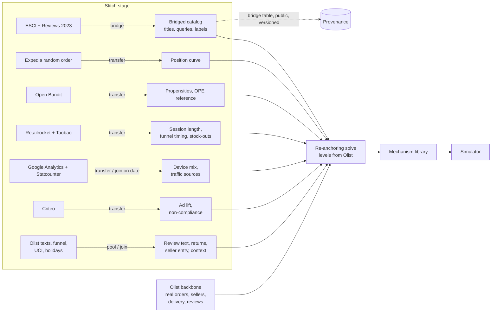
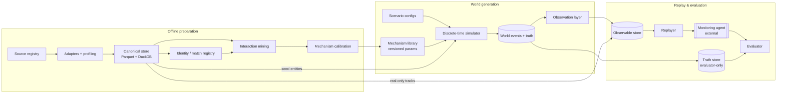
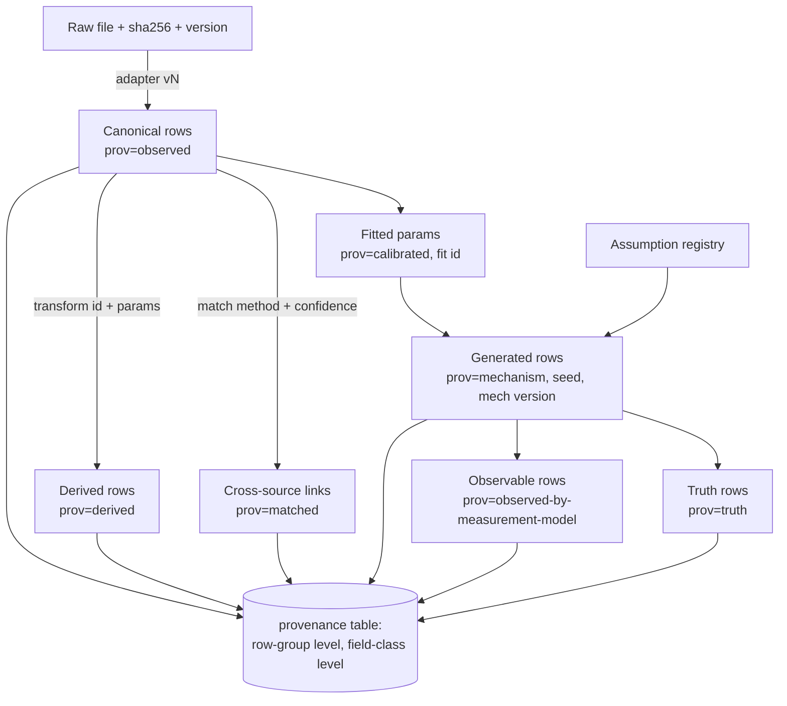
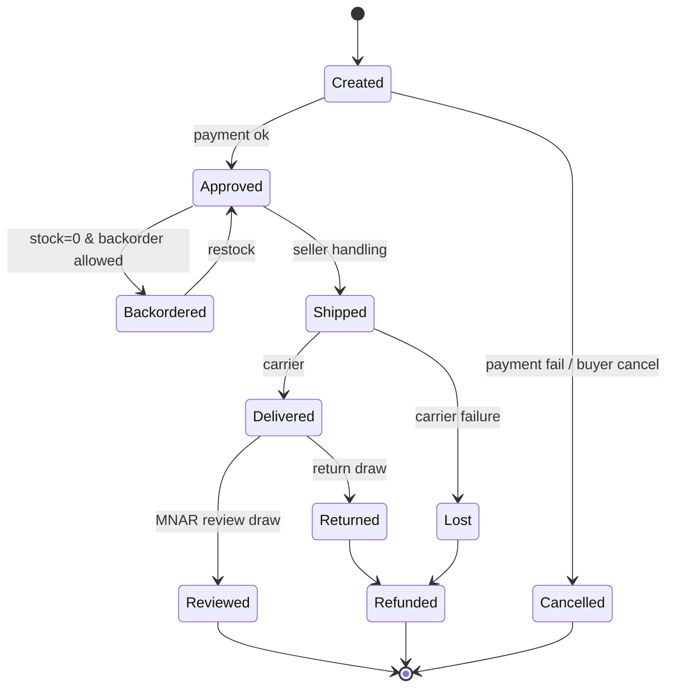
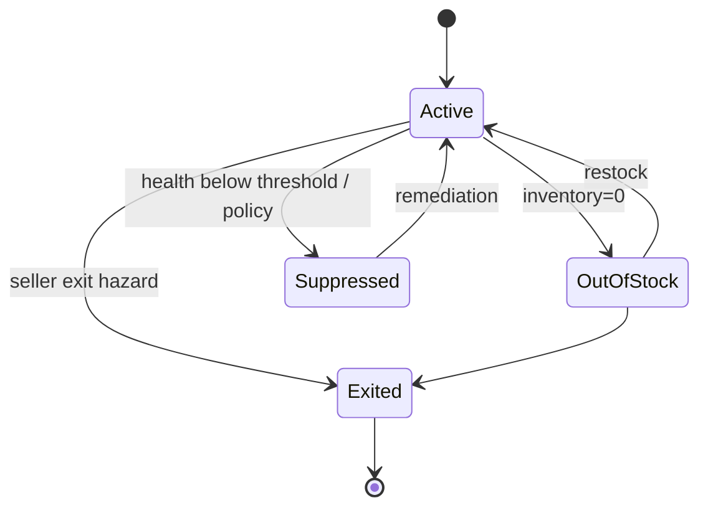
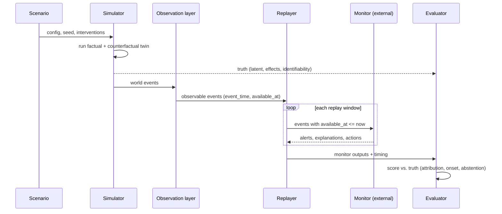
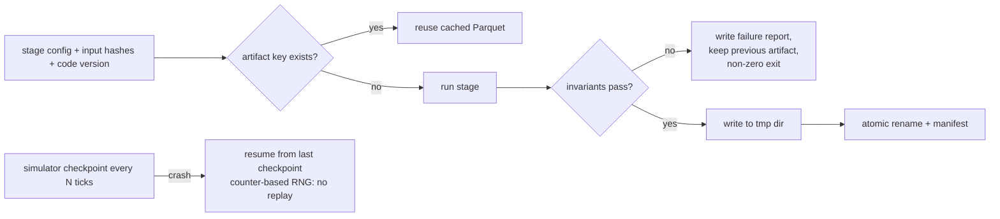

# Marketplace Reconstruction & Interaction Mining — Architecture Proposal

*Status: design; D1–D6 taken; data stitching (§7.5) and the external input-layer review (§7.6, §9.0, §12.5, §13.0) adopted 21 Nov 2026. D7 approved 21 Nov 2026, conditional on gates S1–S10 per phase.*

**How to read the evidence labels used throughout**

| Label | Meaning |
|---|---|
| **[M]** | Measured in this session on this machine (probe: `probes/id_overlap_probe.py`) |
| **[D]** | Taken from the source's primary documentation or paper; not re-checked against the data here |
| **[U]** | Unverified assumption or recollection; must be checked before relying on it |

Hardware **[M]**: 8 cores, 31 GB RAM, 301 GB free on `/home`, 23 GB free on `/`. All budgets below assume this machine, and a 16 GB laptop as the floor.

---

## 1. Executive recommendation

**Recommendation: Strategy B+C, an *Olist-anchored mechanism world* with separate *real-only replay tracks*.**

1. **One coherent operational spine.** Olist is the only candidate source in which buyers, sellers, products, orders, items, payments, freight, delivery timestamps and reviews are linked by real foreign keys **[D]**. It supplies the cross-layer causal chain the monitor most needs (seller → fulfilment → delivery delay → review score) without any synthetic bridge.
2. **Mechanisms, not joins, from everything else.** Amazon Reviews 2023, ESCI, Amazon-M2, Retailrocket, Open Bandit, Criteo, M5, Dunnhumby and others calibrate *mechanisms* (search relevance, session funnels, exposure/position effects, uplift heterogeneity, price/promo response, review MNAR). They are **statistically transferred**, never treated as entity identities of Olist participants.
3. **A generator that owns ground truth.** A vectorised discrete-time structural simulator (hourly ticks, counter-based RNG) runs the calibrated mechanisms over a synthetic population seeded from Olist's real entities and marginal structure. Interventions are `do()` operations on named mechanisms; counterfactual twins share exogenous noise.
4. **An explicit observation layer.** What the monitor sees is produced by a separate measurement model (logging coverage, sampling, delays, outages, schema changes). That is the only way to test "is the measurement reliable?" honestly.
5. **Real-only tracks kept separate.** Olist replay, Retailrocket replay, Open Bandit off-policy evaluation and Criteo/Hillstrom uplift remain unmixed benchmark environments with *real* (not simulated) answers where the data supports one (e.g. randomised logs).

**Measured support (second pass).** The Olist spine carries a strong real cross-layer mechanism: average review score falls from 4.29 for on-time deliveries to 1.71 for deliveries more than 10 days late (n ≈ 96k). It also contains two real shocks: Black Friday 2017 at 6.2× normal volume, and the May 2018 truckers' strike, during which Olist widened its delivery promises from 20 to 37 days so the late rate *fell*. Amazon-M2 has no US locale and overlaps Reviews 2023 by only 2–7% per locale (§4.1).

**Why it wins.** It maximises *causal coherence per unit of real evidence*. The measured Amazon overlaps (§4) show that Amazon sources can be partly entity-matched on product ID, but they share no buyers, sellers, orders, inventory or fulfilment, so an Amazon-centred world would have to synthesise the entire operational half of the marketplace, which is precisely the half the monitoring scenarios exercise.

**Main limitations.**
- Olist is small (99,441 orders, 3,095 sellers, effectively Jan 2017–Aug 2018, Brazil **[M]**), 96.9% of buyers order only once **[M]**, only 3.7% of products have more than one seller **[M]**, and it has no clickstream, inventory, ad, or telemetry data. Anything at 1M–10M events is mostly mechanism-generated.
- Mechanisms transferred from Amazon/ZOZO/Criteo/Walmart populations may not hold for Brazilian 2017 e-commerce (challenge 9, §17). Transfer is a modelling assumption that we label, bound with sensitivity ranges, and test where we can.
- Licences: Olist, Retailrocket and Criteo are CC BY-NC-SA **[D/M]**; M2 and Instacart are under competition terms **[U]**. The system can be built and used for research; redistributing derived worlds needs care (§3).

**Strongest counterargument against this recommendation.** *"You are building a benchmark for an Amazon-inspired monitor on a small Brazilian 2017 dataset whose most realistic parts (sessions, search, ranking, ads, Buy Box) will all be synthetic anyway. You could equally anchor on Amazon catalog + reviews (48M items, real temporal review dynamics, a 37% ASIN-level match to real search-relevance labels) and synthesise operations; the result would be larger, more recent, and closer to the target domain."* This is a serious argument. Our answer: the downstream engine is required to be domain-agnostic, so target-domain resemblance buys little; what it needs is mechanisms that are linked correctly across layers, and only Olist has real linkage across the operational layers. The decision gate in §15 (D1) lets you overrule this; §4's measurements make Strategy A's join base concrete if you do.

---

## 2. Revised marketplace taxonomy

The 8-layer taxonomy is retained but has three structural problems:

1. It mixes **world state** (what happened) with **observation** (what was logged). Those must be separate layers, or the "is the measurement reliable?" question has no ground truth.
2. Layer 8 ("Causal interventions & ground truth") is not a data layer; it is the evaluator's privileged view. It moves out of the observable taxonomy.
3. **Exposure denominators** and **eligibility** are scattered; they decide whether most metrics are interpretable at all and need a home.

**Revised layers** (L1–L7 kept with additions; L0, L9, L10 new; L8 becomes a privileged store):

| # | Layer | Key additions vs. original | Why it matters to the monitor |
|---|---|---|---|
| L0 | **External environment** | Seasonality, holidays, macro (inflation, FX, rates), weather, strikes/logistics shocks, external competitors, media events | Separates "the world changed" from "we broke something"; supplies natural experiments |
| L1 | Identity, scope, context | Temporal validity of every relationship; source namespace; locale-qualified IDs | Prevents cross-locale identity errors (measured: 11,531 ESCI IDs occur in more than one locale **[M]**) |
| L2 | Catalog, offers, competition | Offer **eligibility** state; substitute/complement graph; upstream supplier dependency | Substitution and cannibalisation are invisible without a substitute graph |
| L3 | Seller health & compliance | Seller **liquidity** and payout lag; *(seller reply time: no data. Olist's review_answer_timestamp is the customer's survey answer; corrected 21 Nov)*; seller lifecycle (entry/acquisition → ramp → exit); adaptation policy | Financial feedback loop; strategic response to fees |
| L4 | Demand & discovery | **Exposure denominators** (eligible vs. shown vs. seen); position; sponsored vs. organic; intent class | Without denominators, conversion changes are uninterpretable |
| L5 | Transactions, fulfilment, economics | Carrier capacity; promise vs. actual; contribution margin per party | Operational chain to satisfaction |
| L6 | Trust, reputation, feedback | **Review MNAR** (who chooses to review); review manipulation; dispute flow | Review volume follows sales, not satisfaction (§7.3) |
| L7 | Platform & infrastructure | Policy versions, ranking model versions, flags, latency/error processes | Infrastructure-caused symptoms |
| **L9** | **Observation & measurement** | Logging coverage, sampling rates, pipeline delay, late corrections, schema versions, bot traffic, attribution windows | Measurement failures as first-class causes |
| **L10** | **Lineage & quality** | Provenance class per field, coverage %, freshness, transformation versions | Auditability; lets the monitor discount low-quality evidence |
| L8→ | *Privileged truth store* (evaluator only) | Latent state, mechanism graph, intervention log, counterfactuals, expected effects | Not observable input by construction |

**Ranked omissions** (rank = diagnostic importance × ability to separate explanations ÷ synthesis risk):

| Rank | Omission | Real source available? | Synthesis needed |
|---|---|---|---|
| 1 | Exposure denominators / eligibility / position | Partly: Open Bandit (position, propensity) **[D]**, ESCI (query–product relevance) **[D]** | Ranking-to-exposure mechanism, eligibility rules |
| 2 | Observation/measurement layer (L9) | No marketplace source; NAB/LogHub for anomaly shapes **[D]** | Fully synthetic, assumption-labelled |
| 3 | External environment (L0) | Yes: holidays libs, BCB SGS macro series, Open-Meteo, Wikipedia pageviews, Google Trends (ToS-restricted) **[D]** | Mapping to demand is calibrated, not observed |
| 4 | Review MNAR & manipulation | Yahoo! R3 / Coat (random-exposure test sets) **[D]**; YelpChi/Amazon fraud graph labels **[D]** | Manipulation campaigns |
| 5 | Inventory & replenishment | None open at marketplace grain; M5 gives sales-with-zeros and SNAP effects **[D]** | Inventory process fully synthetic (stockouts inferred from zero-sales runs only with strong assumptions) |
| 6 | Cross-seller competition on the same product | Olist: one `product_id` sold by several `seller_id`s in `order_items` **[D]**; size of that set unmeasured **[U]** | Offer-allocation (Buy-Box-like) rule |
| 7 | Seller liquidity / payouts | None | Synthetic, minimal |
| 8 | Seller acquisition & lifecycle | Olist Marketing Funnel dataset (joins on `seller_id`) **[D]** | Exit hazard |
| 9 | Ad auctions, paid vs. organic | iPinYou RTB logs (bids, prices) **[D]**; Criteo uplift (treatment/exposure) **[D/M]** | Auction mechanism (second-price-like, assumption) |
| 10 | External competitors / outside option | None at entity level | Outside-option utility term, sensitivity-tested |

Categories considered and **not** added (no material gain for decisions): seller-side B2B procurement networks, customer-service chat content, tax regimes.

---

## 3. Verified source inventory

> **Status (22 Nov 2026):** pre-audit survey, kept as the record of what was checked. The current dataset set is decision L10 and the stitching table in §7.5; datasets mentioned here but not there (Amazon-M2, Tmall, iPinYou, Yahoo R3, Keepa) were dropped or archived.

Columns: **contribution** = what it gives the world; **join** = exact-join potential with the spine.

| Source | Size / access | Schema essentials | Contribution | Join to spine | Licence | Limits & biases |
|---|---|---|---|---|---|---|
| **Olist Brazilian E-Commerce** (kaggle.com/datasets/olistbr/brazilian-ecommerce) | 99,441 orders, 112,650 items, 3,095 sellers, 32,951 products, 96,096 unique buyers; purchases 2016-09-04…2018-10-17 but only 329 orders before 2017 and 20 after Aug 2018 **[M]**; 9 CSVs, 43 MB zip **[M]** | orders (5 lifecycle timestamps incl. estimated delivery), order_items (seller_id, price, freight, shipping_limit_date), payments (type, installments), reviews (score, text, created/answered), customers (`customer_id` per order + `customer_unique_id`), sellers/customers zip prefix, geolocation, products (category, dims, weight) **[D]** | Spine: real seller–order–fulfilment–review linkage | — (is the spine) | CC BY-NC-SA 4.0 **[D]** | Brazil only; 96.9% one-time buyers **[M]**; 775 orders have no items (603 `unavailable`) **[M]**; 547 orders carry >1 review and 789 review_ids cover >1 order **[M]**; 8.6% of reviews are created before the delivery date **[M]**; 1,359 orders handed to the carrier before approval **[M]**; review-score selection; seller names removed; Olist is itself an aggregator selling onto other marketplaces **[D]**, so "platform" policies are not Olist's own |
| **Olist Marketing Funnel** (kaggle.com/datasets/olistbr/marketing-funnel-olist) | 8,000 MQLs (first contact 2017-06-14…2018-05-31), 842 closed deals (won 2017-12…2018-11) **[M]** | mql_id, origin, closed deal with `seller_id`, business segment, lead behaviour **[D]** | Seller acquisition channel & ramp | **Exact** on `seller_id`: 380 of 842 deal sellers have Olist sales **[M]** | CC BY-NC-SA 4.0 **[D]** | Covers only sellers acquired via marketing in that window; 55% of won sellers never sell in the order data **[M]** |
| **Amazon Reviews 2023** (amazon-reviews-2023.github.io; HF McAuley-Lab/Amazon-Reviews-2023) | 750 GB total on HF **[M]**; 34 meta + 34 review files; largest review file 31.4 GB **[M]** | review: rating, title, text, `asin`, `parent_asin`, `user_id`, ms timestamp, `verified_purchase`, `helpful_vote` **[M]**; meta: price, store, categories, details map, average_rating, rating_number, bought_together **[M]** | Review arrival dynamics, rating distributions, catalog attributes, price points | None to Olist; ASIN entity-match to ESCI (§4) | HF card declares no licence **[M]**; research use per authors **[U]** | `price` present for only 15.7% of All_Beauty items **[M]**; `bought_together` null in All_Beauty **[M]**; `store` is a brand/storefront, not a seller ID; 1.11 reviews/user in All_Beauty **[M]**; 6,139 (user, ms-timestamp) collisions in All_Beauty **[M]**, so timestamps are not unique event keys |
| **ESCI Shopping Queries** (github.com/amazon-science/esci-data; mirror tasksource/esci) | 2.52 GB parquet mirror **[M]** | example_id, query, query_id, product_id, product_locale, esci_label (E/S/C/I), small/large flags, product title/description/bullets/brand/colour **[M]** | Query–product relevance; substitutes vs. complements (S/C labels) | ASIN entity-match to Reviews 2023 (US only meaningful) | Apache-2.0 **[D/M on mirror card]** | Human-judged relevance on a sampled candidate set, not exposure logs; no positions, clicks or timestamps **[D]** |
| **Amazon-M2** (github.com/HaitaoMao/Amazon-M2-Session-Recommendation; AIcrowd KDD Cup 23) | 3,606,249 sessions; 1,410,675 distinct product IDs in 1,551,057 (id, locale) rows; 99,569 IDs listed in 2+ locales **[M]**; official AIcrowd release (downloaded manually from the website; AIcrowd's API and CLI return 404 for all dataset listings as of 21 Nov 2026) is byte-identical (sha256) to the Kaggle mirror `marquis03/amazon-m2` **[M]** | sessions: `prev_items` list, `next_item`, `locale`; products: id, locale, title, price, brand, color, size, model, material, author, desc **[M]** | Session transition structure, multilocale browsing | Locales DE, JP, UK, ES, FR, IT, **no US** **[M]**. In Reviews 2023 (parent level): 2.2–7.3% per locale **[M]**. Shared with ESCI: JP↔jp 55,238 (16% of ESCI-jp), ES↔es 9,150 **[M]**; also DE↔es 19,430 and UK↔us 16,743 **[M]**, i.e. the same ID string appears in unrelated storefronts | AIcrowd competition terms **[U]** | No timestamps, no user IDs, no event types **[M: columns are only prev_items, next_item, locale]**; mean 3.6–4.5 prior items per session **[M]**. Cannot calibrate dwell times or conversion |
| **Amazon Berkeley Objects** | ≈148k listings, ≈398k images **[D]** | item_id, brand, product_type, multilingual names, dims, images **[D]** | Attribute richness for catalog generator | Not ASIN-keyed in a verified way **[U]** | CC BY-NC 4.0 **[U]** | Small catalog slice; low priority |
| **Amazon Search Dataset** (HF sarthakrastogi) | single 0.2 MB parquet **[M]** | search position, sponsored flag (per card) **[D]** | Illustrative sponsored share only | None | MIT (card) **[M]** | Third-party scrape, unknown provenance and sampling; **excluded** from calibration |
| **Stanford amazon-meta** (SNAP) | 548k products, 2006 **[D]** | salesrank, similar products, categories, reviews **[D]** | Co-purchase graph shape (historic) | Old ASINs; not recommended | Research **[D]** | 2006 catalog; stale |
| **Keepa API** | Commercial, token-priced **[D]** | price / offer / Buy Box history **[D]** | Would calibrate offer competition | ASIN | Commercial ToS; no redistribution **[D]** | **Dropped 21 Nov 2026** (rule: no paid sources) |
| **Retailrocket** | 2,756,101 events (2,664,312 views, 69,332 add-to-cart, 22,457 transactions), 1.40M visitors, 2015-05-03…2015-09-18 **[M]** | events (timestamp, visitorid, view/addtocart/transaction, itemid, transactionid); item_properties (time-varying, hashed values); category tree **[D]** | Real timestamped funnel, cart dwell/abandonment; **real time-varying `available` flag** (2 values, 1.5M snapshots, 417,053 items) **[M]** | None | CC BY-NC-SA 4.0 **[D]** | Hashed property values; unknown shop; heavy-tailed visitors (median 1 event, max 7,757: bots likely) **[M]**; 12% of purchased (visitor, item) pairs have no earlier view of that item **[M]**: skipped steps or logging gaps |
| **Open Bandit (ZOZOTOWN)** (HF zozonext/open-bandit) | 11.75 GB; random/all 0.70 GB, bts/all 6.32 GB **[M]** | timestamp, item_id, position (1–3), click, propensity_score, user features; Random and Bernoulli-TS logging policies **[D]** | **Real logged propensities**, position effects, OPE ground truth (on-policy value of the other policy) | None | CC BY 4.0 **[M]** | Fashion only, 80 items **[D]**, 3 positions |
| **Criteo Uplift v2.1** (HF criteo/criteo-uplift) | 311 MB gz **[M]**, ≈13.9M rows **[D]** | f0–f11, treatment, exposure, visit, conversion **[D]** | Randomised ad treatment; non-compliance (treatment ≠ exposure) | None | CC BY-NC-SA 4.0 **[M]** | Anonymised features; 85/15 split **[D]** |
| **Instacart** | 3M orders, 200k users **[D]** | order sequence, dow, hour, `days_since_prior_order`, reorder flag **[D]** | Repeat-purchase intervals, basket composition | None | Competition rules; redistribution restricted **[U]** | No absolute dates, no prices **[D]** |
| **UCI Online Retail II** | ≈1.07M rows 2009-12…2011-12 **[D]** | invoice (C-prefix = cancellation), stock code, qty, price, customer, country **[D]** | Cancellations, price-quantity, repeat B2B-ish buyers | None | CC BY 4.0 **[D]** | One UK retailer, wholesale-heavy |
| **Added: M5 Walmart** (Kaggle M5) | ≈30k item-store series, 5.4 y **[D]** | daily sales, weekly sell_prices, calendar events, SNAP flags **[D]** | Price elasticity, event effects, **SNAP natural experiment**, intermittent demand | None | Competition terms **[U]** | Retail not marketplace |
| **Added: Dunnhumby Complete Journey / Breakfast at the Frat** | 2.5k households 2 y / store-week **[D]** | transactions, coupons, campaigns; price, feature, display **[D]** | Promotion and display effects | None | Dunnhumby terms **[U]** | Grocery |
| **Added: Hillstrom email / X5 RetailHero** | 64k / ≈400k **[D]** | randomised campaign, spend, visit **[D]** | Second randomised-uplift source for transfer checks | None | Open **[U]** | Small |
| **Added: Yahoo! R3, Coat** | ratings incl. a randomly-exposed test set **[D]** | user, item, rating, random-exposure flag **[D]** | Calibrates **review/rating MNAR** | None | Yahoo Webscope terms / open **[U]** | Not marketplace |
| **Added: iPinYou RTB** | ≈10 days of bids **[D]** | bid price, paying price, impression, click, conversion **[D]** | Ad auction price formation | None | Research **[U]** | China 2013 |
| **Considered: theLook eCommerce** (`bigquery-public-data.thelook_ecommerce`) | BigQuery public dataset; Google account needed, free sandbox tier **[D]**; *not queried here: no bq/gcloud on this machine* **[M]** | 7 tables **[D]**: users, orders, order_items, products, inventory_items, distribution_centers, events (sessions, traffic source, event types) **[U: names of the last two not confirmed]** | **Schema/fixture only**: one linked schema with clickstream, inventory and fulfilment, useful for testing adapters and the engine's source independence | None | Google public-dataset terms **[U]** | **Synthetic** (Google describes it as fictitious/synthetic) **[D]**: no real evidence, and its generator's rules are undocumented, so calibrating on it would copy an unknown generator; single retailer (no sellers, no competition), no reviews **[U]**; dates may roll forward on regeneration **[U]**. **Not a spine candidate** |
| **Added: external context** — Brazil holidays (python-holidays), BCB SGS (IPCA, Selic, BRL/USD), Open-Meteo/ERA5, Wikipedia pageviews | open APIs **[D]** | daily/monthly series | L0 regressors; natural experiments: **May 2018 truckers' strike** in Brazil, **Black Friday 2017** spike visible in Olist **[D/U: measure]** | **Exact on date + state/zip-region** | Open **[D]** | Coarse geography |
| **Added: NAB, LogHub** | small **[D]** | labelled metric anomalies; system logs | Shapes for infra/telemetry anomaly processes | None | Open **[D]** | Not marketplace |

**Cost.** Default build downloads ≈6–8 GB (Olist <0.1, Retailrocket ≈0.3, Open Bandit random ≈0.7 + bts slices, Criteo 0.3, ESCI 2.5 or column-projected ≈0.02 **[M]**, Reviews 2023 selected categories ≈1–3, M5 ≈0.5). Reviews 2023 is never fetched whole.

---

## 4. Dataset compatibility and overlap plan

> **Status (22 Nov 2026):** pre-audit overlap measurements, kept as evidence. The current dataset set is decision L10 and the stitching table in §7.5; datasets mentioned here but not there (Amazon-M2, Tmall, iPinYou, Yahoo R3, Keepa) were dropped or archived.

### 4.1 Measured results (executed this session)

| Check | Result | Label |
|---|---|---|
| ESCI distinct (product_id, locale) | us 1,215,851 · jp 339,059 · es 259,973 | **[M]** |
| ESCI IDs present in more than one locale | 11,531 | **[M]** |
| Reviews 2023 `asin2category.json` keys | 35,393,189 distinct | **[M]** |
| Is that map keyed by parent or child ASIN? | All_Beauty: 112,565 / 112,565 review `parent_asin`s are in the map; only 1 child-only ASIN is | **[M]** → keyed by `parent_asin` |
| ESCI ∩ Reviews 2023 (parent level) | **us 447,879 (36.8%)**, es 18,854 (7.3%), jp 10,709 (3.2%) | **[M]** |
| Child-ASIN under-count (All_Beauty sample) | 1,545 parent hits + 160 extra hits only via child `asin` (≈+10%) | **[M]** |
| Top shared US categories | Home & Kitchen 56k, Books 38k, Clothing 36k, Toys 33k, Electronics 30k | **[M]** |
| Unresolved discrepancy | Paper reports 48.19M items **[D]**; map has 35.39M keys **[M]**. Cause unknown (maybe items without reviews, or the `Unknown` category) | open |
| Amazon-M2 ∩ Reviews 2023 (parent level) | DE 4.1%, ES 5.7%, FR 5.7%, IT 4.5%, JP 2.2%, UK 7.3% | **[M]** |
| Amazon-M2 ∩ ESCI | JP↔jp 55,238; DE↔es 19,430; UK↔us 16,743; UK↔es 13,308; ES↔es 9,150 | **[M]** |
| Olist internal joins | see §4.1b | **[M]** |

### 4.1b Olist and Retailrocket, measured (second pass, Kaggle token)

Script: `probes/olist_retailrocket_probe.py`. All **[M]**.

| Check | Result | Consequence for the design |
|---|---|---|
| FK integrity | 0 orphan items, reviews, payments or orders; 775 orders without items (603 `unavailable`, 164 `canceled`); 1 order without payment | Exact joins confirmed; "no items" is a legitimate state, not an error |
| Money | 99.75% of orders: items + freight = payments within 1 BRL; 232 overpaid (installment interest likely) | Reconciliation invariant needs a tolerance and an interest rule |
| Repeat buying | 96,096 buyers; 96.88% ordered once; max 17 orders | M-12 (repeat purchase) must be transferred (Instacart/UCI) |
| Reviews | 99,224 rows; 547 orders with >1 review; 789 review_ids span >1 order; 768 orders unreviewed; 41.3% have text; 8.6% created before delivery | Review timing is triggered by the *estimated* date, not delivery; dedupe rule needed |
| Score distribution | 5★ 57.8%, 4★ 19.3%, 3★ 8.2%, 2★ 3.2%, 1★ 11.5% | Bimodal; good fit target for M-09 |
| **Delay → score (M-08/M-09)** | on time: 4.29 avg (9.3% 1–2★, n=89,949); late 1–3 d: 3.29 (32.2%); 4–10 d: 1.97 (71.5%); >10 d: 1.71 (78.8%) | The strongest real mechanism we have; confirms the spine choice |
| Competition | 1,225 products (3.7%) have >1 seller, but they hold 12.8% of items; max 8 sellers; 1,278 orders split across sellers | M-05 can be fitted on real data for a minority of products |
| Seller size | items sold per seller: median 8, p90 80, p99 431, max 2,033 | Heavy tail; seller exit/ramp mechanisms must be heterogeneous |
| Timestamp anomalies | 166 handed to carrier before purchase; 1,359 before approval; 23 delivered before carrier pickup | Kept and flagged; state-machine tests need these exceptions |
| Black Friday 2017 | 24 Nov: 1,176 orders = 6.2× the Oct–Dec median | Real seasonal shock (S15) |
| **Truckers' strike 2018** | late share by purchase week: 7.7% (7 May), **16.0% (14 May)**, 5.5% (21 May), **0.4% (28 May)**; orders 1,805 → 941; promised days 20.1 → 25.8 → **37.4** | Real shock *and* a real policy response: the late rate "improves" because promises were widened. S13 promoted to P1 |
| Funnel join | 380 of 842 closed-deal sellers have sales | Seller acquisition data is real but covers a minority |
| Retailrocket | 2.76M events; 12% of purchased (visitor, item) pairs lack an earlier view; real `available` flag over time for 417k items | Funnel must allow skipped steps; availability mechanism gets real calibration |

**Interpretation.** ESCI↔Reviews is an *entity-resolution* link (same string namespace, ASIN), not an exact join of events: ESCI is a 2022 relevance-judgement snapshot, Reviews runs to Sep 2023 **[M: All_Beauty max timestamp 2023-09-09]**, ASINs get re-parented over time, and es/jp ESCI IDs are other storefronts' catalogs, so a match there does **not** mean the same listing. Only the **US, parent-level** match is fit for use, and even then the matched 37% is a selected subset (biased toward items that were both reviewed on amazon.com and judged for queries).

### 4.2 Pairwise plan for everything else

| Pair | Candidate key | Expected | Check |
|---|---|---|---|
| Olist internal (orders ↔ items ↔ payments ↔ reviews ↔ sellers ↔ products ↔ customers) | `order_id`, `seller_id`, `product_id`, `customer_id` | Exact | FK orphan counts; cardinalities (`order_items` 1:N; `reviews` ≈1:1 with documented duplicates **[U]**); `customer_id`→`customer_unique_id` N:1 |
| Olist ↔ Marketing Funnel | `seller_id` | Exact, partial coverage | intersection count; selection: funnel sellers only from 2017-06 |
| Olist ↔ L0 context | date, customer/seller state (zip prefix → state) | Exact on time/geo | coverage of all orders by region-day |
| Reviews 2023 ↔ ESCI | `parent_asin`/`asin` = `product_id`, US only | Entity resolution, 37% of ESCI-US | title-similarity audit on 1k random matches (precision estimate); locale filter |
| Reviews 2023 ↔ M2 | `asin` = M2 product id, UK/DE locales | Entity resolution, expected low | measure after AIcrowd access; title audit |
| Any Amazon source ↔ Olist / Retailrocket / ZOZO / Criteo | none | **No join**: transfer only | — |

**Sample queries** (DuckDB; all are in or directly extend the probe):

```sql
-- FK integrity, Olist
select count(*) orphan_items from order_items i left join orders o using(order_id) where o.order_id is null;
-- duplicate review rows per order
select count(*) from (select order_id from reviews group by 1 having count(*)>1);
-- multi-seller products (competition base)
select count(*) from (select product_id from order_items group by 1 having count(distinct seller_id)>1);
-- match precision audit sample
select e.product_id, e.product_title, m.title from esci e join meta m on e.product_id=m.parent_asin
where e.product_locale='us' using sample 1000;
```

**Validation procedure for any proposed join**: (1) namespace check (same pattern, same locale), (2) exact intersection count, (3) cardinality profile (1:1/1:N/N:M), (4) 1k-pair manual or text-similarity precision audit with a Wilson interval, (5) covariate comparison of matched vs. unmatched (selection), (6) store `match_confidence` and `match_method` on every link. A join not passing (1)–(4) is not used.

### 4.3 Strategy comparison

| | A: Amazon-centred | B: Olist-centred | C: Hybrid generative |
|---|---|---|---|
| Real cross-layer linkage | Catalog↔review↔(37%) query relevance | Seller↔order↔delivery↔review↔payment | None directly; inherits from calibration sets |
| Must synthesise | Sellers, offers, orders, fulfilment, payments, inventory, telemetry | Clickstream, search, ads, inventory, telemetry | Everything instantiated |
| Scale | Large | Small | Arbitrary |
| Causal coherence risk | High (operational half invented) | Low on spine, medium on synthetic front-end | Depends on mechanism graph |
| Effort | High | Medium | Medium-high |
| **Verdict** | Use Amazon sources as *mechanism calibration* | **Spine + real-only replay** | **Generator built on B's spine** |

---

## 5. Interaction ontology

> **Status (22 Nov 2026):** the ontology is current; the *source* column predates the audit (position effects now come from Expedia's random-order log, not Open Bandit). The current dataset set is decision L10 and the stitching table in §7.5; datasets mentioned here but not there (Amazon-M2, Tmall, iPinYou, Yahoo R3, Keepa) were dropped or archived.

Each row is a mechanism `M-xx`. *Type*: **Det** = deterministic/accounting, **Emp** = empirically estimated, **Hyp** = hypothesised and calibrated by transfer, **Asm** = assumed.

| ID | Mechanism | Entities | Lag | Observables | Evidence source | Type | Key confounders | Agent use |
|---|---|---|---|---|---|---|---|---|
| M-01 | Exposure → click by position | session, offer | seconds | impressions, clicks, position | Open Bandit random policy (unbiased) | Emp | relevance | Position bias correction; ranking regressions |
| M-02 | Query → candidate relevance (E/S/C/I) | query, product | — | query, results | ESCI | Emp | — | Search defects vs. demand |
| M-03 | Session funnel transitions & dwell | session | min | view, cart, checkout, purchase | Retailrocket | Emp | bots, logging gaps | Funnel-step localisation |
| M-04 | Price & promo → demand | offer, category | days | price, units | M5, Dunnhumby, Olist price variation | Hyp (transfer) | seasonality, stock | Competitor price cut, promotions |
| M-05 | Offer allocation among sellers of same product | offers | real time | featured share | Olist multi-seller products (weak); Keepa dropped (paid) | Asm | price, rating | Cross-seller substitution |
| M-06 | Stock → availability → eligibility | offer, inventory | hours | in-stock flag, sales zero-runs | Retailrocket `available` snapshots (real, unknown shop) **[M]**; M5 zero-runs (weak) | Emp (transfer) + Asm | demand drop | Stockout vs. demand loss |
| M-07 | Replenishment lead time | seller, inventory | days–weeks | restock events | none | Asm | — | Promotion after-effects |
| M-08 | Seller handling time → carrier → delivery | order, seller, carrier, region | days | approved, carrier, delivered, estimate | **Olist (real)** | Emp | distance, freight, season | Fulfilment degradation |
| M-09 | Delivery delay vs. promise → review score | order, review | days | delay, score | **Olist (real)** | Emp | product quality | Reputation incidents |
| M-10 | Who reviews (MNAR) | buyer, order | days | review presence | Olist presence rate, Yahoo R3 / Coat | Emp+Hyp | satisfaction | Review volume ≠ satisfaction |
| M-11 | Rating → visibility → demand | product, ranking | days–weeks | rank, sales | none direct; Reviews 2023 rating_number dynamics | Hyp | quality | Feedback loops |
| M-12 | Repeat purchase hazard | buyer | weeks | reorders | Instacart, UCI, Olist `customer_unique_id` | Emp (transfer) | — | Retention monitoring |
| M-13 | Fees → seller price & exit | seller, policy | weeks | price, active sellers | none; literature priors | Asm | macro | Fee-change scenarios |
| M-14 | Seller liquidity → inventory investment | seller | weeks | payouts, restocks | none | Asm | — | Financial loop |
| M-15 | Ad treatment → conversion (heterogeneous, non-compliance) | buyer, campaign | days | treatment, exposure, conversion | Criteo, Hillstrom | Emp | — | Uplift vs. selection |
| M-16 | Ad auction price & paid/organic substitution | advertiser, slot | real time | CPC, sponsored share | iPinYou | Hyp | — | Paid cannibalisation |
| M-17 | Infra latency/errors → abandonment | service, session | seconds | latency, errors, conversion | NAB shapes; latency-abandonment from literature | Asm | traffic load | Outage vs. experiment |
| M-18 | Logging/measurement process | pipeline | min–days | event counts, delay | none | Asm | — | Measurement failures |
| M-19 | External context → demand | category, region | days | holidays, macro, weather | Olist + L0 series (Black Friday, strike) | Emp | trend | External shock attribution |
| M-20 | Seasonality & weekly cycles | category | — | traffic | Olist, Retailrocket, M5 | Emp | — | Baselines |
| M-21 | Review manipulation campaigns | fake buyers, product | days | review bursts, graph structure | YelpChi / Amazon fraud labels | Hyp | genuine spikes | Abuse detection |
| M-22 | Seller entry & ramp | seller | weeks | first sale, growth | Olist + Marketing Funnel | Emp | — | Supply-side shifts |
| M-23 | Experiment assignment & exposure | user, flag | — | assignment, exposure | Open Bandit, Criteo | Det+Emp | flag bugs | SRM, selection |
| M-24 | Accounting identities (GMV, fees, refunds, stock) | all | — | — | definitional | Det | — | Reconciliation; must never be "discovered" as causal |

**Coverage strategy and stopping rule.** Each scenario (§12.3) lists the mechanisms it needs; each monitor capability (Phase A matrix below) lists the scenarios that test it. We add a mechanism only if it (a) enables a new scenario class, or (b) creates a competing explanation for an existing symptom that no current mechanism produces. **Stop** when a candidate mechanism adds no new (symptom, competing-explanation) pair to the coverage matrix: that is, every symptom in the scenario library has at least two mechanisms that could produce it and at least one discriminating observable.

**Phase A traceability (abridged; full matrix ships as `coverage/traceability.yaml`)**

| Decision capability | Mechanism | Observables | Sources | Missing | Validation |
|---|---|---|---|---|---|
| Detect & localise change in time/segment | M-20, M-19 | metric series by segment | Olist, Retailrocket | — | injected change-points with known onset |
| Tell measurement failure from real change | M-18, M-24 | event counts vs. reconciliation totals, pipeline lag | none | all | logging-regression scenario |
| Attribute seller sales loss: ranking vs. competitor vs. stock | M-01, M-05, M-06, M-04 | rank, competitor price, stock flag | Open Bandit, M5 | inventory | three-way scenario with shared symptom |
| Fulfilment-driven reputation decline | M-08, M-09, M-10 | delay, score, review presence | **Olist** | — | held-out Olist months |
| Validate experiment results (SRM, exposure bugs) | M-23, M-17 | assignment counts, exposure | Open Bandit, Criteo | — | feature-flag-imbalance scenario |
| Estimate action effect / abstain | all; identifiability flags | — | — | — | evaluator checks abstention on unidentifiable truth |

---

## 6. Mechanism-mining methodology

Order: cheapest falsifiable method first; escalate only when it fails a predefined test.

| Step | Method | Used for | Assumptions | Test of assumption |
|---|---|---|---|---|
| 1 | **Profiling & sufficient statistics** (counts, marginals, missingness by column/segment/time) in DuckDB | every source | — | — |
| 2 | **Transition matrices + duration (survival) models** (Kaplan–Meier, Weibull/log-normal AFT) | M-03, M-08, M-12, M-22 | Markov order-1 for funnels; independent censoring | compare order-1 vs. order-2 held-out log-loss; check censoring by cohort |
| 3 | **Conditional probability tables / GLMs with hierarchical (partial-pooling) effects** | M-09, M-10, M-19 | functional form | posterior-predictive checks on held-out months |
| 4 | **Lagged association / distributed lag models** | M-19, M-11 | no unmodelled common trends | negative-control outcomes (e.g. future holidays must not "affect" past demand) |
| 5 | **Change-point detection** (PELT/BOCPD on daily series) | regimes in Olist (Black Friday, strike) | piecewise stationarity | detect injected synthetic change-points with known onset |
| 6 | **Randomised / quasi-experimental estimation** (difference-in-means on random logs; DR/IPS OPE; DiD around the 2018 strike by region) | M-01, M-15, M-23, M-19 | randomisation (true for Open Bandit random policy, Criteo); parallel trends (DiD) | OPE estimate of BTS policy vs. its on-policy value (a *real* ground truth) **[D]**; pre-trend tests |
| 7 | **Heterogeneous effects** (uplift via T-learner/causal forest on Criteo) | M-15 | overlap | propensity overlap diagnostics |
| 8 | **Sequential pattern mining** (PrefixSpan on Retailrocket, limited support) | discover unexpected funnel paths | — | only kept if it changes the transition model's held-out fit |
| 9 | **Graph mining** (co-purchase/ESCI substitute graph; dense-subgraph detection for review rings) | M-02, M-05, M-21 | — | labelled fraud sets |
| 10 | **Constrained causal discovery** (PC/FCI with tiered temporal background knowledge, accounting identities removed first) | candidate edges among Olist variables only | faithfulness, sufficiency (FCI relaxes) | stability under bootstrap; agreement with known Olist timestamp order |

Rejected by default: generic association-rule mining over all columns (combinatorial, mostly finds accounting identities); deep generative tabular models (CTGAN etc.: memorisation risk, no intervention semantics).

**Interaction-induced reversals to test explicitly (§7.3).** For each fitted mechanism, the mining stage runs: (a) Simpson check, aggregate vs. within-segment effect sign; (b) selection check, effect among reviewed vs. all orders; (c) delay check, effect at lags 0…k; (d) volume-normalisation check (review counts ÷ orders). Every reversal found becomes a scenario candidate.

**Output contract of mining**: an `InteractionCandidate` record (entities, population, lag, source, estimate ± uncertainty, confounders, selection concerns, type, validation status). Nothing becomes a simulator edge without one.

---

## 7. Reconstruction methodology

**What stays observed, transferred, or synthesised**

| Element | Status |
|---|---|
| Olist sellers, products, categories, regions, order→item→payment→review links, timestamps | **Observed** (replayed verbatim in real-only track; used as seed population and calibration in generated worlds) |
| Olist delivery-time and review-score mechanisms (M-08, M-09) | **Fitted on Olist**, held-out validated |
| Funnel, position, uplift, price response, MNAR, repeat purchase | **Transferred** (calibrated elsewhere, re-scaled to Olist marginals, with sensitivity ranges) |
| Sessions, searches, impressions, ads, inventory, prices, returns, review text | **Stitched** from other datasets (§7.5): transferred shapes or bridged real records, re-anchored on Olist |
| Payouts, telemetry levels, logging faults | **Synthesised** by mechanisms, explicitly assumption-labelled |
| Amazon catalog text/attributes | **Optional enrichment** of synthetic product attributes; never an identity claim about Olist products |

**Reconciliation to the spine.** Generated worlds are tuned so that the *Olist-observable projections* (orders/day by category-region, delivery delay distribution, score distribution, seller size distribution) match held-out Olist statistics. Transferred mechanisms enter as relative effects (elasticities, odds ratios, position curves) anchored on Olist base rates, never as absolute rates from another population.

**Seed population.** Real Olist entities (pseudonymised) for the "replay-calibrated" world; resampled synthetic entities (hierarchical draws from fitted distributions, with a nearest-neighbour distance check against real records to avoid memorisation) for scaled worlds.

**Simulator core (discrete-time, vectorised).**

```
for t in ticks:                               # 1 h default
    env   = L0(t)                              # exogenous series + scheduled shocks
    pol   = policy_state(t, interventions)     # fees, ranking version, flags
    infra = infra_process(t)                   # latency/error/outage state
    demand= arrivals(env, buyers, t)           # sessions per buyer segment
    exp   = rank_and_expose(demand, offers, pol)       # M-02, M-01, M-05
    conv  = convert(exp, price, promise, trust, infra) # M-03, M-04, M-17
    orders= allocate_stock(conv, inventory)            # M-06 (state update)
    fulfil= advance_fulfilment(orders, carriers, env)  # M-08 (state update)
    fb    = reviews_returns(fulfil)                    # M-09, M-10
    sell  = seller_policies(sellers, sales, fees)      # M-13, M-14, M-07
    truth.append(...); events.append(...)              # privileged vs. world events
```

Each mechanism is a pure function `(state_slice, params, rng_key) -> (state_delta, world_events)`. Feedback is only across ticks (a DAG within a tick), which keeps the SCM well defined. Latent variables (true product quality, buyer intent, seller reliability) exist only in state and in the truth store.

**Randomness.** Counter-based RNG (NumPy `Philox`) keyed by `(world_seed, mechanism_id, entity_id, tick)`. Consequences: bit-identical reruns; counterfactual twins reuse exogenous noise except where `do()` changes a mechanism; partial reruns from a checkpoint need no RNG replay.

**Interventions.** `Intervention(target=mechanism|parameter|state, selector=population, window, operator=set|shift|replace|disable)`. Examples: `do(ranking.version = v2 for category=X from t0)`, `replace(infra.checkout.error_rate, 0.3, window)`, `shift(fees.commission, +2pp)`. The world also runs the *no-intervention twin* so expected effects are computed, not asserted.

**Observation layer.** `observe(world_events, measurement_model) -> observable_events`: per-stream coverage, sampling rate, delay distribution, duplication rate, late corrections, schema version, outages that drop or duplicate events. Measurement interventions are interventions on this layer only, so "purchases disappeared" can be a logging bug while truth shows purchases continued.

**Difficulty controls.** Each scenario has knobs for simultaneous causes, confounding strength, observation noise, segment heterogeneity, and an `identifiable: bool` flag computed from the mechanism graph and what the observation layer exposes (e.g. effect of latent quality on reviews is unidentifiable when quality is never observed and no instrument exists).

---

### 7.5 Data stitching: filling every missing data type from the other datasets

*Added 21 Nov 2026 at your request. Design only.*

Olist supplies the operational backbone. Every data type it lacks is **stitched** from another dataset, using one of four methods, and labelled with that method. No stitched value ever claims that a real Olist person, seller or product is the same as a record in another dataset (§3.2).

| Method | What it means here | Provenance label |
|---|---|---|
| **Exact join** | Real key shared with the backbone (Olist ↔ Marketing Funnel on `seller_id`; any row ↔ calendar/macro series on date + state) | `observed` / `matched` |
| **Distribution transfer** | Learn a conditional distribution or relative effect elsewhere (e.g. click-through by position), apply it to synthetic entities, re-anchored to Olist base rates | `calibrated:transfer:<source>` |
| **Synthetic bridge** | A synthetic entity is *dressed* with a real record from another source (e.g. a synthetic product gets a real Amazon title and its real search queries). Explicitly **not** an identity claim: the bridge table is public, versioned and random | `bridged:<source>` |
| **Text/value pooling** | Real values sampled into synthetic events by matching condition (e.g. real Olist review text drawn by score) | `bridged:pool:<source>` |

#### Stitching table (current; updated 22 Nov 2026)

The original matrix here predated the dataset audit (Amazon-M2, Tmall, iPinYou, Yahoo R3 and Keepa are now dropped; Taobao, Expedia, Google Analytics and Statcounter added). The current table, with one primary and at most one justified secondary per data type, is below. Dataset evidence is in `docs/datasets/AUDIT.md` and `NOTES.md`.

<!-- stitching-table:start -->
*Generated from `docs/tools/make_stitching_excalidraw.py` by `docs/tools/stitching_table.py`; do not edit by hand.*

| Layer | Data type | Method | Primary | Secondary (why) | What works / what doesn't |
|---|---|---|---|---|---|
| L0 | Seasonality, holidays, Black Friday | fit + join on date | Olist | Holidays (fills gap: holiday dates) | Olist Black Friday 6.2×; holiday rules verified |
| L0 | Macro: inflation, FX, interest | join on date | BCB SGS | — | 3 series 2016–18, values plausible |
| L0 | External shocks (2018 strike) | replay + fit | Olist | Public record (check: strike dates) | strike visible in Olist; dates confirmed |
| L1 | Buyers, regions | fit | Olist | — | 27 Brazilian states |
| L1 | Sellers, regions, size | fit | Olist | — | 3,095 sellers with state and volume |
| L1 | Products, categories, titles | fit + bridge | Olist | ESCI (fills gap: English titles) | Olist has no titles → ESCI (mixed-language shop, labelled) |
| L1 | Devices, channels | prior + transfer | Statcounter | Google Analytics (other part: conversion) | Brazil device share (page views); desktop converts 3.9× mobile |
| L2 | Prices, promotions | fit + transfer | Olist | M5 (fills gap: price changes) | prices yes, promo flags nowhere |
| L2 | Multi-seller offers | fit + assumed | Olist | Expedia (other part: shown together) | only 123 of 1,225 multi-seller products sold by 2 sellers in the same week |
| L2 | Inventory, stock-outs | transfer | Retailrocket | — | real availability flag over time (417k items) |
| L2 | Search queries, relevance | bridge | ESCI | Reviews 2023 (fills gap: category map) | 130k queries with human labels |
| L3 | Handling time, reliability | fit | Olist | — | approval → carrier timestamps |
| L3 | Seller entry, ramp-up | exact join | Olist Funnel | Olist (other part: first sale) | won date → first sale (380 join) |
| L3 | Seller exit | fit | Olist | — | no sale after May 2018: small sellers 92%, large 11% (censored) |
| L3 | Fees, payouts | assumed (A-10) | Assumed | — | no public fee/payout data found; range from general sources |
| L4 | Traffic volume, calendar | anchor (levels) | Olist | — | orders + hourly/weekly shape; visit level via funnel anchor |
| L4 | Session length, revisits | transfer | Taobao | Retailrocket (check: visitor-days) | second-level gaps; median 76 s |
| L4 | Funnel view → cart → buy, timing | transfer | Retailrocket | Taobao (other part: timing) | step rates + second-level timing |
| L4 | Exposure, position, clicks | transfer | Expedia | — | randomised order: position 10 gets 33% of position-1 clicks |
| L4 | Recommendation policy, propensities | transfer | Open Bandit | — | uniform + BTS propensities logged |
| L4 | Repeat purchases | fit + transfer | Olist | Instacart (other part: intervals) | 3.1% repeat; 7-day median gap |
| L4 | Ads, sponsored lift | transfer | Criteo | Hillstrom (check: 2nd randomised) | randomised lift + non-compliance |
| L5 | Orders, items, payments | replay + fit | Olist | — | clean joins; payments reconcile 99.75% |
| L5 | Delivery promise, delays | fit | Olist | — | on time 4.29★ vs late 1.71★ |
| L5 | Cancellations, returns | fit + transfer | Olist | UCI (fills gap: returns) | Olist has no returns → UCI 'C' invoices |
| L6 | Review score given delivery | fit | Olist | — | strong delay → score link |
| L6 | Review text | pool | Olist | — | pt-BR, pooled by stars × delivery outcome (cause-consistent) |
| L6 | Review timing (survey sent, answered) | fit | Olist | — | survey at delivery/estimate; customer answers after median 40 h |
| L6 | Who leaves reviews (MNAR) | fit + transfer | Olist | Coat (fills gap: selection) | Olist ~99% reviewed → Coat gives the shape |
| L6 | Fake reviews, fraud rings | transfer | YelpChi | Amazon fraud (other part: user rings) | no timestamps in either |
| L7 | Service telemetry, faults | live + shape | Astronomy Shop | NAB / LogHub (fallback: shapes) | shop on hold (A2) → NAB shapes meanwhile |
| L7 | Experiments, assignments | transfer | Open Bandit | Criteo (check: 2nd randomised) | randomised logs available |
| L9 | Logging gaps, delays, late data | assumed (A-11) + evidence | Assumed | Retailrocket (evidence: missing views) | assumption, with real evidence |
<!-- stitching-table:end -->

**How sources enter the simulator:** not all at once. Per §13.0 phase 7, each transferred or bridged source is added one at a time, with a transport card (§7.6) and a held-out gain test (gate S4). `scripts/stitch.py` (the original all-at-once plan) is superseded and refuses to run.

#### How stitched pieces stay consistent (the hard part)

Independently stitched mechanisms can contradict each other: Retailrocket's purchase rate × Open Bandit's click curve × Criteo's lift will not reproduce Olist's order volume by accident. Three rules prevent this:

1. **Relative, not absolute.** Each transfer contributes only a *shape* (position curve, elasticity, lift ratio, length distribution). Absolute levels come from Olist.
2. **Re-anchoring solve.** After stitching, one small calibration step adjusts the free base rates (sessions per day, base click rate, base cart rate) so the composed chain reproduces Olist's orders/day, calendar profile and category mix. This is a 3–5 parameter fit, checked on Olist's 2018 hold-out.
3. **Conflict rule.** When two sources give different values for the same quantity (e.g. M2 vs Retailrocket session length), use the one closer to the Olist population as the default and keep the other as the sensitivity bound. Record both in the assumption registry.



**New component: `stitch/`.** One module per source. Each returns either a small transfer-parameter file or a bridge table, plus a provenance record. It sits between calibration and the mechanism library. Each source is optional: without it, the mechanism falls back to its assumption and the run's provenance says so.

**Contract change.** Add `bridged` to `ProvClass`. Add a nullable `text` column to events, for query text, review text and listing titles.

**New benchmark scenarios enabled:** S6 (ranking regression), using real relevance labels; S9 (feature-flag imbalance), using real propensities; S10 (promotion after-effects), using stitched stock-outs; S12 (review manipulation), using stitched fraud shapes.

### 7.6 Transport cards, time cutoffs and randomness keys (adopted 21 Nov 2026 from the external input-layer review)

**Why:** a world stitched from unrelated markets can look coherent without any evidence that its cross-mechanism dependencies hold in the target marketplace. Every borrowed piece must therefore say where it came from, whom it describes, and how far it can be trusted.

**Transport card:** one per transferred or bridged mechanism, stored next to its parameters and checked by gate S4.

| Field | Example (position effect from Expedia) |
|---|---|
| `source_population` | Expedia hotel searches, 2012–2013, mostly US/EU users |
| `target_population` | Synthetic Olist-calibrated shoppers, Brazil 2017–2018 |
| `outcome` / `intervention` | click and booking / display position (randomised order) |
| `support_overlap` | positions 1–10 only; lodging category only; desktop-heavy |
| `assumptions` | the relative decay shape carries over; absolute levels come from Olist (anchor) |
| `estimate` + `uncertainty` | relative CTR per position with bootstrap CI |
| `heldout_check` | split by search date; shape stable within CI |
| `status` | supported / partially supported / **unsupported transfer** (labelled, never silent) |

**Time cutoffs:** every fitted mechanism records `trained_through` (latest event time used) and `available_through` (latest availability time used). Train/validation/test splits are strictly chronological. Replay and simulation refuse a mechanism whose `trained_through` is later than the simulation clock (gate S3). Sources from other periods (e.g. Expedia 2013) are transport, not leakage, and are handled by the transport card.

**Randomness keys:** keying draws by `(seed, mechanism, tick)` is not enough. When an intervention changes how many sessions or orders occur, later draws shift to different entities, which corrupts factual-vs-twin comparisons. Draws are keyed by `(seed, mechanism, entity_id, event_slot, tick)`. Tests check that results are unchanged under parallelism, reordering, and changes to unrelated mechanisms (gate S7). Shared random numbers reduce comparison noise; they do not make a mechanism valid.

**Validate dependencies, not totals:** re-anchoring to Olist's volume, calendar and review rate is necessary but not sufficient. Fidelity checks (gate S5) also compare key conditional distributions (e.g. score given lateness), lag structures (delivery → review), and cross-layer dependencies on held-out data, with tolerances fixed before running.

**Observation effects:** where missingness, delays or selection can be calibrated (Retailrocket skipped steps, Olist timestamp anomalies), they are. Where they can't, scenarios run across several plausible observation mechanisms, and reports show how conclusions depend on them.

## 8. Architecture diagrams

### 8.1 Component architecture



### 8.2 Data and provenance flow



### 8.3 Marketplace state transitions (order and offer)





### 8.4 Simulation, replay, evaluation



### 8.5 Incremental execution and failure handling



---

## 9. Canonical contracts

### 9.0 v3-aligned input contracts (adopted 21 Nov 2026; supersede the sketches in §9.1 onward)

The input layer produces **qualified evidence in the causal core v3's own types**, not a parallel schema (source: `causal_core_v3_domain_agnostic_architecture.excalidraw`). The core must not need to know whether evidence came from Olist, Amazon or anywhere else. It must know the evidence's origin class, environment, observation process, estimand and limits.

| v3 contract | Produced by the input layer from | Key fields the input layer must fill |
|---|---|---|
| `VariableDefinition` (kind, value_schema) | adapters + semantic audits | id, kind (state / continuous / categorical / event / assignment), unit, grain, scope |
| `MetricDefinition` (specialised variable) | metric registry | formula (AST), grain, units, population, empirical identities (accounting rules are never "discovered" as causal) |
| `Observation` | real replay or synthetic world | value/statistics, `event_time`, `available_at`, population, source, revision, quality flags |
| `StudyDesign` / `ExperimentRecord` | randomised sources (Criteo, Open Bandit, Expedia random order) or simulator experiments | assignment policy, unit, exposure/compliance, propensity, outcome, target estimand, uncertainty, validity. One evidence design among others, not a mandatory stage |
| `InterventionSpec` / `InterventionEvent` | action gateway / scenario config | scope, timing, implementation, authorisation |
| `EvidenceRecord` + `ProvenanceLineage` | every stage | lineage roots, **origin class** (real / derived / transported / bridged / synthetic / prediction), transformations, `trained_through`, dataset version, transport card link |
| `EnvironmentScope` | run config | production / real-data replay / staging / emulator; mechanism and data-cut versions |
| `CapabilitySpec` (v3) / `CapabilityManifest` | source adapter | accepted shapes, required metadata, available queries, measurements and interventions, cost/latency, failure codes |

**Evidence-class firewall (gate S6):** real observations, transported parameters, synthetic observations, model predictions and evaluator-only oracle labels stay distinct types. No synthetic evidence is counted as independent real corroboration. **Oracle labels never cross the boundary**: they exist only in the privileged plane.

**Capability honesty (gate S8):** an unsupported query or identification method fails with a failure code. It is never coerced into an A/B-test or time-bucket shape, and generic investigations never require experiment fields.

Mapping from the earlier sketches: `Event` and `MetricValue` → `Observation`; `Intervention` → `InterventionSpec`/`InterventionEvent`; `Assignment` → `ExperimentRecord`; `ProvenanceRecord` → `EvidenceRecord`/`ProvenanceLineage`; `SourceManifest` → lineage root; `ScenarioDefinition` and `GroundTruthRecord` stay **privileged** (evaluation only).

### 9.1 Earlier contract sketches (historical; names superseded by §9.0)

Twelve contracts (the proposed 16 merged where they duplicated): `Observation`/`MetricObservation` merge into `Event` + `Metric`; `PolicyDecision` merges into `Intervention`; `GraphEdge` is a typed `Relationship`; `Outcome` lives in the truth store.

Common columns on every table: `ns` (source namespace), `schema_v`, `prov_class` (enum below), `prov_id` (→ ProvenanceRecord), `world_id`.

```python
ProvClass = Literal["observed","derived","matched","calibrated","mechanism","assumed","unknown"]

class Entity:               # buyers, sellers, products, offers, carriers, services...
    entity_id: str          # canonical: f"{world_id}:{type}:{local}"; never a raw source ID
    entity_type: str
    source_refs: list[SourceRef]   # (ns, source_id) pairs; adapters only
    valid_from: datetime; valid_to: datetime | None
    attrs: dict             # typed per entity_type schema; time-varying attrs live in StateSnapshot

class Relationship:         # offer_of, sold_by, substitute_of, in_category, matched_to...
    src: str; dst: str; rel_type: str
    valid_from: datetime; valid_to: datetime | None
    confidence: float       # 1.0 for exact joins; match prob for entity resolution
    method: Literal["exact","entity_resolution","synthetic"]

class Event:                # one row per atomic occurrence
    event_id: str; event_type: str            # session_start, impression, click, order_created...
    entity_refs: dict[str, str]               # role -> entity_id
    event_time: datetime                      # when it happened (world)
    available_at: datetime                    # when the monitor may first see it
    ingested_at: datetime | None              # set by replayer
    payload: dict; units: dict[str, str]      # currency per money field
    context: Context                          # market, locale, region, channel, device
    supersedes: str | None                    # late correction of an earlier event

class Metric:               # definition
    metric_id: str; formula_sql: str; grain: list[str]; numerator: str; denominator: str | None
class MetricValue:
    metric_id: str; window_start: datetime; window_end: datetime; dims: dict
    value: float | None; n: int | None; missing_reason: str | None; available_at: datetime

class StateSnapshot:        # time-varying attributes, SCD-2 style
    entity_id: str; attr: str; value: Any; valid_from: datetime; valid_to: datetime | None

class Intervention:         # policy changes, experiments, promotions, injected faults
    intervention_id: str; layer: Literal["world","observation"]
    target: str; operator: Literal["set","shift","replace","disable"]; value: Any
    selector: str           # population predicate
    window: tuple[datetime, datetime]
    observable: bool        # announced to the monitor (e.g. a release note) or hidden

class Assignment:           # experiment exposure
    intervention_id: str; unit_id: str; arm: str
    assigned_at: datetime; exposed_at: datetime | None
    propensity: float | None          # only when genuinely known
    propensity_source: Literal["logged","design","unknown"]

class SourceManifest:       # one per registered source/version
    ns: str; version: str; files: list[tuple[str, str]]  # (path, sha256)
    licence: str; access: str; fetched_at: datetime; profile_ref: str

class ProvenanceRecord:
    prov_id: str; prov_class: ProvClass; inputs: list[str]
    transform: str; transform_v: str; params_hash: str; seed: int | None
    assumptions: list[str]  # ids into assumption registry

class ScenarioDefinition:
    scenario_id: str; version: str; base_world: str; seed: int
    interventions: list[Intervention]; measurement_model: str
    difficulty: dict; expected: list[str]   # ids of GroundTruthRecords

class GroundTruthRecord:    # evaluator-only store
    scenario_id: str; kind: Literal["cause","effect","onset","latent","identifiability","counterfactual"]
    target: str; value: Any; window: tuple[datetime, datetime] | None
    identifiable: bool | None; notes: str
```

**Example with lineage** (an Olist order, replay track):

```json
{"event_id":"olist-v2:evt:ord:e481f5...:created", "event_type":"order_created",
 "entity_refs":{"buyer":"w0:buyer:7c39…","order":"w0:order:e481f5…"},
 "event_time":"2017-10-02T10:56:33-03:00", "available_at":"2017-10-02T10:56:33-03:00",
 "context":{"market":"BR","region":"SP","currency":"BRL"},
 "prov_class":"observed", "prov_id":"prov:olist-v2:orders.csv:sha256=…:row=…", "ns":"olist"}
```

A generated impression for that buyer would carry `prov_class="mechanism"`, `prov_id` → `{transform:"M-01.position_click", transform_v:"0.3", params_hash, seed, assumptions:["A-07 position curve transferred from ZOZO"]}`.

**Leakage guards (contract level).** The observable store schema has no truth columns; latent entity attributes are never emitted; canonical IDs are re-keyed per world (`w0:buyer:…` HMAC'd with a world key), so IDs cannot be joined to truth without the key; the replayer refuses any event with `available_at > replay_clock`.

---

## 10. Component specifications

| Component | Responsibility | In → Out | Key algorithms | State owned | Failure modes | Complexity | Tests |
|---|---|---|---|---|---|---|---|
| `registry` | Know what sources exist and which files/versions were used | YAML → SourceManifest | sha256, licence capture | manifests | missing file, licence absent → refuse | O(files) | manifest roundtrip |
| `adapters/<src>` | Parse one source into canonical tables; only place raw IDs exist | raw → canonical Parquet | streaming reads, typed casts | none | schema drift → fail with diff | O(rows), streaming | golden 1k-row fixtures per source |
| `profile` | Marginals, missingness, cardinalities, time coverage | canonical → profile JSON | DuckDB aggregates | profiles | — | O(rows) | known-answer fixture |
| `match` | Cross-source joins and entity resolution | canonical pairs → Relationship(matched) + audit | hash joins, text similarity on sample, Wilson CI | match registry | low precision → link rejected | O(n) hash join | precision on labelled sample; "no Amazon↔Olist link" invariant |
| `mine` | Produce InteractionCandidates | canonical → candidates | §6 methods | candidate store | non-convergence, insufficient support | per method | synthetic data with planted effects must be recovered |
| `calibrate` | Fit mechanism params + uncertainty | candidates, canonical → params | MLE/Bayesian hierarchical, bootstrap | param store (versioned) | poor held-out fit → flagged, not silently used | per mechanism | held-out PPC |
| `mechanisms` | Pure functions per M-xx | state slice → delta, events | vectorised NumPy/Polars | none (pure) | NaN/negative stock → invariant error | O(active entities) per tick | unit tests per mechanism; property tests on invariants |
| `sim` | Advance world, apply interventions, run twin | world config → world events, truth | tick loop, Philox RNG, checkpoints | world state (owned) | crash → resume | O(T × active entities) | determinism; do() correctness; accounting |
| `observe` | Measurement model | world events → observable events | sampling, delay draws, drop/dup | none | — | O(events) | coverage stats equal config |
| `store` | Parquet partitions + DuckDB views; artifact cache | — | content-addressed keys | artifact dir | partial write → atomic rename prevents | — | crash-mid-write test |
| `replay` | Serve observables in event/processing time | observable store → stream/batches | k-way merge by `available_at`, windowing | replay clock | out-of-order/late events by design | O(window) | no-future-leak property test |
| `evaluate` | Score monitor outputs vs. truth | outputs + truth → report | onset error, attribution P/R, calibration, abstention | reports | missing outputs | O(alerts) | known-answer scenarios |
| `export` | Format for causal engine ingestion | observable store → engine contract | — | — | contract mismatch | O(events) | contract tests |

---

## 11. CLI and local execution design

One entry point, `mkt`, each subcommand = one stage; all read `mkt.toml` and write to `./artifacts/<stage>/<key>/`.

```bash
mkt source add olist --path ~/data/olist/ --licence CC-BY-NC-SA-4.0
mkt source add reviews23 --hf McAuley-Lab/Amazon-Reviews-2023 --subset All_Beauty,Electronics
mkt coverage                       # taxonomy × sources coverage matrix (§2) as table/CSV
mkt profile olist                  # marginals, missingness, time coverage
mkt joins check esci reviews23 --locale us --audit 1000
mkt mine --mechanism M-08,M-09 --holdout 2018-05:2018-08
mkt fit --mechanism all --config mech.toml
mkt world build base-br --seed 42 --scale 1x|10x
mkt scenario run checkout-outage@v1 --world base-br --seed 7
mkt replay checkout-outage@v1 --window 15m --speed max --sink jsonl|arrow-ipc|http
mkt validate integrity|stats|causal|robustness --world base-br
mkt export checkout-outage@v1 --format engine-v1 --out ./export/
```

```toml
# mkt.toml (illustrative)
[world.base-br]
spine = "olist"
tick = "1h"
start = "2017-01-01"; end = "2018-08-31"
scale = 1.0
mechanisms = { "M-01" = "position_click@0.3", "M-08" = "fulfilment_aft@1.1", "M-17" = "latency_abandon@0.1" }
measurement_model = "default@1"

[scenario."checkout-outage"]
version = 1
interventions = [
 { layer="world", target="infra.checkout.error_rate", operator="set", value=0.35,
   selector="device == 'mobile'", window=["2018-03-14T19:00","2018-03-14T21:30"], observable=false },
 { layer="world", target="promo.category.electronics", operator="shift", value=-0.10,
   selector="category == 'electronics'", window=["2018-03-14T00:00","2018-03-16T00:00"], observable=true } ]
difficulty = { confounders = 1, observation_noise = "medium" }
```

---

## 12. Verification and performance plan

### 12.1 Invariants (each a test with expected failure behaviour)

| Suite | Invariant | Failure behaviour |
|---|---|---|
| Integrity | Every FK resolves *or* carries `missing_reason` | stage fails, lists first 20 orphans |
| | Order lifecycle respects §8.3 transitions; timestamps monotone except documented exceptions (Olist has delivered-before-approved anomalies **[U]**, kept and flagged) | fails, unless exception rule matches |
| | Money: Σ item price + freight = Σ payments ± tolerance per order; fees + payouts = GMV − refunds | fails with per-order deltas |
| | Inventory: stock_t+1 = stock_t − sold + restock + returns_restocked; stock ≥ 0 unless backorder | fails at first tick |
| | No `matched` link between namespaces in the forbidden-pairs list (e.g. any Amazon ns ↔ Olist) | fails |
| | Observable store has no truth columns; no event with `available_at > clock` reaches the monitor | fails / replayer raises |
| Statistical | Held-out Olist months: KS/Wasserstein on delivery delay, review score, orders/day by category; transition matrices; autocorrelation of daily orders | report + threshold, not hard failure |
| | Discriminator test: a gradient-boosted classifier separating real vs. generated Olist-projection rows; AUC ≤ 0.6 target | report |
| | Memorisation: no generated entity within distance ε of a real record beyond the rate in a real-vs-real split | fails |
| Causal | do() on a mechanism changes only its descendants (twin diff is zero for non-descendants) | fails |
| | Randomised simulation recovers configured ATE within CI in ≥95% of seeds | fails |
| | Placebo intervention (no-op) yields effect CI containing 0 | fails |
| | Identifiability flag matches what an oracle estimator with only observables can recover | report |
| Robustness | Missing source, duplicated/out-of-order/late events, schema change, mass seller failure, logging outage, crash mid-stage | defined behaviour per case; tested with fault injection |

### 12.2 Performance (estimates, **not measured**; to be validated by the experiments below)

| Workload | Estimate on this machine | Bottleneck | Experiment |
|---|---|---|---|
| Prep: Olist + Retailrocket + Open Bandit random + Criteo | minutes | CSV parse | time `mkt source add` + `profile` |
| Prep: one Reviews 2023 category (≈0.3–30 GB) | 1–20 min | JSON parse; reference: DuckDB read of All_Beauty 0.33 GB took seconds **[M]**; Python `tr/sed` of the 1.25 GB map took 4.5 min **[M]** (use DuckDB/streaming JSON instead) | per-category timing |
| Generation: 1M events | target < 1 min | per-tick Python overhead | tick loop with 10k / 100k active entities |
| Generation: 10M events | target < 10 min, < 8 GB RAM | event buffering | flush per N ticks to partitioned Parquet |
| Replay: 15-min window at 10M-event scale (≈ 10³–10⁴ events) | target < 1 s to serve | k-way merge | measure p50/p99 |
| Monitor update | provisional 20 s end-to-end budget; replay share < 1 s | external engine | not ours to claim |

**Architecture-falsifying checks.** (1) If the per-tick loop cannot reach 1M events/min with vectorised mechanisms, the discrete-time design is wrong for scale and we move hot mechanisms to Polars expressions or Numba. (2) If held-out Olist fidelity requires per-seller hand-tuning, the mechanism set is too coarse (violates §3.5). (3) If the do()-descendant test fails, mechanisms have hidden shared state. (4) If transferred mechanisms flip sign under the §6 reversal checks when re-anchored on Olist, the transfer assumption is rejected for that mechanism.

---

### 12.3 Benchmark scenarios

Prioritised; P1 = in the 48-hour scope. "Refuse" = conditions under which correct output is "cause not attributable".

| # | Scenario | Cause (hidden) | Symptom sequence | Competing explanations built in | Discriminating evidence | Agent should conclude | Refuse when | P |
|---|---|---|---|---|---|---|---|---|
| S1 | Sanity: single checkout outage | infra error rate ↑ on mobile, 2.5 h | errors ↑ → mobile checkout conversion ↓ → orders ↓; desktop flat | none | device split, error metric | infra failure, mobile, onset ± 15 min | — | P1 |
| S2 | Outage + simultaneous promo end | S1 + electronics promo ends same evening | conversion ↓, electronics revenue ↓ | demand drop vs. outage | segment by device × category; error metric | both, with separate effects | if error metric not logged (observation knob) → can't separate | P1 |
| S3 | Logging regression | purchase events 40% dropped in one pipeline | orders ↓ in events, payments/settlements flat | real demand drop | reconciliation vs. payments; pipeline lag | measurement failure | — | P1 |
| S4 | Fulfilment degradation | one carrier region slows 3 days | delay ↑ (late-arriving signal) → score ↓ 1–2 weeks later → review volume ↑ negative | product quality drop | delay ↔ score link, seller-agnostic, region-specific | carrier region | onset ambiguous because delivery events arrive late; report window | P1 |
| S5 | Competitor price cut | seller B cuts price 15% on shared products | seller A sales ↓, product total flat | ranking change; A stockout | competitor price, A stock flag, total demand flat | substitution | if competitor prices unobserved → abstain | P1 |
| S6 | Ranking regression | ranking v2 demotes high-rating sellers in category | traffic reallocation among sellers, category total ~flat, later conversion ↓ | seasonality | rank positions, release event (observable) | ranking change | — | P2 |
| S7 | Seller stockout | top seller inventory 0 | top seller sales ↓, competitors ↑, category ↓ less | demand shift | availability flag | supply constraint | — | P2 |
| S8 | Simpson mix shift | new-buyer share rises (ad campaign) | aggregate conversion ↓, within-segment flat | UX regression | segment-level conversion | composition change | — | P2 |
| S9 | Feature-flag imbalance | flag misassigns heavy users to treatment | apparent +lift | true effect | SRM test, pre-period covariates | invalid experiment | — | P2 |
| S10 | Promotion with after-effects | 20% promo 1 week | revenue ↑, then stockouts, margin ↓, post-promo dip | organic growth | inventory, pull-forward | temporary stimulation + cost | — | P2 |
| S11 | Fee increase | commission +2 pp | prices ↑ slowly, marginal sellers exit over weeks | macro inflation (BCB series) | timing vs. announcement, seller-segment | strategic response (partially) | inflation confound when exit lagged → partial attribution with interval | P3 |
| S12 | Review manipulation | ring of fake buyers on 5 products | ratings ↑, review bursts, low verified share | genuine viral demand | graph density, purchase-review linkage | abuse | — | P3 |
| S13 | External shock + promise change (2018 truckers' strike, **real**) | strike, then Olist widens delivery promises | orders purchased week of 14 May: 16.0% late; week of 21 May: orders −48%; week of 28 May: promised days 20.1 → 37.4 and late share **falls to 0.4%** **[M]** | "fulfilment improved" | promised-days series, order volume, actual days (≈11–12, flat) | external shock; late-rate drop is a denominator/policy artefact | — | **P1** (real-only track) |
| S14 | Unidentifiable latent quality | latent quality ↓ for one brand, unobserved | returns ↑, scores ↓ | fulfilment | none sufficient | abstain on cause; flag symptom | always | P2 |
| S15 | Seasonal shift | Black Friday | all categories ↑ | promo, ranking | calendar, cross-category breadth | seasonal | — | P1 (real Olist) |

---

### 12.4 Provenance and benchmark ground truth

- Provenance is stored at **row-group × field-class** granularity (not per cell, which would dominate storage): each Parquet file has a provenance manifest mapping columns to `ProvClass` + `prov_id`; rows that differ (e.g. matched vs. observed) carry `prov_id` per row.
- **Assumption registry** (`assumptions.yaml`): id, statement, mechanism, source of prior, sensitivity range, test that could falsify it. Every `assumed`/`mechanism` row points here.
- **Truth store** layout: `truth/<scenario>/<seed>/{latent_state, interventions, effects, counterfactual_twin, identifiability, limitations}.parquet`. It lives in a separate directory, and the replayer and exporter have no code path to it (enforced by an import-boundary test: `replay`/`export` modules cannot import `truth`).
- **Reproducibility key** = hash(source manifests, mechanism versions + params hashes, scenario version, seed, code version). Same key ⇒ byte-identical outputs (tested).
- Ground truth explicitly records its own **limitations**: "true in the simulator; not a claim about Olist or Amazon".

---

### 12.5 Validation gates S1–S10 (conditions for D7, adopted 21 Nov 2026)

| Gate | Test | Fails when |
|---|---|---|
| S1 Semantic validity | meaning and units of every source field and derived feature | a field is mislabelled (e.g. the customer's survey answer time read as a seller reply; caught 21 Nov) |
| S2 Join and lineage | counts, keys, multiplicity, lineage roots | a bridge is treated as a real identity match, or provenance is lost |
| S3 Temporal non-leakage | pinned `available_at` and `trained_through`, historical replay | future observations or later-fitted mechanisms affect earlier outcomes |
| S4 Transport uncertainty | every transport card: overlap, sensitivity | a source-specific estimate enters the world as an unquestioned law |
| S5 Empirical fidelity | held-out marginal, conditional and lagged distributions | only totals match while dependencies diverge |
| S6 Synthetic-evidence firewall | real, synthetic, replicated, predicted and oracle records through the pipeline | classes are conflated, or an oracle reaches the reasoner |
| S7 Intervention correctness | factual/twin pairs with shared randomness; vary order, concurrency, unrelated mechanisms | unrelated streams change, or known simulator effects aren't recovered |
| S8 Core compatibility | variables, metrics, interventions, experiments without mandatory experiment fields | a use case must invent metrics, SRM data, treatment groups or time buckets |
| S9 Generalisation / abstention | unseen scenarios, invalid transfers, unidentified problems | unsupported causal conclusions are certified instead of reported as uncertain |
| S10 Incremental value | vs. factual-only replay and simple monitoring, matched budget | added synthetic complexity gives no measurable gain |

**Three separate evaluation reports, never merged into one score:** (a) simulator correctness, (b) empirical fidelity, (c) generalisation of causal reasoning. Recovering a simulator twin's effect shows the pipeline is correct. It is not evidence that the mechanism exists in real marketplaces. Randomised logs and off-policy estimates are references only within their logged population, support and assumptions.

## 13. Implementation roadmap

### 13.0 Phased plan (adopted 21 Nov 2026; supersedes the 4-hour plan in §13.1)

| Phase | Build | Exit criterion |
|---|---|---|
| 1 Source semantics + factual spine | minimum Olist tables; audit keys, timestamps, statuses, field meanings | counts, joins and distributions reproduced; S1, S2 pass |
| 2 Real-only core integration | replay real Olist observations through v3 contracts, **no simulator** | an investigation runs with no simulator and no assumption that an anomaly or experiment exists; S8 |
| 3 Minimal synthetic world | demand → orders → fulfilment → reviews, only fitted relations + labelled assumptions | deterministic; held-out marginal, conditional and lagged checks within preregistered tolerances; S5 |
| 4 Observation process + time integrity | delays, sampling, missingness, revisions, `available_at` | no look-ahead; reproducible as-of queries; S3 |
| 5 Interventions + counterfactual twins | a few controlled interventions; evaluator-only oracle | known simulated effects recovered; no oracle leakage; RNG invariance; S6, S7 |
| 6 Experimentation support | logged randomised assignments, compliance, propensities | RCT/OPE use cases work; generic investigations need no experiment fields |
| 7 Expand coverage | add transferred/bridged sources one at a time, each with a transport card | each addition shows a held-out gain, otherwise parked; S4, S10 |

**P0 (first build):** Olist spine, real-only replay, v3 contracts, provenance, one simulated chain (demand → orders → delivery → reviews), one intervention, independent scoring.
**P1:** more datasets, time-varying observation mechanisms, logged-policy evaluation, feedback loops, wider scenarios.
**Deferred:** full 33-type integration, all of M-01–M-24, live Astronomy Shop, large multi-agent simulation, scheduling infrastructure.


**Smallest useful vertical slice** (≈1 day): Olist adapter → canonical store → profile → replay of real Olist orders with `available_at` = event time + delay model → evaluator scoring S15 (Black Friday, real) and S3 (logging regression injected only in the observation layer). This already exercises ingestion contracts, replay, leakage guards and evaluation without any simulator.

**48-hour prototype**
1. Day 1: registry, Olist + Retailrocket + Open Bandit(random) adapters, profile, `joins check` (rerunning the probe for ESCI↔Reviews), the slice above.
2. Day 2: simulator with M-03, M-08, M-09, M-10, M-17, M-18, M-24; Philox RNG; twin runs; scenarios S1–S5; integrity + causal suites; 1M-event benchmark.

**Then**: M-01/M-02/M-05/M-06 (ranking, competition, stock) → S6–S10; seller policies & fees (S11); fraud (S12); scaled synthetic populations; extra sources (M5, Criteo, Yahoo R3).

**Critical path**: canonical contracts → Olist adapter → simulator core → observation layer → evaluator. **Independent**: individual adapters, mining notebooks per mechanism, scenario authoring, validation suites.

**Excluded from the initial build**: Keepa, ABO images, Amazon-M2 (blocked on access), deep generative models, any orchestrator/database server, a UI.

### 13.1 Revised plan for a 4-hour build (D5), superseded by §13.0

> **Status (22 Nov 2026):** historical. The current dataset set is decision L10 and the stitching table in §7.5; datasets mentioned here but not there (Amazon-M2, Tmall, iPinYou, Yahoo R3, Keepa) were dropped or archived.

| Hour | Work | Done when |
|---|---|---|
| 0–1 | Core: contracts (+`bridged`, `text`), Olist adapter, calibration with hold-out, artifact cache | `mkt fit` reproduces the §4.1b numbers |
| 1–2 | Simulator core (fulfilment, reviews, funnel, infra, stock), observation layer, replay, truth store with twin runs | Determinism, placebo, do()-descendant and no-future-leak tests pass |
| 2–3 | Stitch stage, highest value first: bridged catalog + ESCI queries, Open Bandit position curve, M2/Retailrocket session shapes, Retailrocket stock-outs, Olist review text; re-anchoring solve | Composed funnel matches Olist orders/day within 10% on hold-out |
| 3–4 | Scenarios S0, S1, S3, S4, S13 (+ S6 if time); baseline monitor + evaluator; README | All scenarios run, validate and evaluate from the CLI |

Deferred past 4 hours: Criteo ads, M5 prices, UCI returns, fraud rings, S2/S5/S9–S12, the 10M-event benchmark.

### 13.2 Prototype status (written before the "architecture only" clarification)

> **Status (22 Nov 2026): the legacy prototype was removed** (`mkt/sim/engine.py`, `world.py`, `scenario.py`, scenarios S0–S13, the old reader and monitor). It is recoverable from git tag `legacy-prototype`. Internal engine types moved from `mkt/v3.py` to `mkt/engine_types.py`, with clashing names `Engine`-prefixed. `mkt/sim/chain.py` + `observe_chain.py` + `twin.py` is the **gated P0 simulator** (v3 contracts, keyed randomness, gates S1–S8). New layers (sessions, exposure, checkout) are added to the chain only. See `docs/p0/MORNING_REPORT.md`.

Some code was written after "take these decisions" was read as approval to build. It is **uncommitted** in `~/marketplace-recon` and kept only pending D8:
- Built: hours 0–2 of §13.1 plus scenarios S0/S1/S3/S4/S13, baseline monitor, evaluator and CLI. There is no stitch stage yet.
- Measured: 131k events/s generation; every run passes the integrity and leakage checks. Simulated delivery is about 2 days slower than Olist 2018 (fit on 2017). The baseline monitor catches the outage within 3 h, finds the carrier delay after 17 days, misses the logging bug, and raises about 1.3 false alarms/day.
- Tests: 16 of 17 pass. The failing test is the carrier-slowdown test, whose threshold is too strict (late share 13.9% vs 11.4%; it requires +5 points).

## 14. Decision log

| # | Decision | Alternatives rejected | Why |
|---|---|---|---|
| L1 | Olist spine + transferred mechanisms + real-only tracks | Amazon-centred (A) | Measured Amazon overlap is product-only; operations would be invented |
| L2 | Discrete-time vectorised simulator (1 h ticks, sub-tick timestamps drawn) | Event-queue DES (SimPy-style): exact timing but ~10⁵ events/s in Python **[U]**; end-to-end generative model: no intervention semantics | Throughput and simple do() semantics; feedback only across ticks keeps SCM acyclic per tick |
| L3 | Observation layer separate from world | Logging faults as world events | Measurement truth must differ from world truth |
| L4 | DuckDB + Parquet + content-addressed artifact cache, thin CLI | Postgres, Airflow/Dagster, Kafka | No measured need; local-first |
| L5 | Counter-based RNG keyed by (seed, mechanism, entity, tick) | Global sequential RNG | Reproducible partial reruns and coupled counterfactuals |
| L6 | Row-group provenance + assumption registry | Per-cell lineage | Storage cost; per-cell adds nothing the evaluator needs |
| L7 | 12 contracts instead of 16 | All 16 | Removed duplicates (Observation vs. Event, PolicyDecision vs. Intervention) |
| L8 | Amazon ESCI↔Reviews match used only as optional catalog/search enrichment | Integrated Amazon product table | 37% coverage with selection bias; no events link |

| L9 | **Text language field by field** (21 Nov): reviews = Olist Portuguese pooled by stars × delivery outcome; titles + queries = ESCI English; mixed-language shop, labelled | English throughout (Amazon review text by star score); Portuguese via machine translation | Amazon reviews have no delivery outcome, so English text would break the link between cause and text (measured on Olist) | The reasoning engine needs single-language text it can't get from a multilingual model at ingestion |
| L10 | **16 datasets + 2 reference files** (21 Nov): one primary + at most one justified secondary per data type; Amazon-M2, Tmall, iPinYou archived; Yahoo R3, Keepa dropped | Keeping every source | Each extra source costs audits and maintenance without new evidence | A data type loses its primary or a new gap is measured |

| L11 | **Input layer emits causal core v3 types** (§9.0) with an evidence-class firewall and capability honesty | Own parallel schema | One contract set across all sources | v3 spec changes |
| L12 | **Transport card + `trained_through` per mechanism** (§7.6) | Provenance label only | More bookkeeping, but makes transfer assumptions falsifiable | — |
| L13 | **Randomness keyed by entity and event slot** (§7.6) | `(seed, mechanism, tick)` | Slightly more complex RNG; factual/twin comparisons stay aligned | — |
| L14 | **Phased P0 plan and gates S1–S10** (§12.5, §13.0) | 4-hour broad build | Narrower first result, but independently verifiable | A phase exits early |

### 14.1 Challenged assumptions (§17 of the brief)

| # | Assumption | Verdict here |
|---|---|---|
| 1 | Shared IDs ⇒ valid joins | **False as stated**: ESCI es/jp IDs match amazon.com review parents at 3–7% **[M]**; 11.5k ESCI and 99.6k M2 IDs span locales, and 19,430 M2-DE IDs reappear in ESCI-es **[M]**; same string ≠ same listing |
| 2 | Many datasets ⇒ more realism | Rejected: realism comes from linked mechanisms; extra sources are calibration only |
| 3 | Matching marginals preserves interactions | Rejected: validation includes conditional, lagged, cross-layer and discriminator tests |
| 4 | Precedence ⇒ causation | Rejected: temporal order used only as background knowledge for discovery |
| 5 | Known simulator graph ⇒ real causal validity | Rejected: truth is simulator-relative (§12.4) |
| 6 | All behaviour recoverable from observational data | Rejected: S14 and identifiability flags |
| 7 | Complex generator ⇒ better benchmark | Rejected: mechanisms admitted only via coverage rule (§5) |
| 8 | Every anomaly attributable | Rejected: abstention is scored |
| 9 | Calibrations transfer unchanged | Rejected: relative effects only, sensitivity ranges, re-anchoring checks |
| 10 | Volume fixes bias | Rejected: 35M-item Reviews map still yields a selected 37% match |

---

## 15. Approval gate

**Proposed files/modules** (new repo `~/marketplace-recon`, nothing else touched):

```
mkt/
  __init__.py  cli.py  config.py
  contracts/        entity.py event.py metric.py intervention.py provenance.py scenario.py truth.py
  registry/         manifest.py
  adapters/         olist.py retailrocket.py open_bandit.py criteo.py reviews23.py esci.py context_br.py
  profile/          profile.py coverage.py
  match/            joins.py audit.py
  mine/             transitions.py survival.py glm.py changepoint.py experiments.py candidates.py
  calibrate/        fit.py params_store.py
  mechanisms/       m01_position.py m03_funnel.py m08_fulfilment.py m09_review_score.py m10_review_mnar.py
                    m17_infra.py m18_logging.py m24_accounting.py ...
  sim/              state.py rng.py engine.py interventions.py checkpoint.py
  observe/          measurement.py
  store/            artifacts.py parquet.py views.sql
  replay/           replayer.py
  evaluate/         metrics.py report.py
  export/           engine_v1.py
scenarios/          s01_checkout_outage.toml ... 
coverage/           traceability.yaml assumptions.yaml
tests/              integrity/ stats/ causal/ robustness/ fixtures/
probes/             id_overlap_probe.py   (exists)
docs/               ARCHITECTURE.md       (this file)
```

**Implementation sequence**: contracts → registry/adapters(Olist) → store/profile → replay + evaluator (vertical slice) → sim core + RNG → mechanisms M-08/09/10/24 → observation layer → S1–S5 → validation suites → benchmarks → remaining mechanisms.

**Expected measurable outcomes (48 h)**: S1–S5 runnable from config; byte-identical reruns; integrity and causal suites green; held-out Olist KS statistics reported for M-08/M-09; 1M-event generation time and replay p99 measured and reported (whatever they turn out to be).

**Remaining uncertainties**
- Olist and M2 facts are now measured (§4.1b). Still open: whether Olist's widened promises during the strike were a platform rule or seller-set (the data can't say), and the exact M2 licence terms (the files are now the official release, but AIcrowd's rules text wasn't reviewed here).
- Reviews 2023: 35.39M map keys vs. 48.19M items reported.
- Licences for M2, Instacart, M5, Dunnhumby, Yahoo R3.
- Whether transferred mechanisms (position curves from ZOZO, uplift from Criteo) survive re-anchoring on Olist.

**How you can verify the claims independently**
1. `python -I probes/id_overlap_probe.py` reproduces every [M] number in §4.1 (≈2.2 GB download, ≈10 min); `python -I probes/olist_retailrocket_probe.py` reproduces §4.1b (≈1 GB of Kaggle data, about a minute).
2. File sizes: `https://huggingface.co/api/datasets/<id>/tree/main?recursive=true`.
3. Licences: dataset cards on HF (Open Bandit CC BY 4.0, Criteo CC BY-NC-SA 4.0, ESCI mirror Apache-2.0, Reviews 2023 none declared).
4. Everything marked [D] against the linked documentation; everything [U] is deliberately unconfirmed.

**Decisions taken (21 Nov 2026)**
- **D1** Strategy: **Olist-anchored B+C**, now with full data stitching (§7.5).
- **D2** Licences: **non-commercial research only**. Generated worlds that contain CC BY-NC-SA or competition-terms content are not redistributed.
- **D3** Credentials: **done**. Kaggle and AIcrowd access are in place.
- **D4** Simulation step: **1 hour**.
- **D5** Build budget: **4 hours maximum** (not 48). Scope in §13.1.
- **D6** Repo: **`~/marketplace-recon`**, under git.

**Still open for you**
- **D7 ✔ APPROVED 21 Nov 2026**, conditional: the architecture (§7.5 stitching, §7.6 transport cards, §9.0 v3 contracts, §13.0 phased plan). Each phase must pass its gates from §12.5 (S1–S10) before the next starts.
- **R4 ✔** Keep the Open Bandit BTS log (off-policy-evaluation reference, valid within its logged population).
- Amazon Reviews 2023: category map only; the category files are archived in `~/data/mkt/archive/reviews2023_categories`.
- **D8** What to do with the prototype code written early (§13.2): keep it as the starting point, park it on a branch, or delete it.
- **D9** Optional downloads that need your action: Instacart and M5 (accept the Kaggle competition rules in a browser), UCI Online Retail II, YelpChi.
