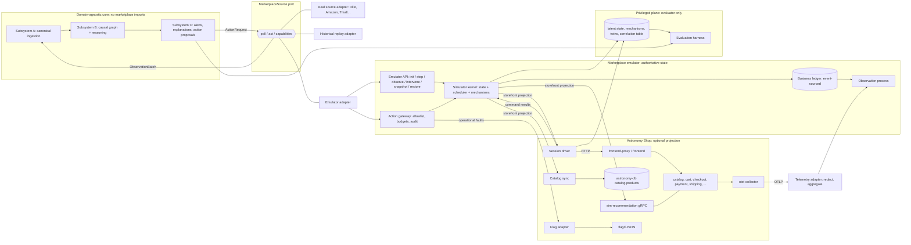
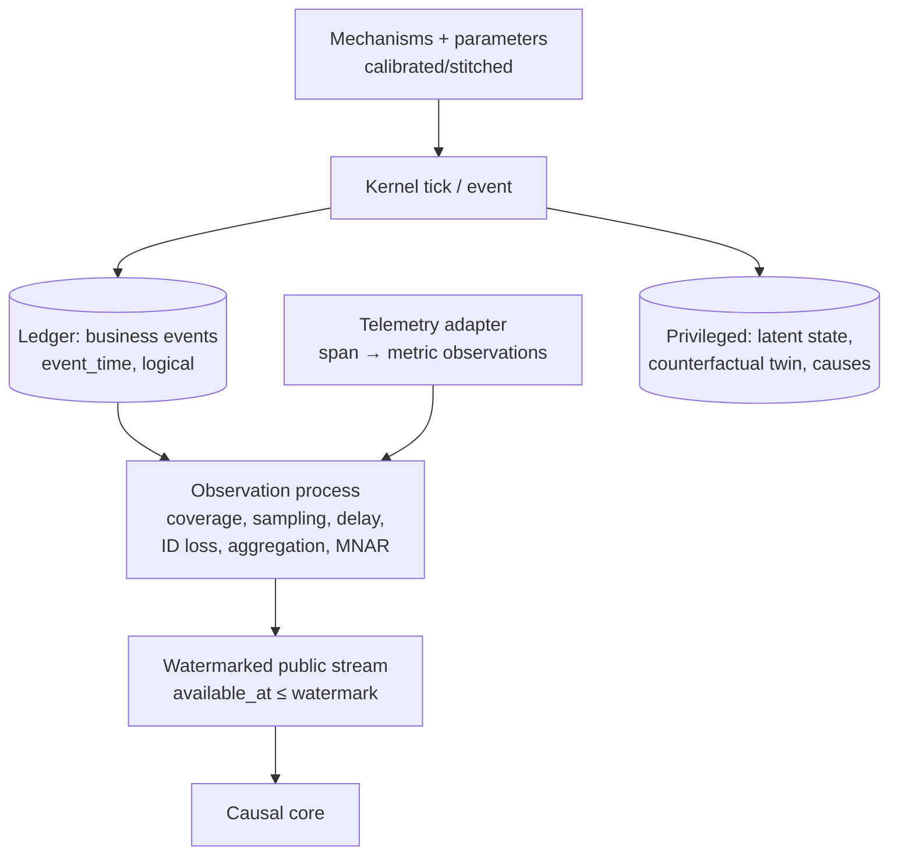
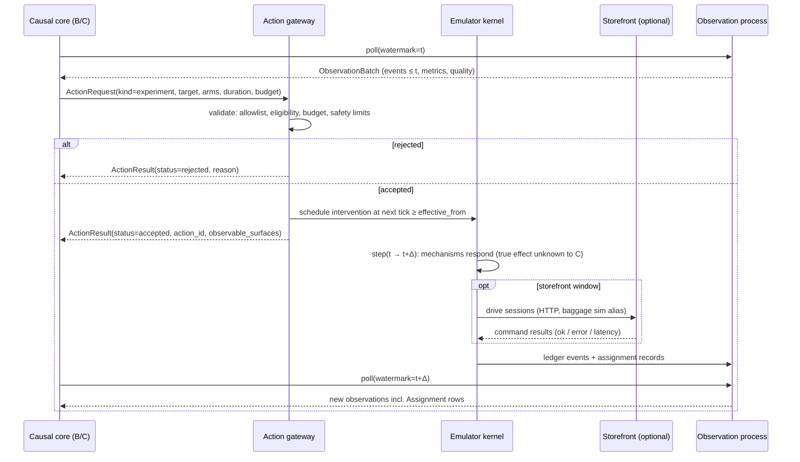
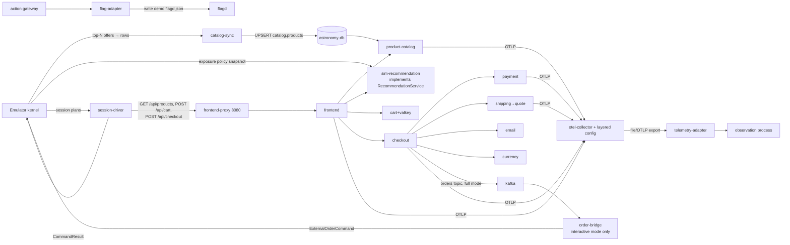
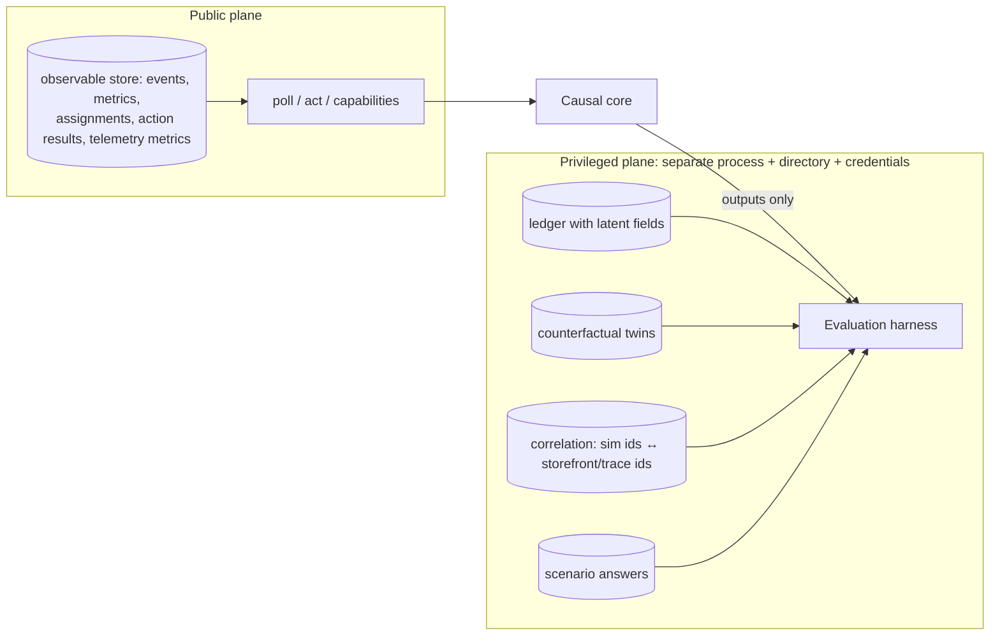

# Astronomy Shop as an Optional Storefront for the Marketplace Emulator: Architecture

*Status: design for approval. Nothing is built and the upstream repo is unmodified. Written 21 Nov 2026. **Updated 21 Nov:** contracts aligned to causal core v3 (see D.0), randomness keys tightened (E), and the live shop deferred until after phase P0 of `ARCHITECTURE.md` §13.0.*
*Companion docs: `ARCHITECTURE.md` (data foundation, §7.5 stitching), diagram `astronomy-integration.excalidraw`.*

**Evidence labels**

| Label | Meaning |
|---|---|
| **[S]** | Read in the upstream source at the pinned revision (file:line below) |
| **[D]** | Upstream documentation (may differ from the source; differences are called out) |
| **[M]** | Measured on this machine (earlier sessions or this one) |
| **[U]** | Unverified assumption, with an experiment (E-n, §I) to settle it |

**Pinned upstream:** `open-telemetry/opentelemetry-demo` @ **`7a88536cf02f7a6ba5f4ee2b3a2b242a8c56c74c`** (2026-11-20, `.env` `IMAGE_VERSION=3.1.0`). Paths below are relative to that tree. The clone is at `~/.cache/otel-demo` (read-only; nothing in it was run).

**Existing project state this design builds on.** `~/marketplace-recon` holds the data-foundation architecture (`ARCHITECTURE.md`, D1–D6 decided). It also holds an **uncommitted prototype** whose fate is still open (D8). The prototype has a seeded hourly simulator, an observation layer, a truth/observable split, replay and an evaluator; its runs are deterministic and pass the leakage checks **[M]**. This design reuses its *concepts*. Whether it reuses the *code* depends on D8. The brief also names **Tmall/Alibaba** as a source. It is not in the verified inventory yet, so it is treated as a future adapter and nothing here depends on it.

---

## A. Executive architectural decision

**Recommendation: a simulator-authoritative hybrid ("Option 3+"), with Astronomy Shop as an optional, unforked projection.**

1. **One source of business truth.** The headless emulator (our simulator, exposed through a step/observe/intervene API) owns all business state: buyers, sellers, offers, prices, stock, rankings, orders, payments, fulfilment and reviews. Astronomy Shop owns **none** of it.
2. **The storefront executes and the emulator decides.** In *storefront mode*, a **session driver** replaces Locust. It plays emulator-decided sessions through the real frontend HTTP API, so the real microservices produce real traces and failures. Each storefront call returns to the emulator as a **command result**: success, failure or latency. The emulator then commits, or does not commit, the business outcome under its own transaction rules. The storefront's own order and transaction IDs are recorded only as correlation data.
3. **Zero upstream code changes in round one.** Every touch point uses an existing extension mechanism:
   - Postgres `catalog.products`, which is read on every request **[S]**
   - a drop-in `RecommendationService` gRPC server (same proto, swapped by a Compose override)
   - flagd's JSON file
   - the Kafka `orders` topic (`compose.full.yaml`)
   - an OTLP exporter layered onto the collector config
4. **Telemetry is not business data.** Spans and service metrics become *operational* metric observations through a telemetry adapter, with redaction. Business events come only from the emulator's ledger.
5. **Two planes.** The public plane carries what a real monitor could see. The privileged plane (latent state, mechanisms, injected shocks, counterfactual twins, correlation tables) is reachable only by the evaluation harness.

**Strongest justification.** Astronomy Shop has no seller, offer, inventory, rank score or quantity check anywhere in its contracts **[S `pb/demo.proto:23-260`]**. Recommendations are a random shuffle of at most 5 products **[S `RecommendationService.java:42,110-112`]**. Checkout charges the card *before* shipping, with no idempotency key and no compensation **[S `checkout/main.go:339-381`]**. It is an excellent *operational* testbed but cannot host marketplace economics. Making it authoritative would mean forking six services in four languages, and we would still lose deterministic replay.

**Main risks:**
- **R1:** storefront throughput on a laptop is unknown, which limits how many sessions can pass through real services (E1).
- **R2:** fault injection can leak through telemetry, because flag states and fault messages appear in span attributes (§B, E3).
- **R3:** storefront mode is not bit-reproducible, so determinism comes from record/replay of storefront outcomes (ADR-4).
- **R4:** most behavioural mechanisms are transferred or assumed, not causally identified. Evaluation must report "unsupported mechanism" separately (§F).

**Simpler alternative considered:** drop Astronomy Shop entirely and synthesise telemetry. That would be cheaper, but synthetic traces would encode our own assumptions about how failures propagate. Real services give real error propagation (payment → checkout → frontend), real latency and real collector behaviour, which are what fault-diagnosis scenarios need. **Failure scenario for the chosen design:** if E1 shows the storefront can sustain only a few sessions per second, storefront mode is limited to short fault windows (minutes) embedded in long headless runs. That is enough for the operational scenarios.

---

## B. Verified Astronomy Shop capability audit (pinned `7a88536`)

### B.1 Docs vs. source differences found (the brief's warning was justified)

| Topic | Documentation says **[D]** | Source says **[S]** |
|---|---|---|
| Product catalog storage | "from a JSON file" (opentelemetry.io `docs/demo/services`) | Postgres `catalog.products`, queried on every RPC (`product-catalog/main.go:225-300`, `postgresql/init.sql:61-97`) |
| Recommendations | "based on what's given in the cart" | Random shuffle of all products minus the requested IDs, max 5 (`recommendation/.../RecommendationService.java:42,106-112`). Java, not the earlier Python |
| Load generator | Python (Locust) | Locust, after a k6 rewrite was reverted (`CHANGELOG.md:39`, `:393`) |
| Kafka/accounting | listed as core | Only in `compose.full.yaml`; checkout publishes to Kafka only if `KAFKA_ADDR` is set (`checkout/main.go:417-421`, `compose.full.yaml:26`) |

### B.2 Component classification

| Component | What it actually does **[S]** | Class | Justification |
|---|---|---|---|
| `product-catalog` (Go) | `ListProducts`/`GetProduct`/`SearchProducts` read `catalog.products` each call; search is `LOWER(name/description) LIKE '%q%'`, ordered by id (`main.go:225-300,374-440`); 10 seeded products (`init.sql:83-97`) | **Adapt** | No code change: the emulator **syncs** its storefront projection into `catalog.products` (price updates are visible on the next request). No ranking: results are ordered by id, so ranking is applied elsewhere |
| `astronomy-db` (Postgres) | `catalog` + `accounting` schemas (`init.sql:24-80`) | **Adapt** | Target of catalog sync. Accounting tables are not authoritative for us |
| `recommendation` (Java) | Random top-5, plus a memory-leak fault flag (`RecommendationService.java:110-155`) | **Replace** (same proto) | A small `sim-recommendation` gRPC server implementing `ListRecommendations` (`demo.proto:56-61`) returns the emulator's exposure policy. Swapped by a Compose override; the upstream image is untouched |
| `frontend` (Next.js) | API routes `/api/products`, `/api/cart`, `/api/checkout`, `/api/recommendations`, `/api/shipping`, `/api/currency` (`pages/api/*`). Cart keyed by `sessionId` = `userId` (`pages/api/cart.ts:16-37`). Sets `session.id` on spans (`SessionIdProcessor.ts:16`) | **Reuse** | The driver calls these HTTP routes. Port 8080 is not published to the host; only `frontend-proxy` publishes it (`compose.yaml` ports) **[S]** |
| `frontend-proxy` (Envoy) | Publishes 8080; `depends_on` the load generator | **Adapt** | Keep it as the driver's entry point; a Compose override drops its `load-generator` dependency |
| `cart` (.NET + Valkey) | Hash per user, 60-min TTL, quantities add (`ValkeyCartStore.cs:138-177`) | **Reuse** | Workflow state only. The emulator keeps the authoritative cart intent; a storefront cart that expires is an operational event |
| `checkout` (Go) | `PlaceOrder`: new UUID order id → quote → charge → ship → empty cart → email → Kafka (`main.go:306-421`). No stock check, no idempotency key, no refund on ship failure | **Reuse as executor** | It never decides business truth. Charge-then-ship-fail becomes an *operational anomaly* the emulator records (and compensates in its ledger) |
| `payment` (Node) | Card validation only; `paymentFailure` n% and `paymentUnreachable` flags; synthetic requests (`baggage synthetic_request=true`) are "not charged" (`charge.js:35-92`) | **Reuse** | Its failures are operational facts fed back to the emulator |
| `shipping` (Rust) + `quote` (PHP) | Tracking id = UUIDv4; quote from item count via quote service (`shipping_service/tracking.rs:7`, `quote.rs:23-90`) | **Reuse (workflow) / Bypass (outcomes)** | No delivery outcomes exist; delivery timing, lateness and reviews stay in the emulator (Olist-calibrated) |
| `currency` (C++), `email` (Ruby), `ad` (Java), `image-provider` | Conversion, confirmation email, random ads, images | **Reuse** (needed by the frontend's `depends_on`) | Operational surface only; the ad *economics* stay in the emulator |
| `accounting` (.NET), `fraud-detection` (Kotlin), `kafka` | Kafka `orders` consumers; accounting writes `accounting.*` (`Consumer.cs:46-130`) | **Bypass** (accounting, fraud) / **Adapt** (Kafka) | The **order bridge** consumes `orders` for *interactive* human sessions (§D.6). Accounting must not be read as truth |
| `load-generator` (Locust) | Fixed task weights (browse 10, add-to-cart 2, checkout 1, ...), `between(1,10)` s waits, hard-coded product list, `session.id` + `synthetic_request=true` baggage (`locustfile.py:104-260`) | **Replace** in experiments; **Reuse** in stress mode | Not economically grounded (tasks are independent, no funnel or choice model). Disabled during deterministic experiments; kept for operational load tests |
| `flagd` (+`flagd-ui`) | 21 flags in `src/flagd/demo.flagd.json`, file-watched (`compose.yaml:716-719`) | **Adapt** | The **flag adapter** writes the file to execute operational interventions; `flagd-ui` is bypassed |
| `otel-collector` | OTLP in; base pipeline exports to `debug` + `span_metrics` only; backends are layered config files (`otelcol-config.yml:155-262`, `.env OTEL_COLLECTOR_CONFIG_*`) | **Adapt** | Layer one more config file: a file/OTLP exporter to the **telemetry adapter**, plus redaction processors |
| Jaeger, Grafana, Prometheus, OpenSearch (`compose.observability.yaml`) | Backends | **Bypass** by default | Optional for humans; the reasoning engine reads canonical observations instead |
| `agent`, `mcp`, `chatbot` (LLM assistant over shop tools) | FastAPI/LangGraph agent, MCP server, Gradio UI (`src/agent/README.md`, …) | **Bypass** | Out of scope. Note: an MCP tool surface onto the shop exists, but it must never be wired to the reasoning engine (it would bypass the guarded action API) |
| `react-native-app`, `opamp-server`, profiling | — | **Bypass** | — |

### B.3 What Astronomy Shop does **not** model (verified by absence in `pb/demo.proto` and the services)

Sellers and multi-seller offers; inventory and stock-outs; strategic or dynamic pricing (the price is a static DB row); ranking and search relevance (results ordered by id); realistic consumer choice (Locust weights are fixed and independent); reputation and reviews; fulfilment outcomes (no delivery time or lateness); returns, cancellations and refunds; promotions; experiment assignment; marketplace-wide policies (fees, eligibility); repeat-customer dynamics.

### B.4 Operational faults vs. behavioural interventions

| Already supported (operational, via flags) **[S `demo.flagd.json`]** | Needs a new economic response model (emulator only) |
|---|---|
| `paymentFailure` (n%), `paymentUnreachable`, `cartFailure` (n%), `productCatalogFailure` (one product), `productCatalogLockContention`, `recommendationCacheFailure`, `adFailure`/`adHighCpu`/`adManualGc`, `emailMemoryLeak`, `kafkaQueueProblems`, `kafkaConsumerDead`, `intlShippingSlowdown`, `imageSlowLoad`, `webInteractionSlowdown`, `loadGeneratorFloodHomepage`, `failedReadinessProbe`, `cartMetricCardinalityOverflow`, `emitRawPii`, `aiRunawayAgent`/`aiSlowResponse` | Price changes and promotions, ranking/exposure policy, seller stock shortages, fee changes, delivery delays (business, not RPC latency), review manipulation, traffic-composition shifts, experiment assignment |

**Telemetry leak found [S]:** fault flags announce themselves in telemetry:
- `demo.feature_flag.recommendation_cache` (`RecommendationService.java:97`)
- error text containing `loyalty_level=gold` (`charge.js:46`)
- OpenFeature evaluations

A hidden-fault scenario would therefore be solved by reading a span attribute. The telemetry adapter must redact `demo.feature_flag.*`, `feature_flag.*` and fault-specific messages for scenarios marked `fault_visibility: hidden` (E3 verifies this). `emitRawPii` must stay `off`; the redaction processor also drops `user.email` and `demo.payment.card_*`.

---

## C. Recommended architecture

### C.1 Options compared

| Criterion | 1: Storefront over simulator, request-driven | 2: Extend shop services | **3+: Hybrid, simulator-authoritative (chosen)** |
|---|---|---|---|
| Single business truth | Yes, but every storefront request must call the simulator synchronously | No: state is split across 6 services | **Yes**: storefront results are command results |
| Upstream changes | Frontend + checkout (stock check, idempotency) | Catalog, recommendation, checkout, cart, payment, shipping in Go/Java/.NET/Node/Rust | **None** (overrides, DB sync, flags, collector layer) |
| Simulation speed | Bounded by HTTP | Bounded by HTTP | **Headless at about 10⁵ events/s [M prototype]**; storefront only for chosen windows |
| Deterministic replay | No | No | **Headless yes; storefront via recorded outcomes** |
| Upstream maintenance | Medium | High (every release) | **Low**: pinned SHA + contract test on `demo.proto` |
| Realistic telemetry | Yes | Yes | **Yes, in storefront windows** |
| Debuggability | Medium | Low | High: one authoritative ledger |
| Main risk | Latency coupling; hidden double-writes | Fork drift | Throughput of storefront windows (E1) |

**Simpler alternative inside the choice:** run the storefront without the Kafka order bridge (driver mode only). That is the round-one plan; the bridge is only needed for interactive human sessions (optional M6).

### C.2 Component boundaries and dependencies



**Ownership:** the simulator kernel owns business state. The ledger is its append-only event log. The storefront owns only transient workflow state (Valkey carts, Postgres rows written by the sync). The causal core owns its graph and hypotheses. The evaluation harness owns scoring. **Must-never dependencies:** the core never imports emulator, shop or dataset modules. The driver never writes business state. The telemetry adapter never reads the privileged plane. The emulator never reads the causal core's internal state.

### C.3 State and observation flow



### C.4 Feedback and intervention flow



### C.5 Astronomy Shop integration detail



### C.6 Public vs. privileged boundary



Isolation is enforced four ways:
1. **Process:** the core talks only to `MarketplaceSource`, over in-process calls or a local socket, never touching files.
2. **Filesystem:** privileged directories are not mounted in the core's container or process sandbox.
3. **Identifiers:** public IDs are keyed hashes. The correlation table maps them back and is privileged.
4. **Telemetry redaction:** see B.4.

An import-boundary test fails the build if `core/` imports `emulator/`, `adapters/astronomy/` or `privileged/`.

---

## D. Contracts and component specifications

### D.0 Alignment with causal core v3 (21 Nov 2026; takes precedence over D.1–D.3)

The emulator and the storefront adapters emit the **causal core v3 types** defined in `ARCHITECTURE.md` §9.0; D.1–D.3 below are kept as design history. Name mapping:

| Name used below | v3 contract |
|---|---|
| `MarketplaceSource.poll` | v3 `EvidenceAccessPort` / `EvidenceQueryPort` (read-only, budgeted) |
| `MarketplaceSource.act`, `ActionRequest` | `InterventionSpec` (proposed) → `InterventionEvent` (executed) |
| `ActionResult` | `InterventionEvent` status + failure code from `CapabilitySpec` |
| `Event`, `MetricObservation` | `Observation` (with `event_time`, `available_at`, population, revision, quality flags) |
| `MetricDefinition` | v3 `MetricDefinition` (specialised `VariableDefinition`: formula AST, grain, units, population) |
| `ExperimentAssignment` | `ExperimentRecord` + `StudyDesign` |
| `Capabilities` | `CapabilitySpec` / `CapabilityManifest` |
| `Provenance` | `EvidenceRecord` + `ProvenanceLineage` (origin class: real / transported / bridged / synthetic / prediction) |
| *(new)* | `EnvironmentScope`: `emulator-headless` or `emulator-storefront`, with mechanism and data-cut versions |

Storefront telemetry becomes `Observation`s with origin class `real` (real service behaviour) **inside** an `EnvironmentScope` of `emulator-storefront`. This is real operational evidence about a simulated marketplace, and the scope keeps the core from treating it as real marketplace evidence.


### D.1 The port the causal core uses (same for every source)

```python
class MarketplaceSource(Protocol):
    def capabilities(self) -> Capabilities: ...
    def poll(self, req: ObservationRequest) -> ObservationBatch: ...       # never returns available_at > req.watermark
    def act(self, action: ActionRequest) -> ActionResult: ...               # real sources may return status="unsupported"
```

- **Real source:** `act` returns `unsupported` or queues for a human. `poll` reads ingested data.
- **Historical replay:** `act` returns `unsupported`; the watermark advances through history.
- **Headless emulator / storefront-connected emulator:** same port. The difference shows only in `Capabilities.modes` and `provenance`.

### D.2 Emulator API (driver side; the core never calls it directly)

```python
class Emulator(Protocol):
    def initialize(self, config: EmulatorConfig, seed: int) -> RunInfo: ...
    def step(self, until: LogicalTime) -> StepReport: ...                  # advances ticks + due events; idempotent for until ≤ now
    def observe(self, req: ObservationRequest) -> ObservationBatch: ...    # public plane only
    def intervene(self, action: ActionRequest) -> ActionResult: ...        # via ActionGateway
    def snapshot(self) -> SnapshotRef: ...                                  # state arrays + event queue + ledger offset + RNG counters
    def restore(self, ref: SnapshotRef) -> RunInfo: ...
    def get_capabilities(self) -> Capabilities: ...
```

### D.3 Canonical schemas (Pydantic v2, representative)

```python
from datetime import datetime
from typing import Literal, Annotated
from pydantic import BaseModel, Field, ConfigDict

SCHEMA = "mkt.v1"
Prov = Literal["observed", "derived", "matched", "bridged", "calibrated", "mechanism", "assumed", "telemetry", "unknown"]

class Base(BaseModel):
    model_config = ConfigDict(frozen=True, extra="forbid")      # extra=forbid: no accidental leak fields
    schema_version: Literal["mkt.v1"] = SCHEMA

class Provenance(Base):
    prov_class: Prov
    source_id: str                      # e.g. "emulator:run-7f3a", "olist:v2ca51e3", "otel:collector"
    transform: str | None = None
    quality: dict[str, float] = {}      # coverage, sampling_rate, est_delay_s ...

class Event(Base):                      # business or interaction event
    event_id: str                       # unique within source; stable across re-delivery
    event_type: str                     # order_created, checkout_error, ...
    kind: Literal["business", "interaction", "assignment", "action", "diagnostic"]
    event_time: datetime                # when it happened (logical time for the emulator)
    available_at: datetime              # earliest time a monitor may see it
    entities: dict[str, str]            # role -> public id, e.g. {"buyer": "h91a…", "offer": "o77"}
    context: dict[str, str] = {}        # market, region, device, category, channel
    values: dict[str, float] = {}       # amount, quantity, score ...
    units: dict[str, str] = {}          # amount -> "BRL"
    supersedes: str | None = None
    prov: Provenance

class MetricDefinition(Base):
    metric_id: str                      # "conversion_rate"
    numerator: str; denominator: str | None
    grain: list[str]                    # ["hour", "device"]
    unit: str
    population: str                     # "sessions with >=1 product view"
    deterministic_parents: list[str] = []   # accounting identities: never "discovered" as causal

class MetricObservation(Base):
    metric_id: str
    window: tuple[datetime, datetime]
    dims: dict[str, str]
    value: float | None
    n: int | None
    missing_reason: str | None = None
    available_at: datetime
    prov: Provenance                    # telemetry-derived metrics carry prov_class="telemetry"

class ObservationRequest(Base):
    watermark: datetime                 # processing-time cut-off
    since: datetime | None = None
    streams: list[str] | None = None    # business, interaction, telemetry, assignment, action
    extra_measurement: str | None = None    # a requested diagnostic measurement (cost-bearing; see gateway)

class ObservationBatch(Base):
    watermark: datetime
    events: list[Event]
    metrics: list[MetricObservation]
    quality: list["DataQualityNote"]
    next_since: datetime

class DataQualityNote(Base):
    stream: str
    window: tuple[datetime, datetime]
    issue: Literal["late", "gap", "sampling_change", "schema_change", "duplicate_suspected"]
    detail: str

class ActionRequest(Base):
    action_id: str                      # client-generated; idempotency key
    kind: Literal["diagnostic_query", "measurement", "experiment", "policy_change", "seller_action", "operational", "hypothetical"]
    target: str                         # lever name from Capabilities.levers, e.g. "ranking.policy"
    selector: str                       # population (eligibility), same grammar as scenarios
    params: dict[str, float | str]      # e.g. {"arm_b.price_multiplier": 0.9}
    assignment: Literal["none", "unit_random", "cluster_random", "switchback"] = "none"
    unit: str | None = None             # buyer | seller | offer | region | time_block
    effective_from: datetime
    duration_s: int
    max_budget: dict[str, float] = {}   # e.g. {"gmv_at_risk": 5000}
    rationale_ref: str | None = None    # link to the core's evidence record (audit)

class ActionResult(Base):
    action_id: str
    status: Literal["accepted", "rejected", "unsupported", "completed", "aborted"]
    reason: str | None = None
    observable_surfaces: list[str] = [] # where effects can be seen (streams/metrics), not what they are
    assignment_stream: str | None = None

class ExperimentAssignment(Base):
    action_id: str
    unit_id: str
    arm: str
    assigned_at: datetime
    exposed_at: datetime | None         # exposure is observed separately (non-compliance possible)
    propensity: float | None            # known by design for emulator experiments
    prov: Provenance

class Capabilities(Base):
    source_id: str
    modes: list[Literal["headless", "storefront", "replay", "live"]]
    streams: list[str]
    levers: dict[str, dict]             # lever -> {kinds, selectors allowed, bounds, budget unit}
    supports_act: bool
    supports_snapshot: bool

class ErrorResponse(Base):
    code: Literal["invalid", "forbidden", "budget_exceeded", "unsupported", "conflict", "internal"]
    message: str
    retryable: bool
```

**Correlation (privileged only):** `CorrelationRecord(sim_event_id, logical_time, sim_session_id, sim_command_id, storefront_user_id, storefront_order_id, payment_tx_id, trace_id, wall_time)`. Public events carry only the public hashed IDs. Telemetry metrics carry only service, operation, status and window, never trace IDs that could be joined to privileged records.

**Representative message (public):**

```json
{"schema_version":"mkt.v1","event_id":"em-7f3a:e:1048213","event_type":"order_created","kind":"business",
 "event_time":"2018-03-15T19:42:10","available_at":"2018-03-15T19:42:31",
 "entities":{"buyer":"h5c0e…","offer":"o5512","seller":"s88"},"context":{"device":"mobile","region":"RJ","category":"telescopes"},
 "values":{"amount":389.40,"quantity":1},"units":{"amount":"BRL"},
 "prov":{"schema_version":"mkt.v1","prov_class":"mechanism","source_id":"emulator:run-7f3a","quality":{"coverage":0.98}}}
```

### D.4 Component specifications

| Component | Owns | Inputs → outputs | Must never depend on | Key failure modes | Test |
|---|---|---|---|---|---|
| **Simulator kernel** | All business state, scheduler, RNG counters | config, actions, command results → ledger events, truth | storefront, core | invariant violation (negative stock) → halt with diagnostic | property tests (§F) |
| **Ledger** | Append-only business events (event-sourced) | kernel events → files/partitions | — | partial write → atomic segment rename | crash-recovery test |
| **Observation process** | Measurement model (coverage, delay, sampling, ID loss, aggregation, MNAR) | ledger + telemetry metrics → public stream | privileged fields | leak of latent column → schema forbids | leakage tests |
| **Action gateway** | Allowlist, eligibility, budgets, audit log | ActionRequest → ActionResult + scheduled intervention | core internals | over-budget, invalid selector → reject with reason | rejection tests |
| **Session driver** | In-flight storefront sessions | session plans → HTTP calls → CommandResult | ledger writes | storefront down → result `operational_failure`; timeouts | contract test vs. pinned frontend |
| **Catalog sync** | Mapping offer → storefront product row | projection snapshots → Postgres UPSERT | ledger | DB unavailable → retry, mark projection stale | round-trip read via `ListProducts` |
| **sim-recommendation** | Nothing (stateless) | `ListRecommendationsRequest` → current exposure policy from the projection | upstream Java code | projection stale → serve last good + flag | gRPC contract test with `demo.proto` |
| **Flag adapter** | Desired flag file | operational actions → `demo.flagd.json` write (atomic) | — | flagd not reloaded → verify via OFREP read-back | read-back test |
| **Telemetry adapter** | Aggregation windows | OTLP/file export → `MetricObservation(prov=telemetry)` | ledger, privileged | span storms → bounded windows, drop counters | span → metric fixture tests |
| **Order bridge** (optional) | Dedupe table of storefront order IDs | Kafka `orders` → `ExternalOrderCommand` | — | redelivery → idempotent by order_id | duplicate-delivery test |
| **Evaluation harness** | Scores | public outputs + privileged truth → reports | — | — | known-answer scenarios |

### D.5 Storefront projection rules (Astronomy Shop has products, not offers)

- **Mapping:** storefront product = the emulator's *featured offer* for a product, chosen by the emulator's offer-allocation (Buy-Box-like) mechanism. `id` = public offer id (10-char, to match the `id TEXT` key). `price` = the current offer price, converted to the storefront currency. `categories` = mapped category. Seller identity is not shown; the storefront has no field for it.
- **Size:** the top-N offers by exposure. N is limited by `SearchProducts`' unindexed `LIKE` scan (E4 measures this).
- **Freshness:** the sync runs at each tick boundary while storefront mode is active. The projection version is recorded, and the driver tags sessions with it.

### D.6 Transaction semantics (storefront mode)

1. The emulator decides a **session plan** (buyer, intent, sequence of views and cart adds, checkout or not) with its own RNG, and **reserves** stock for the planned purchase (a reservation event in the ledger).
2. The driver executes the plan via HTTP with baggage `session.id=<public alias>` and `synthetic_request=true`. The latter is the upstream convention, so payment marks the request as uncharged **[S charge.js:88-92]**.
3. The driver returns a `CommandResult(command_id, outcome ∈ {ok, payment_failed, cart_failed, catalog_failed, timeout, ship_failed_after_charge}, latencies, storefront_order_id?)`.
4. The kernel **commits** on `ok`: order_created, payment_approved, then fulfilment scheduled by the emulator's Olist-calibrated mechanisms. On any failure it **releases** the reservation and records an `operational_failure` interaction event. `ship_failed_after_charge` adds a ledger compensation (refund) and is visible as an anomaly.
5. **Idempotency:** `command_id` is generated by the emulator and travels in baggage. A replayed or retried result with the same `command_id` is ignored. Storefront order IDs are unique keys in the correlation table.
6. **Recovery:** if the driver crashes mid-session, outstanding reservations expire at the next tick and become `abandoned` interaction events. Nothing is committed without a result.
7. **Interactive (human) mode, optional M6:** checkout → Kafka `orders` → order bridge → `ExternalOrderCommand`. The kernel validates stock and price. If the order is invalid in emulator state (e.g. the offer is out of stock), it records `order_rejected_post_payment` + refund. The storefront can't enforce stock without upstream changes, and this keeps the emulator authoritative.

---

## E. Simulation mechanism

**Time:** a hybrid of a vectorised time-stepped core (1 h ticks, D4) for high-volume behaviour (arrivals, browsing, choice, funnel) and a discrete-event calendar queue for delayed and irregular events (fulfilment steps, reviews, restocks, intervention start/end, observation releases, storefront command results).
- **Why:** per-session discrete-event simulation in Python would be about 10–100× slower at marketplace volume [U, E7]. A pure time-step would quantise delays to hours. The hybrid keeps sub-tick timestamps (drawn within the tick), and cross-tick feedback (stock, ratings, prices) stays explicit.
- **Ordering:** events are ordered by `(logical_time, priority, seq)`. Within a tick, mechanisms run in a fixed DAG order. Feedback crosses only tick boundaries, so each tick is a well-defined SCM step.

**Randomness:** a counter-based generator (Philox) keyed by `(seed, mechanism, entity_id, event_slot, tick)` (tightened 21 Nov; see `ARCHITECTURE.md` §7.6, gate S7). The prototype still uses the weaker `(seed, mechanism, tick)` key: it gave identical reruns and a twin equal to the placebo **[M]**, but must be upgraded before factual/twin comparisons with interventions that change event counts are trusted. Changing one mechanism doesn't perturb the others' streams. Counterfactual twins share exogenous noise.

**Interventions:**
- Actions are scheduled at the next tick at or after `effective_from`.
- Each is applied as a `set`, `shift`, `scale` or `replace` on a named lever, within its eligibility selector.
- Assignments are drawn from a dedicated stream (`assign:<action_id>`) so experiments can be audited and reproduced.
- The emulator **does not** know any effect size in advance. Effects emerge from mechanisms, and the twin computes the "true" effect for the evaluator.

**Persistence and snapshots:**
- **State:** entity arrays (Arrow/NumPy), the event queue, the ledger offset, the projection version and the RNG counters (only the tick index is needed).
- **Format:** `snapshot_<tick>.npz` + `queue.parquet` + a manifest.
- **Restore:** load the snapshot and truncate the ledger to its offset.
- **Property test:** run(0→T) == run(0→t) + snapshot + restore + run(t→T), byte-identical for headless runs.

**Storefront mode and determinism:**
- Storefront outcomes are exogenous inputs and are **recorded** as `CommandResult` rows.
- Headless **re-simulation with the recorded results injected** reproduces the business ledger exactly (record/replay).
- A fresh storefront run is not reproducible bit-for-bit, and the design doesn't claim it is. Evaluation compares distributions across seeds and repeats.

**Empirical grounding:** mechanisms come from `ARCHITECTURE.md` §5, §7 and §7.5 (stitching). Each mechanism declares one of the brief's five classes:

| Class | Examples |
|---|---|
| 1 Replayed observations | Olist real-only track (strike, Black Friday) |
| 2 Statistically calibrated | Olist delivery & review-score CPT **[M]**, Retailrocket funnel, M2 session lengths |
| 3 Structurally supported by causal evidence | Open Bandit position effect (randomised logging), Criteo ad lift (randomised) |
| 4 Explicit synthetic assumptions | Price elasticity, offer-choice coefficients, seller pricing/restock policy, latency → abandonment |
| 5 Adversarial/artificial | Logging faults, flag-driven outages, review manipulation |

The mechanism registry stores the class, source and uncertainty interval per parameter. A class-4 mechanism can never be used as a Level-3 causal-validity reference.

**Dynamic causal features (supported by the kernel):**
- endogenous prices: a seller pricing policy reacts to sales and competitor prices;
- popularity → exposure → sales feedback: ranking uses past sales and ratings;
- confounding: promotions are scheduled in high-season weeks and the traffic mix shifts;
- interference: shared buyers and stock between competing offers;
- carryover: stock depletion and rating changes persist;
- nonstationarity: mechanism parameters can follow schedules;
- selection and survivorship: seller exit hazard, review MNAR.

---

## F. Evaluation and testing

**Level 1: simulator correctness (property-based, Hypothesis):**
- no negative stock without explicit backorder;
- quantity conservation (reserved = committed + released);
- money conservation (GMV = payments − refunds);
- event order per order (created ≤ approved ≤ shipped ≤ delivered);
- idempotent `act` and `CommandResult` handling;
- snapshot/restore equivalence;
- replay invariance;
- isolation between runs (distinct run keys share no files or IDs);
- a placebo intervention leaves the twin identical;
- `do()` changes only descendants (session arrivals unchanged by checkout faults).

Prototype evidence: determinism, placebo, descendants and lifecycle checks already pass headless **[M]**.

**Level 2: empirical realism, on held-out data:**
- Olist 2018 months were held out (fit on 2017). Prototype gap measured: delivery about 2 days slower, late share 13% vs 9.4% **[M]**.
- Also: product and seller holdout (fit on 80% of sellers), M2 locale holdout, and Retailrocket last-month holdout.
- Metrics go beyond marginals: conditional distributions (score | lateness), transition matrices, lag/autocorrelation of daily orders, cross-layer joints, and discriminator AUC.

**Level 3: causal validity, against independent references only.** Each mechanism is fitted on one part of the data and tested on a disjoint part:

| Reference | Split |
|---|---|
| Open Bandit: BTS policy value vs. off-policy estimate from the random log | Real |
| Criteo: lift on one half of the dataset | Fit on the other half |
| Olist 2018 strike | Fit pre-strike, test the shock period |

Mechanisms without a reference are listed as **unsupported** and excluded from causal-validity scores.

**Level 4: reasoning-engine capability, on hidden scenarios.**

Three rules guard against circularity:
- **Mechanism-family randomisation:** each hidden scenario draws functional forms from a family the core has not been given.
- **Held-out regimes:** some scenarios use parameter ranges outside those used during core development.
- **Scenario-author separation:** scenarios are written and sealed before the core is run against them.

Scores cover:
- detection onset error;
- localisation (segment);
- hypothesis ranking (correct cause in top-k);
- evidence quality (the cited observations support the cause);
- choice of the most informative measurement (expected information gain vs. the oracle);
- intervention-outcome prediction error, compared with the twin;
- abstention calibration on unidentifiable cases.

**Telemetry fidelity:**
- for each operational fault, the expected span/metric signature is checked in the exported telemetry, e.g. a payment error rate rising within 2 windows;
- with `fault_visibility: hidden`, no flag name or fault-specific string may appear in the public stream (E3).

**Integration tests:**
- the pinned `demo.proto` contract test (fails if upstream changes RPCs);
- frontend API smoke tests at the pinned SHA;
- driver → command result → ledger round-trip;
- catalog sync visible via `ListProducts`;
- `sim-recommendation` honoured by the frontend.

### F.1 Adversarial and fidelity scenarios (8 required)

| # | Scenario | Class | Evidence | Injected (hidden) | Expected observables | Hidden reference | Invariants | Failure criteria for the core |
|---|---|---|---|---|---|---|---|---|
| 1 | Price change with substitution | Adversarial (elasticity assumed; substitution structure from Olist multi-seller products, 12.8% of items **[M]**) | M5 elasticity range (when stitched) | Seller A −15% on 10 shared products | A sales ↑, competitor B ↓, category total roughly flat | Twin: A/B/category deltas | GMV and quantity conservation | Claims category demand growth; ignores B's loss |
| 2 | Inventory shortage | Adversarial (stock-out spell shape from Retailrocket **[M]**) | Retailrocket availability | Top seller stock → 0 for 3 days | Seller sales ↓, competitors ↑, rank shifts, `order_unavailable` ↑ | Twin; stock latent | No negative stock | Attributes to ranking or demand |
| 3 | Ranking change, exposure only | Fidelity of the position effect (Open Bandit) + adversarial | Open Bandit curve | Ranking v2 demotes high-rating offers | Traffic reallocation; quality metrics unchanged | Exposure shares by offer (twin) | Sessions unchanged | Blames product quality |
| 4 | Traffic-composition shift (Simpson) | Adversarial | Olist calendar + segment rates | New-buyer share +30% via campaign | Aggregate conversion ↓, within-segment flat | Segment-level twin | — | Raises a UX/conversion regression without segment analysis |
| 5 | Payment failure, operational + business | Operational (real services, storefront mode) | `paymentFailure` flag **[S]** | `paymentFailure=25%` for 30 min | Payment error spans/metrics ↑, checkout errors ↑, orders ↓ (mobile and desktop equally) | Flag window; affected command IDs | Reserved = released for failed commands | Misses it; or uses flag names from telemetry (leak test) |
| 6 | Delayed, partly unobserved outcome | Fidelity (Olist delay → score CPT **[M]**) | Olist | Carrier slowdown in RJ, 3 days | Late deliveries after 1–3 weeks; review scores ↓; reviews 99% present, but text MNAR | Twin; true lateness | Lifecycle order | Declares resolved before outcomes mature; or flags an anomaly at the wrong onset |
| 7 | Experiment with interference/carryover | Adversarial | Design-known | Core requests a price A/B by buyer; arms compete for shared stock | Apparent lift inflated by stock stolen from control | Twin with cluster (seller-level) randomisation | Assignment propensities known | Reports a naive buyer-level ATE without flagging interference |
| 8 | Look-alike pair | Adversarial | — | 8a: logging drop on `order_created` (web) / 8b: real demand drop | Identical order-count dip; 8a: finance/payment stream flat; 8b: sessions and payments ↓ | Cause label | Ledger unchanged in 8a | Same diagnosis for both; or no discriminating measurement requested |

Metamorphic tests:
- Doubling the scale should leave rates unchanged and scale counts.
- Relabelling sellers should leave every result unchanged.
- Adding a placebo action should change no metric.
- Running two runs concurrently should leave each byte-identical to a solo run (isolation).

---

## G. Implementation sequence (each milestone independently testable)

| M | Objective | Components | Acceptance criteria | Verification | Depends on | Risk |
|---|---|---|---|---|---|---|
| **M0** | Settle the unknowns cheaply | Scripts only (E1–E5); upstream untouched | Numbers for storefront throughput and memory, catalog scale, leak list, contract stability | Reports in `docs/experiments/` | Docker available | E1 shows low throughput → narrower storefront role |
| **M1** | Emulator API over the kernel (headless) | `emulator/` (`initialize/step/observe/intervene/snapshot/restore/capabilities`), Pydantic `mkt.v1` | Level-1 property suite green; snapshot equivalence | `pytest -m level1` | D8 (reuse prototype kernel or rebuild) | Kernel refactor cost if D8 = delete |
| **M2** | Planes + action gateway | `observation/`, `gateway/`, `privileged/`, import-boundary test | Leak tests pass; invalid actions rejected with reasons; audit log complete | `pytest -m planes` | M1 | — |
| **M3** | **MVS headless closed loop** | `MarketplaceSource` emulator adapter, harness, a stub core (or the real core if available) | §H steps 1–3 and 6–10 run headless with one scenario (#8 look-alike pair) | `make mvs-headless` | M2 | Core interface mismatch → adapter only |
| **M4** | Storefront projection | `adapters/astronomy/`: catalog-sync, sim-recommendation, session-driver; `deploy/compose.emulator.yaml` (overrides only) | Driven sessions produce committed ledger orders with matching correlation rows; zero duplicate purchases under retry | `make mvs-storefront` + duplicate-injection test | M3, E1, E4 | Frontend API drift → contract tests |
| **M5** | Telemetry adapter + redaction | collector layer config, `telemetry_adapter` | Scenario #5 signature visible; hidden-mode leak scan clean | E3 rerun as a test | M4 | Collector config drift |
| M6 *(optional)* | Interactive human mode | order-bridge (Kafka) | Human checkout → validated command; redelivery idempotent | duplicate-delivery test | M4 | Kafka memory (620 MB) |
| M7 *(optional)* | Full scenario suite 1–8 + Level-2/3 reports | scenarios, evaluation reports | All scenarios run in both modes where applicable | `make eval` | M5, stitching (`ARCHITECTURE.md` §7.5) | Unsupported mechanisms reduce Level-3 coverage |

**Essential first round:** M0 → M5. M6 and M7 are optional enhancements.

**Sequencing change (21 Nov):** under the phased plan (`ARCHITECTURE.md` §13.0) the live Astronomy Shop is **deferred** until phase P0 has passed its gates (real-only replay through v3 contracts, one simulated chain, one intervention). M0 experiments (E1–E5) can still run earlier as read-only feasibility checks if you approve A2.

### H. Minimum viable vertical slice (maps to the brief's 10 steps)

1. **Initialize from a calibrated dataset:** `initialize(config=olist-calibrated params, seed=7)`, reusing the existing calibration artifact.
2. **Synthetic population:** scale 0.1 (about 300 sellers, 3,200 products) **[M: prototype world sizes]**.
3. **Behaviour:** `step` for 7 logical days headless.
4. **Optional storefront:** a 20-minute storefront window on day 7 drives about 200 planned sessions through the frontend [U: E1].
5. **Observations:** canonical business events from the ledger, plus telemetry metrics from the collector for the window.
6. **Feed the core:** via `MarketplaceSource.poll(watermark)`, in 15-minute processing windows.
7. **Request an action:** scenario #8 runs (logging drop vs. demand drop, chosen by hidden coin flip). The core should request the `payment_settled` reconciliation measurement (a `measurement` action).
8. **Apply it:** the gateway accepts it, and the emulator exposes the finance stream for the window.
9. **Advance:** `step` 1 more day; new observations arrive.
10. **Evaluate:** the harness compares the core's diagnosis, its requested measurement and its abstention against the sealed answer and the twin.

**Done when** the loop runs end to end from one command, twice with the same seed, giving identical headless ledgers, and the evaluation report is produced.

---

## H2. Performance and operating modes

| Mode | Runs | Throughput / latency target | Memory |
|---|---|---|---|
| **Fast headless** | kernel + observation + core | ≥ 10⁵ events/s generation (prototype measured 1.3×10⁵ **[M]**) | < 4 GB for 10⁷ events with partitioned flushing [U] |
| **Interactive / storefront** | minimal Compose subset: frontend-proxy, frontend, product-catalog, astronomy-db, cart, valkey, checkout, payment, shipping, quote, currency, email, ad, image-provider, flagd, otel-collector, sim-recommendation (load-generator, flagd-ui, telemetry-docs, kafka, accounting, fraud, observability backends **off**) | Storefront sessions/s [U, E1] | Sum of upstream limits for that subset ≈ 1.9 GB (1,855 MB + ours) **[S: compose.yaml deploy limits; ad 300M, collector 400M, frontend 250M, …]**, versus about 4.2 GB (4,155 MB) for the default 20-service stack |
| **End-to-end evaluation** | headless + optional storefront window + core + harness | < 20 s from an observation becoming available to the core's alert | as above |

**Latency budget for the 20 s alert path:**

| Step | Budget |
|---|---|
| Collector batch export (telemetry only) | 2 s |
| Telemetry adapter aggregation | 1 s |
| Observation release / poll interval | 2 s |
| Ingestion + validation | 2 s |
| Causal-graph incremental update | 5 s |
| Reasoning | 6 s |
| Output | 1 s |
| Headroom | 1 s |

Likely bottlenecks: graph update on large windows (keep sufficient statistics incremental), collector batching, and Python per-event overhead in the adapters (batch Arrow records).

**Backpressure:** the emulator doesn't advance logical time while the public queue exceeds a bound in end-to-end mode (lock-step). It free-runs in headless benchmark mode.

**Telemetry overhead:** sample traces at 100% only in storefront windows; the business stream is never sampled except by the explicit observation model.

---

## I. Architecture decision records

| ADR | Decision | Rejected | Trade-off | Revisit when |
|---|---|---|---|---|
| 1 | The emulator is the only business-state authority | Shop-authoritative; split authority | Storefront outcomes need translation | Never for economics; for workflow-only fields, if upstream adds idempotency |
| 2 | No upstream forks; only overrides, DB sync, flags, collector layers | Patching services | Some realism is lost (no stock check in the storefront) | If E2/E4 show a required capability is impossible without patching |
| 3 | Hybrid time-step + event queue | Pure DES; pure time-step | Hour ticks for bulk behaviour | E7 shows per-session DES is fast enough |
| 4 | Determinism by record/replay of storefront results | Claiming deterministic traces | Live runs are compared distributionally | Never |
| 5 | Telemetry → operational metrics only, with redaction | Spans as business events | Need a correlation table | — |
| 6 | Locust replaced by an emulator-driven driver in experiments; kept for stress | Calibrating Locust weights | Driver must track frontend API changes | Upstream changes the API → contract tests catch it |
| 7 | Recommendation via a drop-in gRPC server | Patch the Java service | One more container | Upstream adds a pluggable policy |
| 8 | Catalog via Postgres sync; storefront product = featured offer | Multi-seller UI | Seller identity invisible in the storefront | Interactive seller views become a requirement |
| 9 | Interactive orders via Kafka bridge with post-validation | Pre-checkout stock gate (needs a frontend patch) | Possible "accepted then refunded" orders | Human sessions become central |
| 10 | Two planes isolated by process, filesystem, IDs and redaction | Single store with access flags | More plumbing | — |

---

## I2. Risks, unresolved assumptions, and decisive cheap experiments

| Priority | Risk | Experiment (cheap, decisive) |
|---|---|---|
| 1 | Unsupported behavioural mechanisms masquerade as realism | Mechanism registry with class labels; Level-3 report lists unsupported mechanisms; CI fails if a class-4 mechanism is used as a reference |
| 2 | Telemetry leaks fault ground truth | **E3:** run the minimal stack 10 min with `paymentFailure=25%` and `recommendationCacheFailure=on`; export spans to a file; `grep -E 'feature_flag|loyalty_level|Fail Feature Flag'`; must be empty after redaction |
| 3 | Storefront throughput too low for useful windows | **E1:** minimal Compose subset + a 50-concurrency driver for 10 min; measure checkouts/s, p95 latency, total RSS |
| 4 | State consistency under retries | **E5:** replay each CommandResult twice and Kafka redelivery ×3; the ledger must be unchanged |
| 5 | Catalog scale | **E4:** load 1k / 10k rows into `catalog.products`; time `ListProducts` and `SearchProducts` (unindexed LIKE) |
| 6 | Upstream drift | **E2:** contract test: `demo.proto` + `pages/api/*` hash at the pinned SHA; diff on bump |
| 7 | Identifiability: the core can't learn some effects from permitted evidence | **E8:** for each scenario, run oracle estimators on public data; mark scenarios where even the oracle can't identify the effect → those score abstention only |
| 8 | Reproducibility of headless runs under snapshot | **E7:** snapshot/restore equivalence on 10 random cut points |
| 9 | Performance of the 20 s path | Measure each budget line with the stub core in M3 |

---

## J. Approval checkpoint

**Proposed modifications (all inside `~/marketplace-recon`; upstream untouched):**

```
emulator/        api.py, kernel adapter, scheduler.py (calendar queue), snapshot.py, ledger.py
contracts/       mkt_v1.py (Pydantic v2 schemas above), capabilities.py
observation/     process.py (measurement model), watermark.py
gateway/         actions.py (allowlist, budgets, audit), levers.yaml
privileged/      truth_store.py, correlation.py, harness.py
ports/           marketplace_source.py (+ emulator, replay adapters)
adapters/astronomy/  catalog_sync.py, recommendation_server.py, session_driver.py,
                     flag_adapter.py, telemetry_adapter.py, order_bridge.py (M6)
deploy/          compose.emulator.yaml (overrides: disable load-generator, swap recommendation,
                 add sim services), otelcol-config-emulator.yml (file export + redaction)
experiments/     e1_throughput.py ... e8_identifiability.py
tests/           level1/, planes/, contracts/ (pinned demo.proto), scenarios/
```

**Order:** M0 experiments (no product code) → M1 → M2 → M3 (MVS headless) → M4 → M5. Stop for review after M0 and after M3.

**Why:** each step produces something you can check independently. M0 tests the four assumptions this design depends on (throughput, leakage, catalog scale, contract stability) before any integration code exists.

**How you can verify it yourself:**
- `git -C ~/.cache/otel-demo log -1` shows the pinned SHA. Every **[S]** citation is a `file:line` in that tree.
- After M0, `docs/experiments/E*.md` holds the raw outputs and commands.
- After M3, `make mvs-headless` twice gives the same ledger hash. `pytest -m "level1 or planes"` passes. The import-boundary test proves the core imports nothing from the emulator or the shop.

**Decisions requiring your approval:**
- **A1:** the architecture as recommended: simulator-authoritative, no forks, Astronomy Shop optional, contracts per D.0 (v3), and the shop deferred until after P0.
- **A2:** run the M0 experiments. This needs Docker and the upstream images (several GB of downloads) and runs the minimal stack locally.
- **A3:** D8 from `ARCHITECTURE.md`: reuse the prototype kernel for M1 (faster) or rebuild it.
- **A4:** whether Tmall/Alibaba should be added to the source inventory now (not verified yet).
- **A5:** keep interactive human mode (M6) optional, as proposed.
