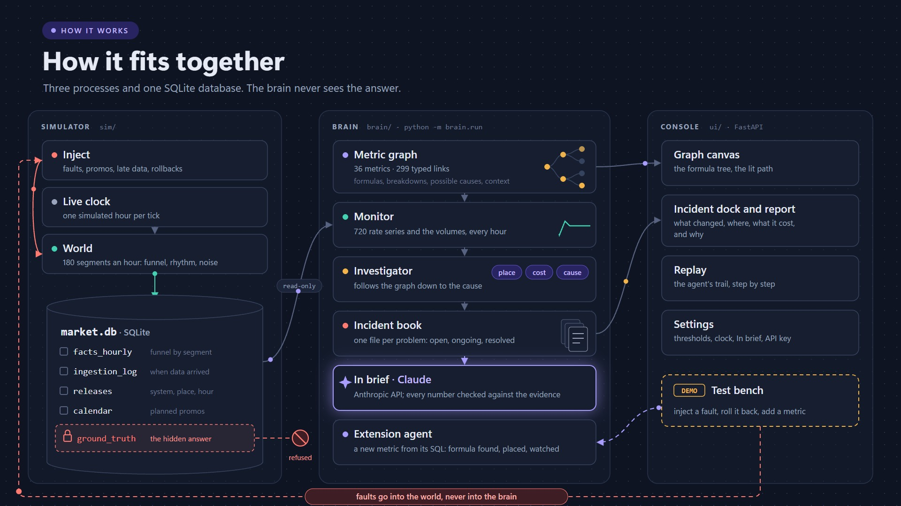

# Eye of the System — autonomous monitoring for a marketplace

HackLab #2 Berlin Robotics & AI Hackathon (21–22 Nov 2026), **Almedia track**:
*"Eye of the System: Fully Agentic Monitoring"*.

A system that watches a simulated Amazon-like marketplace on its own. It keeps a
graph of how the business works, decides what to watch, notices meaningful changes,
investigates them along the graph, and reports what happened with evidence — without
anyone asking questions.

**Demo video (3 min):** [Google Drive](https://drive.google.com/file/d/1ADnWZdD1NAGRhRsetv04xTqLpWmxFqqJ/view?usp=sharing) ·
**Slides:** [Google Slides](https://docs.google.com/presentation/d/1sueOgcyfAJC_uVvprgKThNIqJpHp910n/edit?usp=sharing)

> All code in this repository is written during the official hacking window, which
> opened on Saturday 21 Nov 2026 at 11:00 CET. The git history is the record.
> Third-party libraries are listed at the end with credit.

---

## At a glance

**What it is.** A monitor that watches a simulated marketplace's hourly business numbers by itself. It decides what to
watch from a graph of how the business works, notices a change worth attention, finds where it happened and what most
likely caused it, says what it costs and what is still uncertain, keeps one incident per problem until the data shows
the problem is gone, and takes in a new metric while it runs. Nobody asks it a question. All data is simulated.

**Measured** ([`docs/results.md`](docs/results.md)): twenty 49-day runs of our simulator, each with 12 injected faults of
four kinds, 8 innocent changes and a routine deployment every day. Ten of the runs (seeds 111 to 120) are a holdout
generated on Sunday morning after the last change to the brain; the table shows those ten.

| On the 10 holdout runs | Faults found | In the right place | Cause confirmed | False alarms | Innocent changes left alone |
|---|---:|---:|---:|---:|---:|
| This system | 120 / 120 | 120 / 120 | 116 / 120 | 0 in 457 watched days | 80 / 80 |
| Plain ranking, strict threshold | 47 / 120 | 46 / 47 | 34 / 47 | 1 | 79 / 80 |
| Plain ranking, sensitive threshold | 91 / 120 | 87 / 91 | 72 / 91 | 83 | 39 / 80 |

Place and cause are counted among the faults each monitor found: the strict ranking names the right cause for 34 of the
47 it found, 34 of all 120. False alarms are counts on the same ten runs. On the ten runs the brain was built on it also
finds 120 of 120 with 118 causes and no false alarm. Seeds 101 to 110, the holdout of the first version, were replayed by
this version too: 120 of 120, 118 causes, 1 false alarm; they are no longer independent, so the page does not count them as
a holdout. Honest caveats on the new holdout: it was generated after commit `e220dfc` and scored there; the integration
commit `b9cbe9b` had been replayed on it once before, unread. The page is from `b7b856c`, which adds two fixes made after
that score was seen, neither tuned on it: an incident on visits no longer closes while the drop runs on (found by a code
review) and failures doubling in a share near 1 are now reported (a stress case). The holdout numbers are the same at
both commits, apart from one more repeated incident on seed 112.

**Stress cases** ([`docs/stress.md`](docs/stress.md)): what those runs do not test, one seeded case each: a traffic drop
with unchanged rates, a fault during a promo, an unannounced mix shift, the two recommendations faults, a fault with no
release or a late one, a fault that comes back, a fault during late data and a small payment fault (failures 6 % to
14 %, only an 8.5 % fall of payment success) pass: 10 of 11. One fails: stock-outs in one category in two countries are
named as one incident at the whole category.

The plain ranking is the honest baseline: each hour it reports the most anomalous rate and cell against the same hour of
the previous three weeks, with no calendar, no pooled windows and no investigation. The strict threshold (z 50) was
picked on the other ten runs by a fixed rule; the sensitive one (z 12) is the first version's threshold, fixed long
before this holdout existed. These are engineering checks on our own simulator, not results on real traffic; the
results page lists every miss, the false alarm and one report that leaves a harmless deployment supported next to the
real cause.

**Against the plain ranking** (`scripts/baseline_ranking.py`, the section of `docs/results.md` written with `--baseline`). On the ten holdout seeds it finds 47 of 120 faults, names the right cause for 34, raises 1 false alarm and stays silent through 79 of 80 innocent events at z 50, the threshold picked for at most 1 false alarm on the built-on seeds (the brain: 0 there, 0 in all runs), and at z 12 it finds 91, names the right cause for 72, raises 83 false alarms and stays silent through 39 of 80, against 120, 116, 0 and 80 for the brain: the gap reflects the brain's statistics, calendar, search over places and investigation together, not the graph alone, and part of the cause gap is the plain ranking's own cause rule: 12 of its 13 unconfirmed causes at z 50 are stock-outs in a category, where that rule names whatever release falls in the window.

**How it works** (sections 3.2 to 3.7 have the details, [`docs/brain-architecture.html`](docs/brain-architecture.html)
and [`docs/system-overview.html`](docs/system-overview.html) the pictures):

1. **A graph of the business** ([`brain/metrics/`](brain/metrics)): 36 metrics from the outcome (contribution) down to
   the step rates of the funnel, with typed links: exact formulas, breakdowns by country, platform, category and channel,
   possible causes with a sign, and context (releases, data freshness, the promo calendar). Its links are checked for
   unknown metrics and cycles every time it loads; its formulas and coverage are checked against the data when the live
   monitor starts with `--graph-out` and whenever a new metric joins.
2. **A monitor** ([`brain/monitor.py`](brain/monitor.py)): every hour it judges each of the 15 atomic rates (funnel
   steps, money, ads, search, feed and stock-outs) in seven cuts of the market (48 series each, 720 in all) against its
   own history, with an exact binomial test where the rate is a share and a spread test where it is not, over one and
   three hours; it also watches visits and orders as counts against the same hour of earlier weeks, so orders falling
   with every rate unchanged is caught; it waits for late data instead of judging incomplete hours, and a planned promo
   explains only a change that has the promo's direction and size.
3. **An investigator** ([`brain/investigate.py`](brain/investigate.py)): separates the cause from its symptoms along the
   graph, finds the place by scoring up to 479 places (every combination of dimension values that has counts, from one
   country or one platform down to one finest cell), splits the outcome's change over its factors (LMDI) and puts a euro
   figure on it, checks every step of the order chain in that place top-down (traffic, add to cart, checkout, payment...)
   and says which one moved, and tests every recent release, the calendar, late data and a mix shift as explanations,
   keeping the rejected ones with the reason; a mix shift that explains the change is innocent and raises no alert.
   Every step goes into the incident's trail.
4. **Incidents** ([`brain/incidents.py`](brain/incidents.py)): one file per problem, also when the fault shows in sibling
   or crossing series, updated in place, resolved only when the data would show the fault and does not; a fault that comes
   back is linked to the resolved one, and each incident has a severity from its euro effect. The console ([`ui/`](ui))
   is a canvas with the metric graph (drag to move, right-drag a box to place it, Layout puts the boxes back, scroll to
   zoom, click a metric for its definition). The incidents sit in a dock along the bottom, live ones first; a click on one lights its path on the graph and opens its report in a
   panel on the right. **Replay the investigation** walks the incident's trail on the graph one step at a time, with a
   numbered pin on each metric a step touched. The **Test bench** (marked DEMO) opens from the header and holds the
   simulated faults, the rollback and the new-metric buttons. The earlier console, graph and incidents side by side with a
   folded DEMO bar, stays at `/classic`.
5. **New metrics** ([`brain/extension.py`](brain/extension.py)): a definition and its SQL dropped into a folder are run
   in a sandbox, checked against its formula (the given one, or one found by search when the definition has none),
   placed in the graph, given the release, calendar and freshness context of what it is built from, and watched from the
   next hour, without a language model. A duplicate of an existing metric is refused as an alias.
6. **A language model**, only where it helps a reader: with `--narrate` (an API key in `.env`; the scoring and all
   results run without it) it writes a short summary of each incident from the incident's own evidence; every number in
   it is checked against that evidence, and the template report stays. Seen live on Sunday morning: the console showed
   it about 10 s after the fault began, and a new one when the incident resolved.

**Run it** (Python 3.13, Windows PowerShell; the full demo with resets and timings is [`docs/demo.md`](docs/demo.md)):

```powershell
py -3.13 -m venv .venv; .venv\Scripts\python -m pip install -r requirements.txt
.venv\Scripts\python -m sim.run --backfill 28d --db data/market.db --force
.venv\Scripts\python -m brain.run --db data/market.db --incidents incidents --incoming incoming_metrics --graph-out data/graph.json --fresh
.venv\Scripts\python -m sim.live --speed 2 --db data/market.db
$env:GRAPH_JSON="data/graph.json"; .venv\Scripts\python -m uvicorn ui.app:app --port 8000
```

Run the last three in three terminals, then open http://127.0.0.1:8000 and use the **Test bench** in the header.

On macOS or Linux (Python 3.13): `python3 -m venv .venv`, use `.venv/bin/python` in place of `.venv\Scripts\python`,
and start the console with `GRAPH_JSON=data/graph.json .venv/bin/python -m uvicorn ui.app:app --port 8000`.

**Check it yourself**: `python -m pytest` (the whole suite); `python -m scripts.live_check --run runs/check` (the real
processes for a simulated day and a half with every kind of event and nobody watching; it exits with an error if any check
fails); `python scripts/stress_cases.py` (the stress page); and, to rebuild `docs/results.md`: for each seed N in 4 8 9
10 11 12 13 22 71 80 111 112 113 114 115 116 117 118 119 120, `python -m sim.score generate --seed N --db runs/seedN.db` then
`python -m brain.run --replay --db runs/seedN.db --incidents runs/seedN-incidents --fresh`; then
`python -m scripts.summarize_evaluation --runs runs --seeds 4,8,9,10,11,12,13,22,71,80,111,112,113,114,115,116,117,118,119,120 --holdout 111,112,113,114,115,116,117,118,119,120 --commit <the brain commit you ran> --warmup-hours 80 --baseline --baseline-z 50`.
The section "Against a plain ranking" also needs `python -m scripts.baseline_ranking --db runs/seedN.db --out <folder> --z <Z>` run
into `seedN-baseline` (z 50, every seed), `seedN-baseline-z12-all` (z 12, every seed) and the sweep folders `seedN-baseline-z<Z>`
(built-on seeds only); without `--baseline` the page is written without that section. The docstring of
`scripts/summarize_evaluation.py` explains every option.

**Not built**: a euro threshold for alerts; watching volumes other than visits and orders; formulas with constants in the new-metric
search; cause links proposed for a new metric; a range around the euro figure.

---

## 1. What the brief asks for, and how it is judged

| Capability | What it means here | Weight |
|---|---|---|
| Metric graph | Business outcomes linked to their components and breakdowns; each edge has a meaning: formula, breakdown by a dimension, possible cause | 40% (with extension) |
| Automatic extension | A new metric arrives as a definition + query; an agent finds its place, validates it and starts monitoring it | |
| Continuous monitoring | Decide what to watch, learn expected behaviour (seasonality, data completeness, planned events), detect changes worth investigating | 40% (with investigation) |
| Autonomous investigation | Choose the next query, follow the graph, compare explanations, decide when to stop, separate symptoms from first causes | |
| Communication | Alerts with numbers and an investigation trail; track whether an issue persists or resolves; never re-report the same problem | |
| Demo | Run the full loop live: a fault, an innocent change, a new metric | 20% |

## 2. Demo scope

A small marketplace, enough to show the complete loop:

- **Dimensions:** country (DE, FR, ES, PL), platform (iOS, Android, Web), category (5), traffic channel (organic, ads, recommendations).
- **Time:** hourly data on a simulated clock; 4 weeks of history backfilled, then the clock runs live (fast-forward for the demo).
- **Domains:** traffic, search, "For You" feed, cart, checkout, payment, orders, revenue, ads, inventory.

Scenarios of the demo (all are built). S4 is the new metric; S1, S2, S3, S5 and S6 are the kinds scored on twenty runs
in `docs/results.md`; S7 to S10 are measured one case each in `docs/stress.md`, with a small payment fault, a fault
during a promo, a missing or late release, a fault in two sibling places, a fault that comes back and a fault during
late data:

| # | Kind | Scenario | What the system should do |
|---|---|---|---|
| S1 | Fault | Payment success drops for **Android in Germany** after a payment SDK release | payment success rate ↓ (watched directly) → narrows to DE × Android → matches the release → reports the cost in orders and EUR and the remaining uncertainty |
| S2 | Innocent change | Planned promo in France: traffic and orders up | finds the event in the promo calendar, explains it, does **not** alert |
| S3 | Data completeness | The payments source arrives 2 h late | holds judgement on the incomplete hours instead of raising a false alarm |
| S4 | New metric | `refund_rate` is added live as definition + SQL | agent places it in the graph, validates the formula and dimensions, starts monitoring it |
| S5 | Fault | Popular products of a category run **out of stock**: feed clicks up, add-to-cart down | names the category's stock-out rate as the first cause the data can show, add-to-cart as its symptom; says that supplier deliveries and purchase orders are not in the data |
| S6 | Fault | An advertiser's daily budget is spent early (the pacing controller ignores its schedule) | sponsored impressions per session jump, then fall; sessions checked, so not a traffic surge; names the pacing release and says the spend ran ahead of schedule and the budget ran out |
| S7 | Fault | Visits fall by half for **Android in Germany**, every rate unchanged (an app store or tracking problem) | caught as a volume against the same hour of the week; the chain check shows traffic moved and the rates did not; no cause confirmed, with what is left to check |
| S8 | Innocent change | Traffic moves toward one category, no calendar entry | market-wide rates move; the mix test explains them; written as explained, **no** alert |
| S9 | Fault | "For You" shows unavailable products after a recommendations model rollout | stock-outs and feed clicks rise in the recommendations channel; names the recommendations release |
| S10 | Fault | Recommendations push discounted products: orders up, contribution down | the discount rate rises in the recommendations channel; names the recommendations ranking release; the euro split shows where the money went |

## 3. Architecture



*Three processes and one SQLite database: the simulator writes it, the brain only reads it and is refused the hidden answer, and the console shows what the brain found.*

```
 sim/  (the world)                 brain/  (the eye)                          ui/
 ┌──────────────────┐   SQLite    ┌──────────────────────────────────────┐  JSON   ┌───────────────┐
 │ marketplace sim  │──────────▶ │ metric graph ◀── extension agent       │────────▶│ graph view    │
 │ fault injection  │  facts,    │      │                                │incidents│ alert feed    │
 │ innocent events  │  releases, │      ▼                                │         │ report + trail│
 │ data delays      │  calendar, │ monitor ──▶ investigator ──▶ reporter │         │ inject buttons│
 │ ground truth     │  ingestion │      ▲            │                   │         └───────────────┘
 └──────────────────┘   log       │      └── incident lifecycle ◀─────────┘
                                  └──────────────────────────────────────┘
```

### 3.1 Three contracts

**Data (SQLite, written by `sim/`, read by `brain/`):**

```
facts_hourly(ts, country, platform, category, channel,
             sessions, searches, search_clicks, feed_impressions, feed_clicks,
             product_views, add_to_cart, checkouts, payment_attempts, payment_successes,
             orders, gmv, discounts, marketplace_fees, refunds,
             ad_impressions, ad_clicks, ad_spend, stockouts)
ingestion_log(source, ts, arrived_at)           -- data completeness per source and hour
releases(ts, system, country, platform, description)
calendar(start_ts, end_ts, country, kind, description)   -- promos, holidays
ground_truth(injected_at, kind, scope, description)      -- hidden from brain/, used for scoring
```

**Metric definition (how a metric arrives, including the live one in the demo):**

```yaml
name: refund_rate
description: Share of orders refunded
formula: refunds / orders          # optional; the agent infers it when missing
sql: >
  SELECT ts, country, platform, category, channel,
         SUM(refunds) * 1.0 / NULLIF(SUM(orders), 0) AS value
  FROM facts_hourly GROUP BY ts, country, platform, category, channel
dimensions: [country, platform, category, channel]
unit: ratio
```

**Incident (written by `brain/`, read by `ui/`):**

```json
{
  "id": "inc-0007", "status": "open | ongoing | resolved | explained | pending",
  "first_seen": "...", "last_seen": "...",
  "metric": "contribution", "segment": {"country": "DE", "platform": "Android"},
  "change": {"observed": "...", "expected": "...", "delta": -910, "delta_pct": "...", "window": {"...": "..."}},
  "impact": {"contribution_eur": -910, "orders": -178},
  "contributions": [{"node": "payment_success_rate", "share_of_delta": 0.86}],
  "hypotheses": [{"cause": "release payments-sdk: payments-sdk 4.2 rollout (DE, Android)", "kind": "release", "status": "supported", "evidence": ["..."]},
                 {"cause": "traffic drop", "kind": "metric", "status": "rejected", "evidence": ["..."]}],
  "trail": [{"action": "watch", "target": "payment_success_rate", "result": "..."}],
  "uncertain": ["..."],
  "report": "plain-language summary"
}
```

Rules for an incident file (details in `docs/contracts/README.md`):

- `first_seen` is the newest data hour at the tick that raised the incident; the onset goes to `change.window.start`.
- Every hypothesis has a `kind`: `release`, `metric`, `calendar` or `freshness`. The cause of a release is built from the row,
  `release <system>: <description>`; a rollback row ends a release, it is not a new cause.
- `explained` (a calendar event covers the deviation) and `pending` (hours held because a source has not arrived) use the same
  file shape and are written beside the incidents as `explained-*.json` and `pending-*.json`. The scorer skips both; the
  console draws their cards quiet, grey with a dashed edge.

### 3.2 Metric graph

A picture of the brain - the data path, the graph as loaded from the code, the loop as it runs, the checks on a new metric and the measured results - is in [`docs/brain-architecture.html`](docs/brain-architecture.html) (open it in a browser; rebuild with `python docs/build_brain_architecture.py`).

- **Nodes:** metrics, breakdown views (`orders@country`) and context sources (`release:<system>`, `freshness:<source>`, `calendar`).
- **Edges, each with its own reasoning:**
  - `formula` — an exact identity used for decomposition (`gmv = orders × aov`). The formula graph is a DAG, not a tree: `gmv` is a factor of both `marketplace_fees` and `discounts`, which enter `contribution` with a plus and a minus; `sessions` feeds `orders` and `ad_impressions`.
  - `definition` — how a derived metric is computed when that differs from its decomposition (`take_rate = marketplace_fees / gmv`).
  - `breakdown` — split by a dimension; additive metrics sum, ratios are always ratios of sums.
  - `may_affect` — a possible cause with a prior and a sign (which way the effect moves when the cause rises). It stays `assumed` in the graph: an incident tests the link and records the result in its own report, and it is never "validated" by correlation on history (see 3.8).
  - `context` — releases, the promo calendar and data freshness. Freshness is inherited through formulas: a metric is as fresh as its least fresh source.
- **Declared outcome:** `contribution` carries `outcome: true`. A contributed metric never becomes a second outcome (`top_outcomes` stays `contribution`); a formula tree outside the outcome, such as `refunds = orders × refund_rate` once the demo's metric is placed, is listed under `unplaced_roots`.
- **Tree view:** a spanning tree over `formula` edges from the declared outcome, for people to browse. The algorithms work on the DAG.
- **What "validated" means:** every check has a basis. `definition` — it follows from the metric definitions alone and no data can make it fail (`orders = sessions × (orders / sessions)`); it shows the definitions are consistent. `data` — it can fail on the data (coverage, bounds, a contributed SQL against its formula). The validation report keeps the two apart.

### 3.3 Extension agent

Built in `brain/extension.py`; no language model is used. The live monitor looks into `$INCOMING_METRICS_DIR` on every poll, takes a `<name>.yaml` once it reads the same on two looks in a row, and answers with `<name>.result.json`: a status, a message, and every check with its numbers. On the 28-day demo data the console's `refund_rate` is answered within about 2 to 10 seconds (it validates the definition on all the data so far). The console's **Add refund_rate** sends the query alone, so the agent finds the formula itself; **Add a duplicate metric** sends a query that equals an existing rate under another name, which the agent refuses as an alias.

1. **Read the definition.** A new lower_snake_case name with a formula, a query or both. The formula may use only metrics the graph has (a near miss gets a suggestion). A definition may set the tolerance of its own comparison only above 0 and up to 1e-4 (the default is 1e-6); anything looser is rejected.
2. **Run the SQL** inside the contract tables with a 3 s time limit and a 500,000-row limit, and read its grain from the result columns.
3. **Find the formula.** The given one, or a search: every formula of the shapes `a`, `a / b`, `a * b`, `a + b`, `a - b` over the column metrics (1,045 candidates for 19 columns) is computed on the same rows, and the one that reproduces every value of the query is taken.
4. **Check what the SQL really defines.** Row by row against the formula at the query's grain. Row sets in both directions: rows the facts lack reject the definition, rows the query lacks make it a filtered metric (`tentative`). Split test: the query is run again on a private in-memory copy of the last 24 hours with every fact row split in two; a function of sums returns the same values, an average or a count of rows does not (`tentative`).
5. **Recognise aliases.** Each definition has a numeric signature (its value on random column values, `brain/signature.py`). A definition with the signature of an existing metric is reported as an alias and not added. One exception: when that metric is a tentative contribution and the new definition has no caveat, the new one takes its place and the tentative one's file is answered as the alias.
6. **Find its place.** Identities that hold for any data and link the new metric to two existing ones (`x = y * m`, `x = y + m`, differences) are found by signature. A product or a sum whose whole has no decomposition yet and lies outside the outcome tree is applied, when it is the only such place and the new metric has no caveat. Two such places are `ambiguous`: none is applied and the status is `tentative`. A place inside the outcome tree, or any place of a metric that is itself tentative, is proposed and left to a person. The alternatives stay in the result with the reason.
7. **Take its context.** The metric takes the release systems, the calendar link and the sources of the metrics its formula is built from (and of the watched rates it equals the product of for any data), so a release of those systems is tested as its cause, a promo can explain it, and late data holds it. The answer names what was inherited, or that there was nothing to inherit.
8. **Re-validate and watch.** `brain/validate.py` runs on the whole graph with the metric in it, the graph export is written again, and a ratio of two columns joins the monitor's watch list from the next tick (`Monitor.rewatch`). Any other shape is added and validated but not watched, and the answer says so in one sentence.

Statuses: `validated`, `tentative` (in the graph, with the caveat named in the message), `rejected` (not in the graph, with the reason). A changed file replaces what it defined before; a text that is rejected withdraws the metric.

**Not built.** Formulas with constants or with more than two metrics in the search. Watching a new metric that is not a ratio of two columns. Proposing cause links for a new metric: a definition may declare `may_affect` links itself, and they stay `assumed`.

### 3.4 Monitoring

Built in `brain/clock.py`, `brain/stats.py`, `brain/monitor.py`, `brain/impact.py`, `brain/incidents.py`; run with `python -m brain.run`.

- **Clock and completeness.** `clock = MAX(facts_hourly.ts) + 1 h`; a source's hour has arrived when `arrived_at <= clock + 10 min` (`docs/contracts/`). An hour of a metric is judged only when every source the metric depends on has arrived; until then it is *pending*: neither healthy nor an alert. `--replay` walks a finished database with the same rule and never reads a row from the future.
- **What to watch.** Every atomic rate of the graph (15 today), on the formula tree or not, in seven cuts: total, each dimension, country × platform and country × category (48 series per rate, 720 in all), and two volumes, sessions and orders (below). The money outcomes are not judged directly, because a fault in one cell is diluted in them (3.8); they are used for the impact.
- **Expected rate.** Pooled numerator over pooled denominator of the series' own visible history (up to three weeks; three days are enough to start), without the hours being judged, hours already flagged, hours of calendar events and held hours. A fault that lasts therefore does not become the new normal. The simulator's rates have no daily pattern; real data would need an hour-of-week factor here.
- **Volumes.** Sessions and orders as counts in the whole market, per country, per platform and per country × platform, against the mean of the same hour of the week over the previous three weeks (weeks under a calendar event, flagged or inside an open incident are left out), with a negative-binomial spread fitted per series from week-to-week differences: p below 1e-7 and at least 20 %. This is what catches orders or visits falling while every rate stays the same. An orders alert is dropped when sessions or a rate in a compatible place moved in the same episode, so a traffic drop or a payment fault is one alert, not two.
- **Detection.** The test is chosen per metric from its own history. If numerator and denominator count events and the hour-to-hour spread is binomial: the exact two-sided binomial tail, p below 1e-7. The same on the surplus for a ratio that never falls below 1 (payment attempts per checkout). Otherwise (money, impressions per session): the residual against its historical spread, beyond 6 spreads and beyond anything clean history showed. Each hour is judged alone and summed with the two before it, and the rate must have moved by at least 10 %; for a share expected above one half (payment success, about 0.94) it is also enough that the share that fails moved by half of itself, so failures doubling from 6 % to 14 % is not hidden by the 10 % floor. Half, not 10 %, because the failure rate of a single series differs from the market's by up to a third through the mix alone. The last 8 hours are re-read and re-judged on every tick, because an injection can rewrite them. An hour of a summed window counts as bad only when it is unusual on its own, so an episode ends at its last faulty hour and the rate reported is the rate during the fault.
- **One fault, one incident.** A fault in one cell also shows, diluted, in every series that contains the cell: per metric the strongest series wins, alerts on other metrics in a compatible place join it, and an open incident is updated in place (same file, same `first_seen`), its place refined when stronger evidence arrives. Alerts join one incident only when one place lies inside the other and the graph relates the metrics, so faults that merely overlap stay apart. It is resolved when, three hours after the last bad hour, there is enough data that the faulty rate would show and it does not.
- **After a release.** The scan asks thousands of questions an hour and needs overwhelming evidence for each. A release asks one: did the metrics linked to its system change, in its scope, since it went out? That is tested on the sum since the release (exact tests only, p below 1e-4, one episode per release and metric), which finds a fault in a small cell at night that the scan cannot.
- **Planned events and late data.** A calendar event that overlaps a deviation in time and scope explains it only when the change goes the way the event predicts (a promo raises sessions, orders, add-to-cart and the discount rate) and is not clearly larger than twice what earlier events of the same kind did to that series: then it is written as a record with status `explained`, no alert, and its hours stay out of later baselines. Otherwise the alert is raised and the event is kept as a rejected rival with the reason, so a discount fault during a promo is not hidden by it. Hours held for late data are written with status `pending` and removed when the data is in.
- **Impact.** The outcome is recomputed through the formulas of the graph with the moved rates back at their expected values, so every path counts (a payment fault lowers fees and discounts together). From a metric that moved, the `may_affect` links are followed with one targeted test each: out-of-stock listings cost orders through the add-to-cart rate.
- **Not built.** An hour-of-week factor for rates (the simulator's rates have no daily pattern; its volumes have one, and the volume baseline uses the same hour of the week); a euro threshold for alerts.
- **Known limits.** A monitor started in the middle of a fault takes the fault into its baseline (start it on a fresh backfill with `--fresh`); a source more than 8 hours late is never judged.

### 3.5 Investigation

Built in `brain/investigate.py`, `brain/localize.py`, `brain/attribution.py`; it runs on every tick for every open incident that has a live alert on that tick (an open incident without one keeps its last report until it is resolved) and records each question and its answer in the trail.

- **Cause and symptom.** Among the metrics that moved, one that another moved metric may affect (a `may_affect` link, in the direction the link predicts) is read as a symptom. The investigation leads with a cause candidate.
- **Top-down check.** In the incident's place and hours every factor of the order chain is checked against its baseline: sessions, views per session, add-to-cart, checkout, payment attempt, payment success and order rate. The trail lists each as normal or moved, and the report says which one moved and that the others, traffic included, stayed normal: the path from orders down to the step that broke, written out.
- **Volumes.** A sessions or orders alert is investigated like a rate. The chain check names traffic as the moved factor, releases, the calendar and freshness are tested, and when nothing fits the report says "No cause is confirmed" and lists what is left to check (tracking, an app store, an outage).
- **Localization.** Every place the dimensions can name that has counts in the window is scored on the 180 finest cells: at most 479 places and the whole (a place with nothing to divide by is left out). The score is the log-likelihood gain of "the rate moved by one common factor inside this place and nowhere else" over "nothing moved" (binomial for proportions, so a cell with 0 of 3 is weak evidence; Gaussian on the historical spread for other ratios), minus the price of the search: ln(number of places of that kind) + ln(number of kinds). The monitor's place is confirmed, narrowed (only when the rest of it is quiet), widened (only when the wider place moved as one) or kept; a fault in a combination that no watched series covers is narrowed to it. When the rate changed direction during the incident (an ad budget that overspends and then runs dry), the place is read from the hours since the last change of direction. A different place that explains the counts nearly as well is reported under "still uncertain".
- **Attribution.** One function splits the outcome's change over the atomic factors along every path of the formula DAG: the logarithmic mean Divisia index (LMDI) per product, which is exact and leaves no interaction term, with a Shapley split as the fallback for zeros and other formula shapes. The incident's cost is a counterfactual, in EUR and in orders: the outcome as observed against the outcome with the moved rates put back to their baselines, together with any rate a directed link from them predicts to move, even while the data does not show it yet (that is then named under "still uncertain"). The baselines are frozen when the cost is first reported, so a long incident is not measured against itself. `explained_share` is that effect as a share of the whole gap to the state with every judged rate at its baseline (capped at 1, left out when the two have opposite signs); the rest is what the other rates differ from their baselines by: noise, or something else going on in the same place, and the trail names the largest of them. Traffic is a factor of the cost when it moved (a volume alert); otherwise it is taken as given.
- **Mix versus rate.** For the leading rate the change inside the place is split into "the rates of the cells moved" and "the weights of the cells moved". A mix shift is one of the explanations that are tested, and is rejected or kept by its share. When it explains at least 80 % of the change and no release is supported, it leads, and the change is innocent: written as `explained`, no alert (3.6).
- **Hypotheses.** Every release from 12 h before the onset until now is scored on three questions. Is its system linked to what moved (the `systems` tags of the graph)? Does its scope fit the place (exactly, wider, only part of it, or elsewhere, with the rate inside its scope as evidence)? Did the change start with it (within two hours of the estimated onset, before or after; earlier than that only if the hours in between already lean the same way; more than two hours after it never)? `supported` needs all three. The others stay in the report as `plausible` or `rejected`, each with its reason. Without a supported release the moved metric itself is the cause candidate, supported once the second movement that a directed link predicts is there. A planned event, late data and a mix shift are always tested as well; an event the monitor did not accept (wrong direction or too large) stays a rejected rival with the monitor's reason. Each release's evidence says what `supported` requires and which parts held. For stock-outs the stock-out rate is the first cause the data can show, and the report says that supplier deliveries and purchase orders are not in the data. For an ad budget, a rise in sponsored impressions per session followed by a fall is told as spending that ran ahead of schedule until the budget ran out.
- **Stop step.** Every candidate is tested on every run; nothing stops early. The trail's last step (`stop`) states the outcome: the leading explanation is supported and ahead of the next one, supported with every other one rejected, supported but not ahead of a rival, or not supported yet.
- **Not built.** Attribution per finest cell (it runs at the incident's place); a range around the cost (the estimate is noisy for a short incident in a small place); causes that are not in the context tables.
- **Known limits.** Two faults of one metric that start in the same hour in places that share a country or a platform can be reported as one incident at the series that contains both (DE x Android and DE x iOS as DE), with no release supported; faults in places that share nothing stay two incidents. A harmless release of the same system and place within two hours of the onset is `supported` next to the real one.

### 3.6 Reporting and lifecycle

Built in `brain/incidents.py`.

- **One incident per problem.** A fault shows up as many alerts: in the cell where it happened, diluted in every series that contains the cell, and on the metrics downstream. Alerts join one incident when one place lies inside the other and the graph relates their metrics (a cause link either way, or a shared system); the strongest alert of each metric leads. An open incident that matches is updated in place: same file, same id, same `first_seen`; its place is refined when stronger evidence points to a narrower series. A group of alerts also joins an open incident whose localized place nests with its own when the metrics are related or both lead to the same supported cause, so a fault that shows in sibling series (one category in two countries) stays one incident.
- **Back again.** A new incident with the same lead metric and a nested place as a resolved one carries `recurrence_of` and says "It is back"; the console links the two.
- **Severity.** `high`, `medium` or `low` from the euro effect and the hours; the feed lists live incidents first, the severe ones on top.
- **Lifecycle.** `open` on the tick that raises it, `ongoing` while alerts continue, `resolved` after three normal hours, and only on evidence of health: the data since the last bad hour would show the fault if it were still there, and does not. A quiet night in a small cell proves nothing, so the incident stays open.
- **Not an alert.** A deviation that a planned event or a mix shift explains is written as `explained`, with the reason; hours held back for late data as `pending` (removed once the data is in). Same file shape, no alert, grey in the console, skipped by the scorer.
- **Report content.** What changed and where, the cost in EUR and in orders, the drivers with their role (cause candidate or symptom), where in the segments, the hypotheses with status, score and evidence, the trail of every step, what is still uncertain, and a template summary. With `--narrate` a checked narration is added (3.7).

### 3.7 Where the language model is used

The core loop runs without it, so the demo cannot fail on an API call. Built in `brain/narrate.py`, switched on with `python -m brain.run --narrate` (live loop only; the replay and the scoring never call it).

- **A narration of each incident**, three or four plain sentences, written by `claude-opus-5-5` from the incident's own evidence and nothing else. One request per milestone (a new incident, a change of the leading explanation, a cost in euros that crosses a power of two, the incident resolved), never per tick; background threads, 20 s per request.
- **Checked before it is shown.** The text must be plain and finished, and every number in it must appear in the evidence (as given, rounded to the precision written, or as a percentage of a share). A text with any other number is dropped, not repaired. The template report always stays; the console shows the narration as "In brief" above it.
- **Fails quietly.** No credit or a refused key turns narration off for the run, with the reason in the incident file and on a monitor line (`narration: off: ...`) printed on the monitor's next pass after the first request is refused; a timeout or a server error waits a minute before the same milestone is tried again. The key comes from the environment or `.env` and never appears in a reason.
- **Seen live** on Sunday morning, four requests in all: "In brief" showed about 10 s after the fault began, and a new text when the incident resolved. That run also showed the text falling behind the figures (−345 EUR in the text, −1,943 EUR above it), so a cost that crosses a power of two is now a milestone too.
- **Not needed** to find a formula or a place for a new metric: that is a deterministic search (3.3). **Not built:** suggesting descriptions or cause links for new metrics.

### 3.8 What the algorithm choices are based on

Once the first simulator and metric graph were running, the plan was checked against open implementations and published research, and against measurements on the simulator's data (all data here is simulated). The numbers below were measured during that review on a 28-day history with the payment fault S1 in DE × Android.

| Decision | Based on | Measured here |
|---|---|---|
| A rate is always a ratio of sums; numerator and denominator are first-class metrics | [dbt MetricFlow ratio metrics](https://docs.getdbt.com/docs/build/ratio) | — |
| The graph is specified and typed, not learned from the series; cause links are not validated by lagged correlation | [Pham et al. 2024](https://arxiv.org/abs/2408.13729): root-cause analysis on learned causal graphs is close to random; [Fan et al. 2024](https://arxiv.org/abs/2406.02191): aggregation over time hides the lags | effects land in the same hour; 390 of 1,260 metric pairs correlate above 0.5 through shared traffic |
| Detect on step rates in country × platform cells, not on top outcomes | [Adtributor](https://files.usenix.org/s3fs-public/cdn/nsdi14-paper-bhagwan.pdf), [PSqueeze](https://ar5iv.labs.arxiv.org/html/2305.03331), [RiskLoc](https://arxiv.org/pdf/2205.10004) | deviation in units of noise: total orders −0.8, orders in the cell −2.9, payment success rate in the cell −17.2 |
| One expected state for the base columns, metrics derived from it | RiskLoc and PSqueeze define the forecast of a derived measure from the forecasts of its fundamental measures; [hierarchical forecasting](https://otexts.com/fpp3/hierarchical.html) | separate medians break the identities by 1.5 % on average (up to 7 %) and segments miss the total by 2.5 % (up to 11 %) |
| Localize by scoring every element of every cuboid for a common shift | HotSpot, Squeeze / PSqueeze, RiskLoc ([open implementations](https://github.com/shaido987/riskloc)), [ThirdEye](https://www.linkedin.com/blog/engineering/analytics/analyzing-anomalies-with-thirdeye) | exact cell found in 33 of 36 one-hour windows, against 12 of 36 for a one-dimension-at-a-time drill-down |
| Attribution over all paths of the formula DAG; LMDI for products | [Ang 2005](https://ideas.repec.org/a/eee/enepol/v33y2005i7p867-871.html) | along one path the payment rate "explains" 146 % of the change; over all paths 91 % |
| Completeness from arrival time against a defined clock | [The Dataflow Model](https://www.vldb.org/pvldb/vol8/p1792-Akidau.pdf), [dbt source freshness](https://docs.getdbt.com/reference/resource-properties/freshness) | "source row missing" never fires: a late source still gets its row, only `arrived_at` moves |
| New metrics: canonical comparison, alias detection, placement by search | [Uber uMetric](https://www.uber.com/blog/umetric/); random evaluation of formulas (polynomial identity testing) | formula for `refund_rate` found from its SQL result in 0.5 s without a language model |
| Contributed SQL runs with a table whitelist inside SQLite, plus time and row limits | [SQLite security guide](https://www.sqlite.org/security.html) | none of about 80 bypass attempts read the scoring table |

## 4. Repository layout

```
sim/         marketplace simulator, injections, ground truth, scorer
brain/       graph, monitor, investigator, incidents, new-metric agent, narration
ui/          console (graph canvas, incident dock, report panel, replay, DEMO test bench; the classic console at /classic) and data browser
scripts/     results page from many runs, plain-ranking baseline, unattended live check, core rehearsal, guardrails
docs/        results, demo and pitch scripts, contracts, architecture pages and picture
tests/       tests
data/        SQLite database (not committed)
incidents/   live incident JSON output (not committed)
eval_incidents/ separate scoring output (not committed)
incoming_metrics/ new metric definitions (YAML) and the brain's answers (runtime)
# sim_meta in the database stores seed/start/countries for simulator bookkeeping
```

## 5. Getting started

```powershell
py -3.13 -m venv .venv
.venv\Scripts\python -m pip install -r requirements.txt
.venv\Scripts\python -m pytest
```

The commands that run the whole system are under "Run it" at the top; `docs/demo.md` has the full reset and the timings.
For narration (3.7) put an API key with credit in `.env` (never commit it) and add `--narrate` to the monitor:

```
ANTHROPIC_API_KEY=...
```

**Settings in the console.** The gear button (or the key `,`, or `?settings=1`) opens a settings panel. It shows whether the
monitor is running and what it runs with (newest data hour, series watched, thresholds in effect), switches the language
model's "In brief" on or off, sets or removes the API key, sets the seconds per simulated hour, moves the four detection
thresholds within safe ranges (with their defaults and a reset), and lists every path the stack uses. Changes go to
`settings.json` beside the market database (`brain/settings.py`); the live monitor and the accelerated clock read it on
their next tick, with no restart, and the monitor writes what it applied to `brain_status.json` in the same folder. The key
is written to `.env` of the checkout the console runs from, only from this computer (127.0.0.1), and is never sent back to
the page or written to the status file; the monitor reads `.env` again when it changes. The replay and the scoring never
read `settings.json`.

## 6. Third-party libraries

Python packages, used as published under their own licenses (versions in `requirements.txt`): anthropic (narration only), fastapi and uvicorn (the console's server), httpx2 (the console's tests and the narration tests; installed with anthropic), pandas and numpy (data), scipy (exact binomial tails), pydantic (request bodies), pyyaml (metric definitions), python-dotenv (the API key), pytest (tests).

The console uses no third-party JavaScript, CSS or fonts. The algorithm sources are cited in 3.8.
